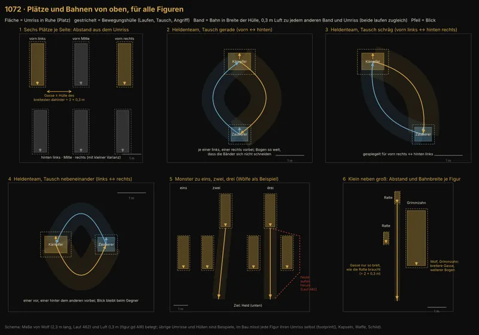
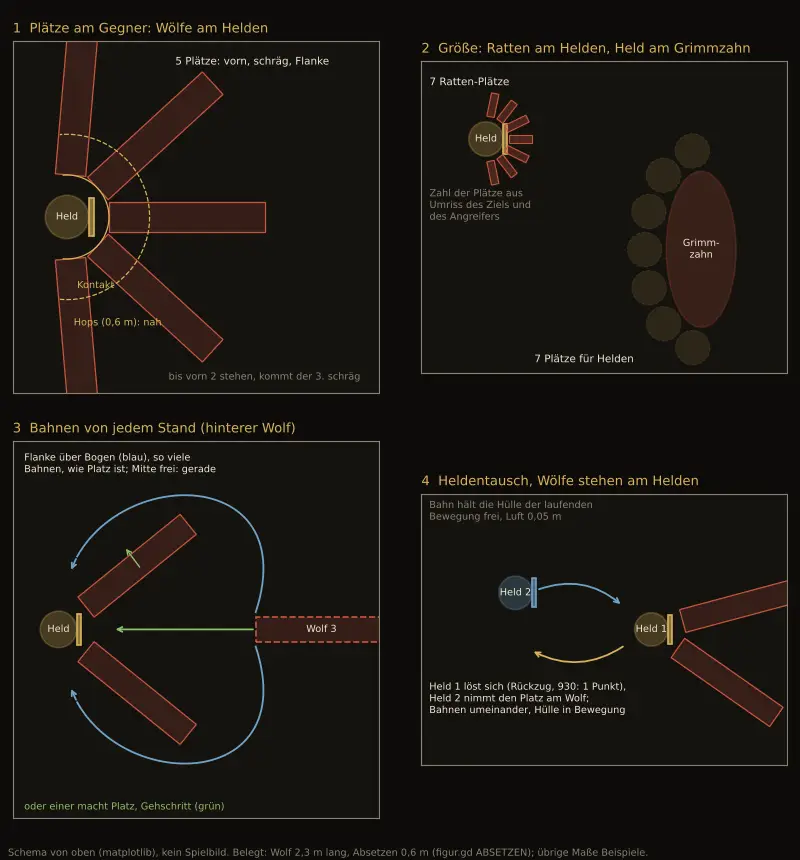

# Aktionspunkte im Kampf: Gespräch Chef und Sokrates

Arbeitsstand des Gesprächs ab 13.11., 23:35, damit der Chef es nachlesen kann (Chef 14.11., 00:07: „Du musst das alles nachhalten, was wir hier erarbeiten, damit ich genau das, so wie wir es hier haben, nachlesen kann. Das muss alles in der Datei jetzt kommen … Eine eigene MD … Wo alles drin ist. Und das muss jetzt nicht in dem Vorgang sein“). Gehört zu 930 (Handgemenge und Abstand), betrifft 1072. Nichts hier ist entschieden, solange unter „Entscheidungen“ kein Wort des Chefs steht. Pflegt Sokrates, nach jedem Gesprächsschritt.

## Warum wir das machen

- **23:35, Chef:** „Also bevor Jerry jetzt wieder irgendwas einfach so entwickelt und viel Zeit verplempert, wird schon die erste Runde, ohne dass wir drüber nachgedacht haben, dann würde ich jetzt sagen, macht mal Jerry nicht weiter und wir machen erstmal unsere Hausaufgaben. Weil was wollen wir zusammenbringen? Was kostet was? Wie kann es laufen? Okay?“ Jerry ist seitdem angehalten (1072 Plätze und Laufwege, 709 und 709.1 Bisse zu kurz).
- **23:48, Chef:** „Ja, ich denke, wir müssen uns vorneweg schon mal einen Kopf machen, ob wir das mit Aktionspunkten machen wollen und was wie viel kostet.“
- **23:50, Chef:** „Weil davon hängt ab, inwieweit Leute wieder zurückweichen können oder nicht, weil was es kostet, zum Beispiel. Was kostet Gehen, was kostet Rennen, was kostet ein Tank nehmen, was kostet ein Waffenwechsel, was kostet ein leichter Zauber, was kostet ein schwerer Zauber. Fragen über Fragen, die man da stellen kann.“ Und: „hör auf, jetzt jedes Mal schon wieder 1000 Dinge im Hintergrund zu machen. Ich bin doch noch am Ideen sammeln mit dir zusammen.“
- **00:03, Chef** (Nachricht brach ab): „So, und jetzt machen wir wieder eins nach dem anderen. Jetzt hast du mir gezeigt, was deine Regelseite heute vorschlägt. … Und daran arbeiten wir jetzt mal und stecken Hirnschmalz rein. … jede einzelne Entscheidung, jede einzelne“. Gelesen als: Entscheidung für Entscheidung durchgehen.
- **14.11., 08:47, Chef (Neuanfang):** „Nee, wir fangen nochmal ganz anders an, sondern wir schauen jetzt erstmal, was für mögliche Aktionen gibt es denn überhaupt, die man machen kann. Dann schauen wir, was soll das kosten. … Und dann können wir uns auch überlegen, keine Ahnung, ob es immer sein soll, einmal was tun und einmal bewegen. Und ob Bewegen zum Beispiel auch umsonst sein kann. Also normales Bewegen. Aber erstmal brauchen wir eine Liste von Sachen, die überhaupt machbar sind im Kampf. Und dann schauen wir, wie wir die kategorisieren, und dann schauen wir, was die kosten oder ob sie mal nichts kosten oder ob es nur zwei gibt.“ Damit gilt die Reihenfolge: (1) Liste, (2) Gruppen, (3) Preise, (4) Zahl der Punkte oder „ein Tun, ein Bewegen“. Alles darunter (Abschnitte ab „Erster Wurf“) ist Vorarbeit, nicht der Weg.

## Schritt 1: Was man im Kampf tun kann (Sokrates, 14.11., 08:50)

Ohne Preise. Quellen: Code auf `main` (`424334472`: `mars.gd` `_perform`, `kampf_ui.gd` `_build_orders`), `DESIGN-BRS.md` 7, `STORY-BRS-KOENNEN.md`, `STORY-BRS-KAMPF.md` (Ansagen), Regelseite 930 in `DESIGN-KAMPF.md`. Zeichen: **●** heute im Spiel, **◐** beschlossen, noch nicht gebaut, **○** nur Vorschlag.

**Heute auf dem Bildschirm:** Angriff, Können, Tasche, Wechsel; darunter Abwehr, Flucht, (Decken), Söldner Auto, Held Auto. Heute ist jede Wahl der ganze Zug, außer **Wechsel**: Platztausch und Waffe ziehen kosten nur den Schritt, danach darf man noch handeln (`mars.gd` `act`). „Einmal bewegen, einmal tun“ gibt es also schon, aber nur für den Wechsel.

**A. Bewegen**
1. Heran an einen Gegner (Schritt) ○ – heute nur Bild, kostet nichts
2. Zurück, aus dem Handgemenge (Rückzug) ○
3. Rennen, mehrere Felder ○
4. Platz tauschen in der eigenen Reihe, vorn ↔ hinten ●
5. Fliehen, ganzer Kampf ● (nie vor einem Boss)

**B. Angreifen**
6. Nahkampfschlag ●
7. Schuss (Bogen, Armbrust) ●
8. Wurf (Wurfwaffe, Kampftrank, Wurfmittel) ●
9. Schwung: zweiter Schlag nach einem Treffer ○ (930)
10. Kampfhandlungen der Fertigkeit ab Geselle ● (Liste in Jerrys Code, wirken teils noch nicht): Finte, Stich aus dem Hinterhalt, Wuchtschlag, Schädelstoß, Griff, Ruhige Hand, Durchschlag, Zwei auf einmal
11. Zurückdrängen: Schildstoß, Wuchtschlag drängt ○ (930 Regel 5)

**C. Zaubern** (nach Schule, Mana)
12. Angriff auf einen: Funkenpfeil, Arkanpfeil, Gleißstrahl ●; Glutstrahlen (drei Ziele) ●
13. Fläche, eine Reihe: Flammenfächer, Glutkugel ●
14. Schutz für sich: Arkanhaut, Bannschild ●
15. Heilen eines Freunds: Wundsegen ●
16. Stärken: Beistand ●

**D. Gegenstände**
17. Trank trinken ●
18. Trank einem Freund geben ● (Ziel wählbar)
19. Waffe wechseln, Zweitwaffe ziehen ●
20. Schild ablegen oder aufnehmen, Fackel ziehen ○ (Fackelstoß, Tiere verscheuchen: `LISTE-MARS.md`, ○)

**E. Abwehr und Haltung** (wirkt bis zum eigenen nächsten Zug)
21. Abwehr (heute „warten“, gibt Gegnern Ungunst) ●
22. Decken: Schläge auf einen Freund auf sich ziehen ● (nur alte Klasse Kämpfer; im BRS Fähigkeit des Wächters)
23. Schildwall ● (wirkt in Kapitel 1 nicht, Held allein)
24. Auf Abstand (Stangenwaffe, Gegenstoß) ●
25. Wehrhaltung ○ (nur, wenn Jerry sie behält)
26. Deckung aus übrigen Punkten ○ (930)
27. Atem holen, Ausdauer zurück ○ (930 Regel 3)

**F. Im Zug des Gegners** (kein eigener Zug, aber eine Wahl)
28. Ring der Abwehr bei großen Schlägen ● (1048 A)
29. Ausweichen ● (704 A: kostet nichts)
30. Ring beim eigenen Schlag ◐ (1048 D, Bau 1068)

**G. Einmalig und Sonderfälle**
31. Kraft schöpfen, Leben zurück, einmal je Kampf ●
32. Einschüchtern zu Beginn (Späher verjagen) ●
33. Hinterhalt zu Beginn (nach Schleichen) ●; Abstand selbst wählen ○ (930 Regel 8)
34. Die Kulisse benutzen (Feuer, Fass, Wasser) ○ (Baustein 3, nie gebaut)
35. Bedienung, keine Handlung: Held Auto, Söldner Auto, Schnell

**H. Gegner** (für die Frage, ob für sie dieselben Preise gelten)
- einfacher Schlag oder Biss je Art ● · Schwerer Hieb ● · Anspringen ● · Flanke ● · Einkreisen ● · Durchbrechen ● · Hilfe rufen ● · Kraft sammeln ● · Gift sammeln ● · Netz werfen ● · Anlegen (Schuss) ● · In den Schatten ● · Heilen (Schamane) ● · Fliehen ● · Kroggs Prankenhieb ○ (930 Regel 9)

**Was auffällt:**
- Gut die Hälfte gibt es schon; neu für die Punktefrage sind vor allem A1–A3 (der Weg) und E26, E27.
- „Bewegen umsonst“ (Chef) hieße: A1 und A2 kosten nichts, dann zählt Abstand nur noch, wenn das Tempo begrenzt, wie weit man frei kommt (etwa ein Feld frei, jedes weitere kostet). Sonst wäre der Fernkämpfer ohne Vorteil, und der Rückzug wäre gratis.
- Mehrere Dinge sind keine eigene Wahl im Zug (F), andere nur einmal je Kampf (G31, G32); die brauchen vielleicht gar keinen Preis.

**Nächster Schritt (2):** Gruppen festlegen. Vorschlag zur Prüfung: **Bewegen** (A) · **Tun** (B, C, Angriffe und Zauber) · **Kleines Tun** (D, Tränke und Waffen) · **Haltung** (E) · **frei** (F, G). Dann liest sich die Frage des Chefs so: je Zug ein Bewegen und ein Tun, Kleines Tun statt Bewegen, Haltung statt Tun, Freies immer.

## Vorbilder: wie andere Spiele den Zug einteilen (Sokrates, 14.11., 10:05)

Auftrag Chef 10:02: „Kennst du die Spiele XCOM oder Jagged Alliance? Die arbeiten ja zum Beispiel auch mit Aktionspunkten. Ja, recherchier doch mal ein bisschen … Oder schau dir mal auch normale Brettspiele an, wie da normalerweise Züge eingeteilt sind und so. Was da gut ankommt, was da Ideen wären. Und pack das alles schön immer in unsere Datei rein.“ Quellen unten; wo keine steht, aus eigener Kenntnis der Spiele.

### Die Grundformen

| Form | Beispiel | So geht der Zug | Gut daran | Schwäche |
|---|---|---|---|---|
| **Viele kleine Punkte** | Jagged Alliance 2 (bis 25 je Söldner, nach Werten), Battle Brothers (9) | Jeder Schritt, jedes Drehen, Hinknien, Zielen kostet; übrige Punkte erlauben, den Gegner in seinem Zug zu unterbrechen | sehr fein, Werte spürbar (flinke Figur hat mehr Punkte), Zielen als Wahl | viel Rechnen und Tippen; „lohnt sich ein Schritt mehr?“ ist eine Rechenfrage, keine Spielfrage |
| **Zwei Halbzüge** | XCOM 1 und 2 | Zwei Aktionen: bewegen + schießen oder zweimal bewegen; **Schießen beendet den Zug**; Scharfschuss kostet beide; „Wache“ (Overwatch) schießt im Gegnerzug auf den, der sich bewegt | sofort verständlich, schnell, aufs Handy übertragbar (XCOM gibt es dort) | „Schießen beendet den Zug“ verbietet „schießen, dann zurück“; Kritik: Spieler kriechen vorsichtig vor, Wache wird zur Standardtaste |
| **Drei gleiche Aktionen** | Pathfinder 2 (Tischrollenspiel), Star Wars Zero Company (Nachfolger der XCOM-Macher, 3 Punkte, Wache beendet den Zug) | Drei Aktionen in beliebiger Folge, große Dinge kosten zwei oder drei; dazu eine Reaktion im Gegnerzug | einfach und doch abgestuft; „schwerer Zauber 2, dann noch ein Schritt“ | Kritik: man bleibt lieber stehen und schlägt dreimal; ständige Frage „ist das eine Aktion?“ |
| **Getrennte Töpfe** | Baldur's Gate 3 (D&D 5): Bewegung als eigener Balken (9 m), eine Aktion, eine Bonusaktion, eine Reaktion | Bewegen kostet nicht die Aktion; Trank, Waffe ziehen, kleine Dinge sind Bonusaktion | **„einmal bewegen, einmal tun“** genau so; Bewegen ist praktisch frei bis zur Grenze | wenig Wahl je Zug (eine Aktion), darum viel Lähmen und Betäuben als stärkstes Mittel |
| **Ein Topf für alles** | Divinity: Original Sin 2 (Punkte für alles, auch Laufen) | Alles in Laufen oder alles in Angriffe | viel Freiheit, Einfälle | Durcheinander, schwer abzustimmen; Laufen und Schlagen konkurrieren |
| **Bewegen, dann tun, Gegner sagt an** | Into the Breach | Jede Figur: einmal bewegen, einmal handeln; alle Gegner zeigen vorher, was sie tun | glasklar, jede Runde ein kleines Rätsel; ideal fürs Handy | wenig Raum für Haltung, Tränke, Kleinkram |
| **Brettspiel: zwei Aktionen aus einer Liste** | Descent (Fantasy Flight) | Zwei Aktionen: Bewegen, Angriff, Rasten, Fähigkeit, Aufstehen, Tür …; dieselbe darf zweimal, nur Rasten nicht; **Erschöpfung gegen Extraschritte**; Bewegen darf man unterbrechen, handeln, weitergehen | einfach, Erschöpfung als zweite Währung | zwei Angriffe je Zug sind oft die beste Wahl |
| **Brettspiel: Karten oben, unten** | Gloomhaven | Zwei Karten, je eine obere (meist Angriff) und eine untere (meist Bewegung) Hälfte; vorher wählen, Karten werden mit der Zeit weniger (Erschöpfung) | jede Wahl ein echtes Abwägen, Ermüden ist eingebaut | zu viel Planung für einen schnellen Handykampf |
| **Brettspiel: feste Zahl gleicher Aktionen** | Pandemie (4 Aktionen), viele Eurospiele | Vier Aktionen aus einer kurzen Liste, jede gleich teuer | leicht zu lernen | keine Abstufung (Trank = Schlag) |

### Was gut ankommt (Lob, das sich wiederholt)

1. **Wenige, große Punkte** werden auf dem Handy und für Neulinge besser verstanden als viele kleine (XCOM, Into the Breach gegen Jagged Alliance).
2. **Bewegen und Tun getrennt** (Baldur's Gate 3, Into the Breach, Descent mit Bewegen im Angriff): der Spieler muss nie zwischen „hingehen“ und „zuschlagen“ wählen, nur wohin und was.
3. **Eine Reaktion im Gegnerzug** gilt überall als das, was den Gegnerzug spannend macht (Jagged Alliance Unterbrechen, XCOM Wache, Pathfinder Reaktion). Bei uns: der Ring (F28, F30).
4. **Ansage der Gegner** (Into the Breach, bei uns Baustein 1 schon gebaut) macht jeden Zug zum Rätsel statt zum Würfeln.
5. **Erschöpfung als zweite Währung** (Battle Brothers, Descent, Gloomhaven): Punkte füllen sich jede Runde, Ermüdung nicht; das verhindert „jede Runde dasselbe“. Battle Brothers: jeder kann auch erschöpft noch einen Grundschlag.

### Was oft kritisiert wird

- „Schießen beendet den Zug“ (XCOM) fühlt sich starr an; der Chef will ausdrücklich „zurückweichen und dann schießen“ (930, 12:28).
- Viele kleine Punkte machen Kämpfe langsam (Jagged Alliance), bei uns gegen F9 (Rundenzeit).
- Eine Taste, die immer richtig ist (XCOM Wache, Pathfinder dreimal schlagen), macht den Kampf eintönig. Gegenmittel: der dritte Schlag schwächer (Pathfinder macht das genau so: jeder weitere Angriff im Zug mit Abzug).

### Ideen für uns (zum Prüfen, nichts entschieden)

- **I1 Getrennte Töpfe statt einer Zahl:** je Zug **ein Bewegen** (frei bis zum Tempo, etwa ein Feld; schnell zwei) und **ein Tun**; dazu **ein Kleines** (Trank, Waffe wechseln, wie die Bonusaktion). Das beantwortet die Chefsfrage „einmal tun, einmal bewegen, Bewegen umsonst“ direkt, und es passt zu heute: der Wechsel kostet schon nur den Schritt.
- **I2 Tausch der Töpfe:** das Tun gegen ein zweites Bewegen tauschen (Rennen = zweimal bewegen, wie XCOM und Descent), nie umgekehrt; damit kein Doppelschlag (870a 3).
- **I3 Schwere Dinge kosten Bewegen mit:** schwerer Zauber, Wuchtschlag, gezielter Schuss = Tun und Bewegen (wie XCOMs Scharfschuss mit zwei Aktionen). So entsteht Abstufung ohne Punktezählen.
- **I4 Unverbrauchtes Bewegen wird Deckung** oder Reaktion (Jagged Alliance: gesparte Punkte zum Unterbrechen). Wer stehen bleibt, wehrt besser ab.
- **I5 Ausdauer als zweite Währung** (930 Regel 3; Battle Brothers, Descent): Extraschritt gegen Ausdauer, erschöpft nur Grundschlag.
- **I6 Gegner nach demselben Muster,** aber mit eigenem Tempo und Ansage (Into the Breach); der Wolf „springt und beißt“ ist dann ein Bewegen und ein Tun. Löst den Befund aus der Rechnung (Gegner mit 3 Punkten nehmen dem Abstand den Preis), weil Bewegen begrenzt ist.

**Stärkstes Gegenargument gegen I1:** getrennte Töpfe machen Abstand billig; ist Bewegen frei, kommt jeder Nahkämpfer in jedem Zug heran, der Fernkämpfer gewinnt kaum Zeit. Antwort: das Bewegen hat eine Weite (Tempo) und kostet nur bis dorthin nichts; der Wiedergänger schafft ein Feld nicht in einem Zug (Schlurfen), der Wolf zwei. Gegenprobe nötig: Rechnung mit `handgemenge.py`, sobald der Chef eine Form gewählt hat.

**Votum Sokrates (vorläufig):** I1 mit I2, I3, I6 ist für uns die beste Grundform: einfacher als Punkte zählen, beantwortet „einmal tun, einmal bewegen“ und braucht keine Glutmarken. Punkte (3 je Zug) bleiben der Vergleich.

**Nachtrag zur Liste (Schritt 1):** fehlte **B12 Helfen**: der Gefährte greift im Vorteil an (Idee Chef 12.10., `LISTE-IDEEN.md`, reif zu 72.10a.9), und **A6 Freischritt** ab Geselle Ausweichen oder Leichte Rüstung, ein Schritt je Zug frei (Idee A8, Chef 11.11., 14:33, ebenda) – das ist schon eine Form von „Bewegen umsonst“.

### Idee des Chefs 10:04: Grundzauber, Pfeilarten, Munition

**Wortlaut:** „Dann so grundsätzliche Zauber oder wie auch immer, die es halt immer geben könnte, wäre eine Art Schutzfeld, eine Steinhaut, eine Feuerwand, Blitze, dann kann man auch für die Fernschützen, also wie Bogenschützen oder Armbrustschützen, verschiedene Pfeilarten mit Gift, mit, keine Ahnung, schwarzer Magie, mit brennende Pfeile und so. Auch da Variation oder auch, dass die Pfeile an sich unterschiedlichen Schaden verursachen, weil sie halt besser hergestellt sind oder halt einfach aus besserem Holz gemacht worden sind. … Weil bei den Schwertern haben wir ja schon unterschiedliche Stufen. Also dass nicht nur die Art des Bogens bestimmt, wie stark was ist, sondern natürlich auch die Pfeile einen Einfluss darauf haben. Das hat jetzt noch nicht 100% was gerade mit dem zu tun, was wir hier tun, aber spielt halt alles in die Optionsmöglichkeiten mit rein. Erstens in das, was die Leute herstellen können sollen, was sie dafür sammeln können müssten. Nämlich dann vielleicht auch sozusagen verschiedene Holzsachen im Wald finden. Und daraus kann man ja dann Teile herstellen. Ich habe bloß wieder so eine Idee.“

**Abgleich mit dem Bestand (nachgesehen):**
- **Zauber:** heute zehn (Liste C). Schutzfeld ≈ Bannschild, Steinhaut ≈ Arkanhaut (beide nur für sich selbst). **Feuerwand** und **Blitz** gibt es nicht; Blitz bräuchte eine neue Schadensart (heute Schnitt, Stich, Wucht, Feuer, Gift, Säure, Licht; 870a 8). Feuerwand ist die erste Handlung, die einen **Ort** im Kampf verändert (Abstand!), passt zu 930 Regel 5 („Glutring“) und Baustein 3.
- **Pfeile:** heute keine Munition; der Schuss hängt nur an Bogen und Fertigkeit. Kampftränke und Wurfmittel tragen schon eine Schadensart (870a 8); Pfeilarten wären derselbe Gedanke am Bogen. „Schwarze Magie“ gibt es als Schadensart nicht.
- **Güte** (Schlecht bis Meisterhaft, `DESIGN-BRS.md` 11) gilt für jedes Stück; Pfeile mit Güte passen ohne neue Regel.
- **Holz:** Die Sammeltabelle (`DESIGN-BRS.md` 10) kennt Kräuter, Erz, Fisch, Tierteile, **kein Holz** und kein Handwerk für Bogen und Pfeil (Bogner, Pfeilmacher). Federn und Sehnen kämen aus der Jagd, Spitzen aus Erz über den Schmied.

**Was es für die Aktionspunkte heißt:** Pfeilart wählen ist ein **Kleines Tun** oder frei (wie Waffe wechseln, D19); ein Zauber wie Feuerwand ist ein großes Tun (I3: kostet Tun und Bewegen). Die Liste wächst also, ohne neue Gruppe.

**Stärkstes Gegenargument:** Munition heißt Zählen, Nachkaufen, Tasche voll; viele Spieler empfinden Pfeile zählen als Pflicht ohne Spaß (darum haben viele Spiele unendliche Grundpfeile). Und jede neue Schadensart braucht Schwächen, Stärken und Bilder je Monster. **Antwort:** Grundpfeile unbegrenzt, nur besondere Pfeile gezählt (wie Kampftränke heute); Gift und Feuer nutzen vorhandene Schadensarten.

**Kosten (grob):** Pfeilarten mit vorhandenen Schadensarten klein bis mittel (Datensätze, Wahl im Kampf, ein Bild je Art); Holz und Bogner ein neues Handwerk (mittel, Rezepte, Fundorte, Bilder); Feuerwand und Blitz je ein neuer Zauber mit Bild und Klang, Blitz dazu eine Schadensart (groß).

**Votum Sokrates:** Ja als Richtung, aber nicht für Kapitel 1 (Oberste Direktive: erst Kapitel 1 fertig; 488). Jetzt nur: in Liste und Gruppen mitdenken (Pfeilart = Kleines Tun). Vorschlag für später: (1) Grundpfeile unbegrenzt, besondere Pfeile (Feuer, Gift) gezählt, aus Jagd, Kräutern und Holz; (2) Pfeile mit Güte; (3) Holz als Rohstoff mit neuer Fertigkeit oder unter Kräutersammeln; (4) Feuerwand als erster Zauber, der den Abstand verändert, mit 930.

**Quellen:**
- XCOM: [Incentives and Intent: XCOM's Creeping Forward Problem](https://evizaer.github.io/Incentives-and-Intent/), [A Deep Dive Into XCOM and XCOM 2](https://www.gamedeveloper.com/design/a-deep-dive-into-xcom-and-xcom-2), [XCOM 2 Wiki: Combat](https://xcom2.wiki.fextralife.com/Combat), [Zero Company vs. XCOM](https://hacktheminotaur.com/swzc/star-wars-zero-company-vs-xcom-explained/)
- Jagged Alliance: [Jagged Alliance Wiki](https://jaggedalliance.fandom.com/wiki/Jagged_Alliance_2), [PC Games: Taktik-Klassiker](https://www.pcgames.de/Jagged-Alliance-Spiel-8152/Specials/Taktik-rundenbasiert-Klassiker-1293711/galerie/3052551/), [GOG-Forum](https://gog.com/forum/jagged_alliance_series/ja2_mercy_questions_for_mercy_people), [1.13 Play Guide](https://1dot13.github.io/documentation/play-guide.html)
- Battle Brothers: [Dev-Blog Kampfmechanik](https://indiedb.com/news/dev-blog-on-tactical-combat-mechanics), [Character Stats](https://battlebrothersgame.com/character-stats)
- Pathfinder 2, Gloomhaven: [EN World: Pathfinder 2's 3 Action Economy](https://www.enworld.org/threads/from-7-action-types-to-pathfinder-2s-new-3-action-economy.665200/page-6), [Nerdist: PF2 Action Economy](https://nerdist.com/article/pathfinder-2e-action-economy-guide-beginner/), [Black Gate: Gloomhaven](https://www.blackgate.com/?p=422989), [The Giant Brain: Gloomhaven](https://giantbrain.co.uk/2022/03/09/gloomhaven-in-focus/?amp=1)
- Baldur's Gate 3, Divinity 2: [Divinity Wiki: Action points](https://www.divinitywiki.com/index.php/DOS2:Action_points), [WePC: BG3 vs. Divinity](https://www.wepc.com/gaming/baldurs-gate-3-divinity-original-sin-comparison/)
- Descent: [Regelzusammenfassung 2. Edition](https://lehi-innovation.github.io/boardgame-rules/rules/descent-journeys-in-the-dark-second-edition/), [Community-Regelreferenz](https://descent-community.org/wp-content/uploads/2017/10/CRRG_1_8_1.pdf)
- Into the Breach, Pandemie: eigene Kenntnis, nicht nachgeschlagen.

## Entwurf aus einem Guss: Lesen, Planen, Antworten (Sokrates, 14.11., 10:15)

**Auftrag Chef 10:10:** „die Anzahl der Punkte per se richtet sich halt immer noch danach, was denn alle Tätigkeiten, die wir erfassen, kosten sollen. Oder ob gewisse Sachen grundsätzlich frei sind, wie ein normales Feld sich bewegen. Genau, oder sich Aktionspunkte aufsparen, damit man sozusagen, wenn man sieht, der Gegner stürmt heran, dass man sozusagen da abwehrbereit ist oder kontern kann. Also ich weiß nicht, ob wir 3 Punkte brauchen, aber andererseits, wenn wir mit halben Punkten rechnen, ist ja genauso sinnlos. … Stell dir einfach mal vor, du bist ein Spieledesigner und du willst jetzt eben das Kampfsystem unseres Rollenspiels mal richtig interessant machen und abwechslungsreich. … Weil du willst letztendlich mit diesem Spiel einen Preis gewinnen als Newcomer des Jahres. Und das muss dann einfach passen.“

### Der Kern in einem Satz

**Jede Runde ist ein kleines Rätsel in drei Schritten: der Gegner sagt an, was er vorhat (Lesen), du verteilst drei Glutmarken auf Tun und Bereitschaft (Planen), und im Zug des Gegners setzt du die aufgesparte Glut ein, mit dem Ring als Geschick (Antworten).**

Warum das preiswürdig sein kann: Ansage (Into the Breach), aufgesparte Punkte für den Gegnerzug (Jagged Alliance), Ring als Geschick (eigen) gibt es so zusammen in keinem Handy-Rollenspiel. Zwei der drei Teile sind schon gebaut (Ansage, Ring). Der Gegnerzug wird nie Zuschauen, und jede Ansage stellt eine echte Frage: „angreifen oder bereit sein?“

### Die Regeln

1. **Drei Glutmarken je Zug**, ganze Zahlen, nie halbe.
2. **Der erste Schritt ist frei** und löst die halben Punkte: das Tempo sagt, wie viele Felder frei sind, nicht was ein Feld kostet. **Schnell** (Wolf, Grimmzahn, Wildschwein; Held mit Freischritt ab Geselle) 2 Felder frei, **normal** (Held, Goblin, Grak) 1, **langsam** (Wiedergänger, Schleim) 0. Jedes weitere Feld kostet 1.
3. **Ein Tun je Zug** (Schlag, Schuss, Wurf, Zauber, Kampfhandlung). Es kostet 1 oder 2. Damit gibt es keinen Doppelschlag (870a 3), und der dritte Punkt ist keine dritte Attacke.
4. **Was übrig bleibt, ist Bereitschaft.** Sie gilt im nächsten Gegnerzug und verfällt mit dem eigenen nächsten Zug (kein Ansparen über Runden). Je Glutmarke eine Antwort:
   - **Gegenschlag:** kommt ein Gegner in den Nahkampf oder schlägt er dich, schlägst du zuerst (Nahkampfwaffe). Mit dem Ring beim eigenen Schlag (1048 D).
   - **Wachschuss:** rückt ein Gegner heran, schießt der Schütze oder Magier, bevor er da ist (wie die Wache in XCOM, aber nur mit aufgesparter Glut).
   - **Wehr:** der Ring der Abwehr läuft langsamer, perfekt wird leichter.
   - **Ausweichschritt:** nach perfekter Abwehr ein Feld zurück, ohne dass er nachsetzt.
5. **Gegner haben zwei Glutmarken** plus freie Schritte nach Tempo (Befund der Rechnung 00:50: mit drei Punkten verliert der Abstand gegen Gegner seinen Preis). Sie zeigen ihre Bereitschaft in der Ansage, etwa **„lauert“** (Goblin mit Speer, Grak): wer heranrückt, läuft in den Schlag. Damit wird das Heranrücken selbst eine Entscheidung.
6. **Wachsen nach dem BRS** („du wirst, was du tust“, Weg C von 00:25): mehr Punkte gibt es nie in Kapitel 1; die Fertigkeit macht Dinge billiger oder schaltet Antworten frei (Geselle Alchemie: Trank 0 einmal je Kampf; Geselle Ausweichen: Freischritt; Geselle Schild: Wehr gilt auch für den Nachbarn).

### Was was kostet (alle Punkte der Liste aus Schritt 1)

| Gruppe | Handlung | Glut |
|---|---|---|
| Bewegen | Felder nach Tempo | 0 |
| | jedes weitere Feld | 1 |
| | aus dem Handgemenge lösen (Rückzug), dann gilt der freie Schritt | 1 |
| | Platz tauschen vorn ↔ hinten | der freie Schritt |
| | Fliehen | 3 (ganzer Zug, Probe wie heute) |
| Tun, klein | Schlag, Schuss, Wurf | 1 |
| | leichter Zauber (Funkenpfeil, Arkanpfeil, Gleißstrahl, Wundsegen, Arkanhaut, Bannschild, Beistand) | 1 |
| | leichte Kampfhandlung (Finte, Ruhige Hand, Griff, Stich aus dem Hinterhalt) | 1 |
| Tun, schwer | schwerer Zauber (Glutstrahlen, Flammenfächer, Glutkugel; später Feuerwand) | 2 |
| | schwere Kampfhandlung (Wuchtschlag, Schädelstoß, Durchschlag, Zwei auf einmal, Schildstoß) | 2 |
| Kleines | Waffe wechseln, Pfeilart wählen (einmal je Zug) | 0 |
| | Trank trinken oder geben | 1 |
| Haltung | Decken (Schläge auf einen Freund auf sich ziehen) | 1 |
| | Auf Abstand (Stangenwaffe): Bereitschaft wird Gegenstoß | wie Bereitschaft |
| | Abwehr (heute) entfällt als eigene Taste: alles aufsparen ist Abwehr | – |
| Einmalig | Kraft schöpfen | 1 |
| | Einschüchtern, Hinterhalt zu Beginn | 0 |
| Gegnerzug | Ring der Abwehr, Ausweichen | 0 |
| | Gegenschlag, Wachschuss, Wehr, Ausweichschritt | je 1 aufgesparte |

### So spielt sich eine Runde

- **Wachsoldat gegen zwei Wölfe, beide fern; Ansage „Anspringen“ auf ihn.** (a) Heran (frei), Schlag (1), 2 Bereitschaft: der zweite Wolf springt, Gegenschlag mit Ring. (b) Stehen bleiben, 3 Bereitschaft: beide Wölfe laufen in Gegenschläge, aber er hat selbst nichts getan. (c) Trank (1), Schlag (1), 1 Wehr. Drei echte Wege, keiner immer richtig.
- **Jägerkind gegen Wiedergänger, weit.** Der Wiedergänger hat keinen freien Schritt: er braucht beide Glutmarken für zwei Felder. Das Jägerkind schießt (1) und hält 2 Wachschüsse: er kommt nie unbeschossen heran. Gegen Wölfe geht das nicht, die sind in einem Zug da: Abstand zählt, Tempo zählt.
- **Zauberlehrling, Goblin nah.** Lösen (1), frei ein Feld zurück, Funkenpfeil (1), 1 Wehr. Oder Flammenfächer (2) mitten im Handgemenge, 1 Wehr. „Zurückweichen und dann zaubern“ (Chef 12:28) geht.

### Wo das kippen kann (stärkste Gegenargumente)

1. **Bereitschaft wird die immer richtige Taste** (Kritik an XCOMs Wache). Gegenmittel: Gegner mit Ansage „wartet“ oder „ruft Hilfe“ greifen nicht an, dann verfällt die Glut ungenutzt; Antworten sind schwächer als ein eigener Schlag (Gegenschlag ohne Kampfhandlung). Das muss die Rechnung zeigen.
2. **Zu viel zum Lesen auf dem Handy.** Gegenmittel: wer einfach „Angriff“ tippt, spart den Rest automatisch als passende Bereitschaft (Nahkämpfer Gegenschlag, Schütze Wachschuss); Planen ist Kür, nie Pflicht. Ein Tipp macht den Zug wie heute.
3. **Längere Gegnerzüge** durch Antworten (F9). Gegenmittel: höchstens eine Antwort je Gegnerhandlung, Antwort ohne eigenen Weg im Bild.
4. **Balance verschiebt sich** wie schon mit Schwung (Rechnung 00:50). Darum gibt es hier keinen Schwung; neu rechnen.

### Was der Entwurf ersetzt und was bleibt

- Ersetzt: „Deckung aus übrigen Punkten“ (930 Regel 2) durch Bereitschaft; Schwung (930 I.4) entfällt; Abwehr-Taste geht in Bereitschaft auf.
- Bleibt: Abstand nah, fern, weit und Eröffnung (930 Regel 1, 8), Ring (1048 A, D), Ausweichen kostet nichts (704 A), Gegnerregeln Krogg, Grimmzahn, Spinne (930 Regel 9), Ausdauer (930 Regel 3) nur als Grenze des Rennens, nicht als dritte Rechnung je Handlung.

### Nächster Schritt, wenn der Chef die Richtung will

Rechnung mit `handgemenge.py` (freie Schritte nach Tempo, Bereitschaft mit vier Antworten, Gegner 2 Glutmarken, Lauern), gleiche Fälle wie 00:50; Maß: keine Herkunft unter 15 Siegen je 100 gegen Krogg, Bereitschaft in höchstens der Hälfte der Züge die beste Wahl, Runde nicht länger als heute. Kosten etwa 5–10 $ (Jerry oder Sokrates), kein Spielcode, bis der Chef entschieden hat.

**Chef 10:20:** „Also deine Richtung gefällt mir sehr gut. Denk da mal, also geh in die Richtung weiter.“ (Richtung, noch keine Entscheidung über Regeln und Zahlen; Rechnung nicht beauftragt.)

## Wachsen: wie der Kampf des Helden besser wird (Sokrates, 14.11., 10:25)

**Auftrag Chef 10:20:** „wie kann der Held, wenn er aufsteigt, also wenn seine Fertigkeiten besser werden oder er andere Tränke bekommt oder seine Heldenstufe steigt sozusagen, wie wird da sein Kampf besser? Was bekommt er denn dann sozusagen? Kriegt er dann Freebies einmal im Spiel oder wie? … das ist ja eine Entwicklung eines Charakters, der am Anfang schwach ist und im Laufe des Spiels aufsteigt und besser wird, weil er seine Fertigkeiten entwickelt, weil er Stufen bekommt dadurch, weil er einen Pfad wählt. … Und da müssen wir halt auch schauen, … gerade als Taktik im Zweierteam dann, wenn man nicht alleine kämpft, … Ob wir dann noch Tätigkeiten brauchen, sozusagen, die auch im Team sinnvoll sind.“ Dazu 10:20: „Einer von ist sozusagen, der verwendet seine Glut für Bollwerk sozusagen und der hinten, der kann dann besser schießen oder irgend sowas. Also es gibt ja ganz viele Möglichkeiten.“

**Chef 10:21 (Rolle für dieses Gespräch):** „wir arbeiten das weiter in deiner Rolle als top-prämierter Spieledesigner, der jetzt hier unsere Firma Bonwei unterstützt und uns ein tolles Kampfsystem entwickelt, das dann von den Regeln her gut ist und tragfähig ist und ausbaufähig ist und das wir dann grafisch, immersiv mit Sound und allem umsetzen können.“ Maß für jeden Abschnitt: gut, tragfähig, ausbaufähig, in Bild und Klang umsetzbar.

### Grundsatz: die drei Glutmarken bleiben, was sie wert sind, wächst

Mehr Punkte wären ein großer Zahlensprung (ein Drittel mehr Zug) und gegen das BRS („keine großen Zahlenaufschläge, die Kraft bleibt in den Fertigkeiten“, Abschnitt 5). Stattdessen wächst der Held auf **fünf Wegen**, jeder an einer anderen Stelle der Runde, damit man jeden Aufstieg im Kampf **spürt**:

| Quelle | Was sie im Kampf ändert | Spürbar als |
|---|---|---|
| **Fertigkeit** (Rang) | macht Dinge möglich und billiger | „Wuchtschlag kostet nur noch 1“ |
| **Heldenstufe** | Größenordnung (Modell D: Treffer, Schaden, Leben) und **Funken** | „einmal im Kampf eine vierte Glut“ |
| **Pfad** (ab Kapitel 2) | bricht genau eine Grundregel | „ich darf, was sonst keiner darf“ |
| **Ausrüstung, Tränke** | kleine Ausnahmen für eine Zeit | „mit dem Eiltrank zwei freie Felder“ |
| **Team** (ab Kapitel 2) | Glut wirkt für den anderen | „er hält, ich schieße“ |

### 1. Fertigkeit: jeder Rang schaltet eine Stufe frei

Für jede Kampffertigkeit dieselbe Leiter (Ränge nach `DESIGN-BRS.md` 3), damit der Spieler sie einmal lernt:

| Rang | Was dazukommt | Beispiel Einhänder | Beispiel Bogen | Beispiel Evokation |
|---|---|---|---|---|
| Anfänger (0–24) | Grundtun: Schlag, Schuss, leichter Zauber | Schlag 1 | Schuss 1 | Funkenpfeil 1 |
| Geselle (25–49, Kapitel 1) | **Handlung** (heute schon, 870a 3) und **eine Antwort** der Bereitschaft | Finte 1; Gegenschlag | Ruhige Hand 1; Wachschuss | Glutstrahlen 2; Zauber als Wachschuss |
| Meister (50–74, ab Kapitel 2 im Pfad) | **schwere Handlung kostet 1 weniger** | Finte trifft und öffnet für den Partner | Ruhige Hand gilt auch für den Wachschuss | Glutkugel 1 statt 2 |
| Großmeister (75–100, Pfad) | **Meisterzug, einmal je Kampf**: Tun kostet 0 | Hieb, der nicht abgewehrt wird | Schuss durch zwei Gegner | Zauber ohne Mana |

Auch Nicht-Waffen wachsen im Kampf: **Ausweichen** Geselle Freischritt (ein Feld mehr frei), **Schild** Geselle Schildstoß und Wehr für den Nachbarn, **Alchemie** Geselle ein Trank je Kampf für 0, **Leichte Rüstung** Geselle Lösen aus dem Handgemenge für 0, **Schleichen** Geselle Hinterhalt mit eigener Wahl des Abstands.

**Folge:** Antworten der Bereitschaft muss man **lernen**. In Kapitel 1 hat der Anfänger nur „Wehr“; Gegenschlag und Wachschuss kommen mit Geselle. So ist der Held am Anfang schwach, ohne dass er weniger Punkte hat, und die erste Bereitschaftsantwort ist ein Ereignis.

### 2. Heldenstufe: Größenordnung und Funken

- **Größenordnung** wie heute (Modell D, Entscheidung 73): Leben, Treffer und Schaden gegen niedrigere Gegner.
- **Funken** (Antwort auf „Freebies einmal im Spiel?“): **einmal je Kampf eine vierte Glut**, sichtbar als goldener Funke neben den drei Marken. Vorschlag: der erste Funke mit Heldenstufe 4 (Mitte Kapitel 1), der zweite am Ende von Kapitel 3, der dritte in Kapitel 6; höchstens drei. Ein Funke ist selten genug, um die Balance nicht zu kippen, und groß genug, um ihn zu feiern („Jetzt!“). Gegenargument: wieder etwas zum Merken; dagegen: es ist nur ein Leuchten, das man antippt oder nicht.

### 3. Pfad: jeder Pfad bricht genau eine Regel

Statt Zahlen eine Ausnahme, die den Pfad im Kampf unverwechselbar macht (Fähigkeiten aus `DESIGN-BRS.md` 5, hier in Glut übersetzt; ab Weihe, Kapitel 2):

| Pfad | Regel, die er bricht |
|---|---|
| Wächter | Bereitschaft wirkt für jeden neben ihm (Gegner binden, Gefährten decken) |
| Paladin | Wehr heilt: jede perfekte Abwehr gibt ihm oder dem Nachbarn etwas Leben |
| Berserker | ein Treffer gibt eine Glut zurück (Raserei), dafür keine Bereitschaft |
| Duellant | Gegenschlag kostet nach perfektem Ring keine Glut (Riposte) |
| Mönch | zwei Felder frei und Schlag ohne Waffe auch beim Lösen |
| Assassine | erster Schlag aus dem Schatten kostet 0 und ist kritisch (Meucheln) |
| Schatzjäger | Fallen im Kampfort legen und entschärfen als Tun |
| Waldläufer | das Tier hat eigene zwei Glut |
| Scharfschütze | aufgesparte Glut darf über die Runde bleiben, nur für den Zielschuss |
| Magier | aufgesparte Glut lädt den nächsten Zauber auf (stärker statt Antwort) |
| Kriegsmagier | Schlag und leichter Zauber in einem Tun (Waffenzauber) |
| Beschwörer | der Diener hat eigene Glut, er selbst eine weniger |
| Heiler | Heilen als Antwort: wird ein Freund getroffen, heilt er sofort |

### 4. Ausrüstung und Tränke: Ausnahmen auf Zeit

Selten und an der Seltenheit (`DESIGN-BRS.md` 11), nie als Grundzahl: Stiefel des Läufers (ein Feld mehr frei), Köcher mit Schnellgriff (Pfeilart und Nachladen frei), Schild „Bollwerk“ (Wehr kostet 0 einmal je Runde). Tränke: **Eiltrank** (drei Runden ein Feld mehr frei), **Trank der Wachheit** (nächste Runde eine Bereitschaft mehr), **Kampftränke** mit Schadensart (870a 8). Pfeilarten der Idee 10:04 gehören hierher: Grundpfeil unbegrenzt, besondere Pfeile gezählt, mit Güte.

### 5. Team: Glut für den anderen

Zu zweit ab Kapitel 2 (Garrick fest an der Seite, 168 D; Söldner ab Kapitel 3). Jeder hat eigene drei Glut; neu sind Handlungen, die **für den anderen** wirken. Die Idee des Chefs als erste:

| Handlung | Glut | Wirkung |
|---|---|---|
| **Bollwerk** (Idee Chef 10:20) | 2, vorn | Die vordere Figur hält die Linie: kein Gegner kommt an ihr vorbei nach hinten, und die hintere Figur schießt oder zaubert in dieser Runde mit Gunst („gedeckt zielen“). Mit Schild Geselle 1. |
| **Helfen** (Idee Chef 12.10.) | 1 | Der nächste Schlag des Partners auf dieses Ziel hat Gunst. |
| **Herausziehen** | 1 | Den Partner aus dem Handgemenge nach hinten holen, ohne dass einer nachsetzt (Platztausch unter Druck). |
| **Decken** | 1 | Schläge auf den Partner auf sich ziehen (heute schon). |
| **Trank geben** | 1 | heute schon. |
| **Zange** | 0 | Schlagen beide dasselbe Ziel in einer Runde, trifft der Zweite leichter. Belohnt Absprache, ohne Taste. |
| **Wache für den Partner** | Bereitschaft | Gegenschlag oder Wachschuss auch, wenn der Gegner den Partner angreift. |
| **Zusammenspiel**, einmal je Kampf | je 2 | Ein gemeinsamer Zug je Paar, der nur zu zweit geht (Schildstoß von vorn, im selben Augenblick Schuss von hinten in den Taumelnden). Bild und Klang als Höhepunkt. |

**Warum das Team so stark sein kann:** Rollen entstehen von selbst (vorn halten, hinten wirken), ohne Klassen; wer Schild übt, wird zum Bollwerk, wer Bogen übt, zum Schützen dahinter. Das ist „du wirst, was du tust“ zu zweit.

### Stärkstes Gegenargument und Antwort

**Zu viele Sonderregeln:** fünf Quellen, dreizehn Pfadregeln, acht Teamhandlungen; der Spieler verliert den Überblick, und jede Ausnahme muss gebaut, gezeigt und abgestimmt werden. **Antwort:** in Kapitel 1 kommt nur Fertigkeit bis Geselle und ein Funke vor (der Held ist allein); Team ab Kapitel 2, Pfadregeln je Pfad erst mit seiner Weihe. Jede Ausnahme erscheint einmal mit Eingebung, wie heute die Ansagen. Was Kapitel 1 braucht, ist also klein: die Leiter bis Geselle und der erste Funke.

### Was für Kapitel 1 daraus folgt

1. Anfänger: Grundtun, Bereitschaft nur als Wehr.
2. Geselle je Fertigkeit: Handlung (wie heute) und eine Antwort.
3. Erster Funke mit Heldenstufe 4.
4. Tränke wie heute, dazu höchstens Eiltrank.
5. Alles andere ist Regelwerk für später, steht hier, damit es nicht verloren geht.

## Arbeitsplan Wochenende (Sokrates, 14.11., 10:28)

Auftrag Chef 10:25: „Du bist Entwickler und Spieledesigner. … Und weißt, welche Reihenfolge am erfolgsversprechendsten ist für ein gutes Gesamtergebnis. … Du kannst dir auch gerne einen dazu nehmen noch, um dich zu ergänzen. An dem System weiter und in welcher Reihenfolge ihr das machen wollt und so. Das musst du wissen, weil du bist der Profi.“

**Reihenfolge und Grund** (erst die Regeln, die alles andere tragen, dann die Probe, dann das Bild; Bild und Klang zuletzt, weil sie gebaut werden, nicht gedacht):

1. **Gegner im Glutsystem** – ohne sie lässt sich nichts rechnen; jede Art soll dem Spieler eine eigene Frage stellen.
2. **Rechnung** mit einem Glut-Rechner (Ableger von `handgemenge.py`, nur Werkzeug, kein Spielcode): Siege, Runden, wie oft Bereitschaft die beste Wahl ist, ob ein Zug immer richtig ist.
3. **Gegenprüfung durch einen zweiten Designer** (Helfer ohne meine Vorannahmen): sucht die Taste, die immer gewinnt, Lesbarkeit auf dem Handy, Lücken.
4. **Nachschärfen** nach 2 und 3.
5. **Bild und Klang:** wie Glut, Bereitschaft, Antworten, Funken aussehen und klingen; was davon heute schon da ist.
6. **Schnitt für Kapitel 1 und Bauplan** mit Kosten, Reihenfolge, wer baut; als Vorlage in `chefsache/entscheiden/` für die Rückkehr des Chefs.

Kein Spielcode, kein Lauf auf dem Bauserver, kein Auftrag an die Teams vor dem Entscheid (1236).

**Stand 10:42:** Schritte 1 bis 5 stehen unten (Gegner, Rechnung, Gegenprüfung, Fassung 2 mit Rechnung, Bild und Klang); offen Schritt 6.

## Gegner im Glutsystem (Sokrates, 14.11., 10:28)

**Grundregel, die alles verbindet: Was ein Gegner mit 2 Glut tut, ist ein großer Schlag, und jeder große Schlag hat den Ring der Abwehr** (1048 A: große Schläge mit Ring, kleine ohne). Der Spieler lernt eine Regel: „Zwei Glutmarken in der Ansage, Finger bereit.“ Gegner zeigen ihre Glut in der Ansage (kleine Marken unter dem Symbol), damit das Rätsel offen liegt wie in Into the Breach.

**Gewöhnliche Gegner 2 Glut, Bosse 3.** Tempo wie in Regel 2 (frei: schnell 2 Felder, normal 1, langsam 0). Werte aus `LISTE-BESTIARIUM.md` (Werte 2.0) bleiben, bis die Rechnung anderes zeigt.

| Art | Tempo | Typischer Zug | Ansage mit 2 Glut (großer Schlag, Ring) | Frage an den Spieler |
|---|---|---|---|---|
| **Riesenratte** | normal | heran, Biss | – (nur kleine Bisse; zu dritt Gunst) | Wehr oder einfach zuschlagen? viele kleine Treffer |
| **Wolf** | schnell | heran (frei, aus weit), Biss, 1 Bereitschaft (setzt nach, wenn du dich löst) | **Anspringen**: Biss, der umreißt (Ziel verliert 1 Glut im nächsten Zug) | Wachschuss nützt wenig, er ist sofort da; Gegenschlag lohnt |
| **Grimmzahn** (Boss, 3) | schnell | Wölfe brauchen für Felder keine Glut (hetzt); Biss 1, Umreißen 2 | **Umreißen**; **Einkreisen** (die Wölfe stellen sich um dich) | erst er oder erst das Rudel? fällt er unter die Hälfte, flieht das Rudel vor Feuer (915) |
| **Wildschwein** | schnell | **Ansturm** aus fern oder weit: 2 Glut, doppelter Schaden; verfehlt, steht es offen | Ansturm | Ausweichschritt oder Gegenschlag in den Ansturm? |
| **Riesen-Hundertfüßer** | normal | Giftklauen 1, 1 Wehr (Panzer) | – | Wucht bricht den Panzer: Waffe wechseln (frei) |
| **Riesenspinne** | normal | Biss 1 aus Distanz unmöglich, darum **Netz** | **Netz** (2): trifft es, hast du im nächsten Zug nur 1 Glut und wirst ein Feld herangezogen; **Gift sammeln** (2) | perfekter Ring hält dich frei; Feuer verbrennt Netz und Seide (Beute) |
| **Riesenfledermaus** | schnell, fliegt | Biss 1, dann löst sie sich (1): zuschlagen und weg | – | nur Gegenschlag oder Wachschuss treffen sie sicher; Zuschlagen in deinem Zug geht oft ins Leere (flattert, 535) |
| **Blutflügler / Riesenegel** | normal | saugt sich fest (Griff): du brauchst 1 Glut zum Abreißen | – | Abreißen oder ihn erst töten? |
| **Goblin** | normal | heran, Krummsäbel 1, 1 Wehr | **Schwerer Hieb** (2) nur in Graks Nähe | Kanonenfutter; zeigt, wie Grundzug und Wehr gehen |
| **Goblin-Späher** | normal, bleibt weit | Schuss 1, Schritt zurück 1 | **Anlegen** (2): Schuss härter; wer in Wehr geht, duckt sich | heranrücken kostet zwei Felder; Bollwerk (Team) oder ducken |
| **Kobold** | normal | Speer, **lauert** (1 Bereitschaft: wer heranrückt, läuft in die Spitze), Stich 1 | – | zuerst kommen lassen, nicht anrennen; zu mehreren stärker |
| **Goblin-Schamane** | normal, hinten | Wundsegen für einen anderen (1), Stab 1 | **Kraft sammeln** (2) für einen anderen | ihn zuerst, mit Schuss oder Zauber; Nahkämpfer müssen an der Reihe vorbei |
| **Skelett** | normal | Kurzschwert 1, 1 Wehr | – | Wucht schlägt durch; Stich prallt ab |
| **Wiedergänger** (Zombie) | langsam | ein Feld (1), Hieb 1; nie müde, nicht zurückzudrängen | **Packen** (2): hält dich fest, Lösen kostet 2 | Abstand halten und beschießen; nah wird es zäh; steht einmal wieder auf, außer bei Feuer oder Licht |
| **Grabhund** (Ghul) | schnell | Klauen 1; **Lähmung** bei Treffer | **Anspringen** (2) | Wehr ist Pflicht; Licht |
| **Säureschnecke** (Schleim) | langsam | Zunge 1 aus nah | **Säure** (2): greift Ausrüstung an | nicht nah kommen; teilt sich bei Schnitt oder Wucht |
| **Krogg** (Boss, 3) | normal | Morgenstern 1, **Überfall** zu Beginn (Kampf beginnt nah) | **Prankenhieb** (3): schleudert dich auf fern, ausweichen statt abfangen (zweite Ringfarbe, 930 R6) | die eine Runde, in der man nicht blocken darf; danach ist er offen |
| **Grak** (Boss, 3) | normal | Kriegsaxt 1, **lauert** (1), Kampfgeschick (Gunst neben Verbündeten) | **Schwerer Hieb** (2), **Durchbrechen** (2), **Hilfe rufen** (2, einmal) | erst die Helfer oder erst Grak? ein Fünftel seines Lebens vor dem Schweren Hieb, dann taumelt er (Ansage heute) |

**Was diese Tabelle leisten soll:** jede Art eine andere Antwort. Wölfe: Gegenschlag. Wiedergänger: Abstand und Wachschuss. Kobold: nicht anrennen. Späher: Weg kostet. Spinne: Ring. Fledermaus: Bereitschaft statt Zuschlagen. Krogg: Ausweichen statt Abfangen. Grak: Reihenfolge. So wird kein Kampf zum vorigen, über alle Gebiete von Kapitel 1.

**Stärkstes Gegenargument:** achtzehn Arten mit je einer eigenen Regel sind viel zu bauen und zu erklären. **Antwort:** die meisten Regeln gibt es heute schon als Ansage oder Merkmal (Anspringen, Netz, Gift, Flattern, Hilfe rufen, Durchbrechen, Kraft sammeln, Überfall, Zäher Tod, Teilen); neu sind nur Tempo, „lauert“, „saugt fest“, „Packen“ und die Glut in der Ansage.

## Rechnung und Gegenprüfung (Schritt 2 und 3, Sokrates, 14.11., 10:31)

### Rechnung mit dem Glut-Rechner

Werkzeug `tools/sim444/glut.py` auf Zweig `claude/sokrates-930-glut` (`693960a24`, nur Werkzeug), Ergebnis `tools/sim444/glut_ergebnis.md` dort; Formeln und Werte aus 444 und 930.3, je Zelle 300 Kämpfe, Ring eines mittleren Spielers auf großen Schlägen, Autopilot. **Vorsicht:** In dieser Aufstellung (Held auf der Stufe des Gegners, mittlere Fertigkeit aus 444) gewinnen mit Ring schon heute fast alle fast immer; die Zahlen taugen zum **Vergleich der Regeln**, nicht zur Balance.

| Fall | heute | A Antworten frei | B eine Schadensantwort je Gegnerrunde | C Rest ins Tun (Nachdruck) | D nur Wehr |
|---|---|---|---|---|---|
| Kräutersammler gegen Grimmzahn, Sieg % | 56 | 96 | 93 | 93 | 71 |
| Kräutersammler gegen Krogg, Sieg % | 60 | 90 | 92 | 87 | 74 |
| Wachsoldat gegen Krogg, Runden | 8,0 | 4,2 | 4,3 | 3,9 | 7,7 |
| Jägerkind gegen Krogg, Runden | 7,4 | 6,7 | 6,9 | 3,6 | 7,0 |
| Klosterschüler gegen Grimmzahn, Runden | 12,9 | 4,9 | 5,1 | 5,1 | 11,3 |

**Befunde:**
1. **In Kapitel 1 erreicht niemand Geselle.** Höchste Waffenfertigkeit auf Heldenstufe 6 nach 444: 14 bis 21 (Geselle ab 25). Eine Leiter „Antworten ab Geselle“ hieße: in Kapitel 1 gibt es keine Antwort außer Wehr, das Herzstück fehlt im ersten Kapitel. **Folge:** Gegenschlag und Wachschuss ab Anfänger, Geselle verstärkt sie.
2. **Ein voller Gegenschlag ist ein Doppelschlag durch die Hintertür.** Mit Antworten halbieren sich die Kämpfe (Wachsoldat gegen Krogg 8,0 → 4,2 Runden), schwache Herkünfte gewinnen fast immer. Die Grenze „eine je Gegnerrunde“ ändert fast nichts (B ≈ A), weil meist nur einer angreift. **Folge:** Gegenschlag halber Schaden, nie kritisch; voll erst mit Geselle oder Pfad.
3. **Fernkämpfer verschenken Glut:** Jägerkind gegen Skelett 10,5 verfallene Glut je Kampf; der Wachschuss greift nur beim Heranrücken, danach hat der Schütze nichts mehr für seine Glut. **Folge:** Nachlegen im Tun (Glut ins Zielen) gibt ihm die Wahl.
4. **Nachdruck mit +25 % Schaden und Gunst je Glut ist zu stark** für Fernkämpfer (Jägerkind gegen Krogg 7,4 → 3,6 Runden). **Folge:** Nachlegen kleiner (je Glut nur Gunst beim Treffen oder nur +15 % Schaden), Zahl später.
5. **Wehr nur gegen große Schläge wirkt kaum** (D ≈ heute): in Kapitel 1 wäre Aufsparen wertlos. **Folge:** Wehr senkt den Schaden aller Treffer bis zum eigenen Zug, gegen große Schläge zusätzlich langsamer Ring.

### Gegenprüfung durch einen zweiten Designer (Helfer, ohne meine Vorannahmen; Bericht gekürzt)

Stärkste Funde, mit Bewertung:
- **„Schlag und zwei Bereitschaft“ ist immer richtig**, weil die übrige Glut sonst keinen Zweck hat; das Rätsel fällt zusammen. → **übernehmen:** Glut darf ins Tun nachgelegt werden (Befund 3, 4); schwere Handlung = Tun mit Nachlegen, keine feste 2.
- **Doppelschlag durch Gegenschläge** → **übernehmen** (Befund 2).
- **Offene Ansage schaltet „verfällt“ ab**: wer die Ansage sieht, spart nur, wenn ein Angriff kommt. → **offen, beim Chef:** Ansagen nennen die Art, nicht immer das Ziel; manche Gegner täuschen an. Berührt die Ansage (210, gebaut) und den Ton (Eingebungen).
- **Langsame Gegner endlos auf Abstand halten** (kein Ende des Rückzugs, Chef 12:56) → **übernehmen mit Rücksicht auf das Chefwort:** „weit“ ist die letzte Stufe; wer aus weit weiter zurück will, flieht; langsame Gegner bekommen ein Mittel auf Abstand (Wiedergänger rufen Nachschub, Schnecke spuckt).
- **Patt beim Lauern** → **übernehmen:** Lauern hält einen Zug; gegen Fernkampf duckt sich der Lauernde (Wehr).
- **Funke wird immer sofort benutzt** → **übernehmen:** Funke entsteht durch perfekten Ring oder unter der Hälfte des Lebens, nicht als fester Aufschlag.
- **Wachsen schließt Wahlen** (Meister verbilligt die schwere Handlung, Berserker kann mit Glut nichts anfangen, Scharfschütze hebelt Verfall aus) → **übernehmen:** Meister wertet die leichte Handlung auf; Berserker: zweites Tun nach einem Treffer; Scharfschütze: Nachlegen über zwei Züge nur für den Zielschuss bleibt als bewusste Ausnahme, wird aber gerechnet.
- **Ungeklärt, wann die Antwort gewählt wird** → **übernehmen:** eine Haltung je Zug mit Zahl („Gegenschlag ×2“), gewählt beim Planen, löst von selbst aus.
- **Antwort gegen Antwort, mehrere Antworten, Glutentzug stapelt sich, Bosse, Fliehen, freier Schritt nach Lösen** → **übernehmen als Regelzeilen:** Antworten lösen keine Antworten aus; ein Gegenschlag, der tötet oder taumeln lässt, bricht den Angriff ab; Wehr gilt dauerhaft, Gegenschlag als Auslöser; mindestens 1 Glut je Zug; Bosse ein Tun und eine Sonderregel, die dritte Glut offen als „holt aus“; ein freier Schritt je Zug, Lösen schaltet ihn nicht neu frei; Fliehen 3, ein schneller naher Gegner setzt nach, kein Funke.
- **Zu viele Ringe** (bis fünf je Gegnerzug gegen drei Wölfe) → **übernehmen:** höchstens zwei Ringe je Gegnerzug, der Rest ohne Ring.
- **Neuheit unsichtbar, wenn die Maschine die Haltung wählt** → **übernehmen:** zweiter Tap, drei Symbole am Daumen, Vorschlag vorgewählt.
- **Zu viele Marken im Hochformat** → **übernehmen:** Gegnerglut nur beim Antippen; immer sichtbar „großer Schlag“ (goldener Rahmen) und „lauert“.
- **Jede Gegnerfrage einmal gelöst** → **übernehmen:** gemischte Begegnungen (Wolf mit Späher, Kobold mit Schamane), zwei Rezepte gegeneinander.
- **Kampfort tut nichts** → **übernehmen für später:** je Gebiet ein Merkmal mit Glut-Handlung (Baustein 3).
- **Into the Breach: Ansagen umlenken statt nur abfangen; Vorschau vor dem Bestätigen** → **übernehmen:** Zurückdrängen, Netz verbrennen, Taumeln lenken einen angesagten Angriff ins Leere; Vorschau zeigt vor dem Bestätigen, wer zuerst trifft und wie viel.
- **Begriffe stoßen zusammen** (Ausweichen, Ausweichschritt, Freischritt, freier Schritt) → **übernehmen:** „Rückschritt“ für die Antwort, „Eilschritt“ für die Fertigkeit; ins Glossar nach Entscheid.

## Fassung 2: Lesen, Planen, Antworten (Schritt 4, Sokrates, 14.11., 10:41)

Fassung 1 (10:15) mit den Befunden der Rechnung und der Gegenprüfung. Der Kern bleibt: drei Glut, freier Schritt nach Tempo, ein Tun, der Rest wird Nachlegen oder Haltung. Nichts davon ist entschieden.

### Der Zug des Helden

1. **Drei Glut je Zug**, ganze Zahlen. Nie weniger als 1: Umreißen und Netz nehmen je 1, stapeln aber nicht darunter.
2. **Freier Schritt nach Tempo**, einmal je Zug: schnell 2 Felder, normal 1, langsam 0. Jedes weitere Feld 1 Glut. **Lösen** aus dem Handgemenge kostet 1 und gibt keinen neuen freien Schritt (man nutzt den, der noch übrig ist). Abstand nah, fern, weit; **weit ist die letzte Stufe**, wer von dort weiter zurück will, flieht.
3. **Ein Tun je Zug** für 1 Glut (Schlag, Schuss, Wurf, leichter Zauber, leichte Kampfhandlung). **Schwere Handlungen** (schwerer Zauber, Wuchtschlag, Schildstoß …) kosten 2: ein Tun mit festem Nachlegen.
4. **Die übrige Glut teilt der Spieler frei auf:**
   - **Nachlegen** ins Tun: je Glut **+20 % Schaden** (gerechnet: +15 % ist nie besser als Haltung, +35 % fast immer; die Zahl liegt dazwischen).
   - **Haltung**, eine Art je Zug, mit Zahl („Gegenschlag ×2“), gewählt beim Planen, löst von selbst aus: **Gegenschlag** (Nahkampf: schlägt ein naher Gegner zu oder kommt er heran, schlägst du zuerst), **Wachschuss** (Fernkampf, Angriffszauber: rückt ein Gegner ein Feld vor, schießt du vorher), **Wehr** (je Glut ein Schlag gegen dich mit Ungunst bis zu deinem nächsten Zug; gegen große Schläge läuft dazu der Ring langsamer).
   - Gegenschlag und Wachschuss gibt es **ab Anfänger mit halbem Schaden, nie kritisch**; voll ab Geselle.
   - Haltung verfällt mit dem eigenen nächsten Zug, ansparen geht nicht.
5. **Antworten lösen keine Antworten aus.** Ein Gegenschlag, der tötet oder taumeln lässt, bricht den Angriff ab.
6. **Höchstens zwei Ringe je Gegnerzug**; weitere große Schläge in derselben Runde treffen ohne Ring.
7. **Funke** ab Heldenstufe 4, einmal je Kampf: entsteht durch einen perfekten Ring oder wenn das Leben unter die Hälfte fällt, und gibt im nächsten Zug eine vierte Glut. Kein fester Aufschlag, darum wird er nicht in Runde 1 verschossen.
8. **Fliehen** kostet alle 3 Glut (Probe wie heute); ein schneller naher Gegner setzt nach; kein Funke.

### Die Gegner

9. **Gewöhnliche 2 Glut, Bosse 3.** Bosse haben ein Tun und eine Sonderregel; ihre dritte Glut zeigen sie offen als **„holt aus“**.
10. **Großer Schlag = 2 Glut = Ring** (1048 A). Arten oben („Gegner im Glutsystem“).
11. **Lauern hält einen Zug:** wer in dieser Zeit heranrückt, läuft in den Schlag, danach greift der Lauernde selbst an. **Fernkampf ist die Antwort auf Lauern**; kein Ducken (gerechnet: mit Ducken fällt das Jägerkind gegen Grak von 99 auf 84 Siege je 100, der Zauberlehrling von 98 auf 66).
12. **Langsame Gegner haben ein Mittel auf Abstand** (Wiedergänger ruft Nachschub, Schnecke spuckt), damit Abstand halten nie endlos geht.
13. **Umlenken statt nur abfangen:** Zurückdrängen, Netz verbrennen und Taumeln lassen einen angesagten Angriff ins Leere gehen (Into the Breach).
14. **Gemischte Begegnungen:** Wolf mit Späher, Kobold mit Schamane; zwei Rezepte, die sich widersprechen, damit keine Frage zweimal gleich gelöst wird.

### Bedienung auf dem Handy (Hochformat)

15. **Ein Tipp auf den Gegner** = Weg und Tun; die übrige Glut geht in die vorgeschlagene Haltung (nah Gegenschlag, fern Wachschuss, gegen einen angesagten großen Schlag Wehr). Wer nichts plant, spielt wie heute.
16. **Zweiter Tipp** am Daumen: drei Symbole (Gegenschlag oder Wachschuss, Wehr, Nachlegen), der Vorschlag ist vorgewählt.
17. **Vorschau** vor dem Bestätigen: wer zuerst trifft und wie viel.
18. **Immer sichtbar** sind nur „großer Schlag“ und „lauert“; die Glut der Gegner erst beim Antippen.

### Wachsen (ändert die Leiter von 10:25 in drei Punkten)

- **Anfänger:** Tun und alle drei Haltungen, Antworten halb (vorher nur Wehr; in Kapitel 1 erreicht niemand Geselle, Befund 1).
- **Geselle:** Kampfhandlung wie heute und Antworten voll.
- **Meister:** die **leichte** Handlung wird stärker (vorher: schwere billiger; das hätte Nachlegen und Haltung entwertet).
- **Berserker:** nach einem Treffer ein zweites Tun (vorher Glut zurück; damit hätte er mit Glut nichts anzufangen). **Scharfschütze:** Nachlegen über zwei Züge nur für den Zielschuss bleibt bewusste Ausnahme und wird vor dem Bau gerechnet.

### Rechnung Fassung 2

Werkzeug `tools/sim444/glut2.py` auf `claude/sokrates-930-glut`, Ergebnis `glut2_ergebnis.md` dort; je Fall 400 Kämpfe, Autopilot mit festen Spielweisen, Werte 444. Nachgezogen: kritisch und Zaubergrund nach 952 D auch in den Rechnern von 930.3 und Fassung 1 (deren Zahlen bleiben gleich). Zwei Aufstellungen: Held auf der Stufe des Gegners und eine Stufe darunter (härter, damit die Zahlen nicht an 100 kleben).

| Fall | heute | Schlag und Haltung | alles Nachlegen | nur Wehr |
|---|---|---|---|---|
| Wachsoldat gegen Krogg, Runden | 8,1 | 6,5 | 5,1 | 7,9 |
| Klosterschüler gegen Grimmzahn, Runden | 12,8 | 9,4 | 8,3 | 11,1 |
| Kräutersammler gegen Krogg, Sieg % | 65 | 55 | 60 | 72 |
| dasselbe eine Stufe darunter, Sieg % | 20 | 19 | 22 | 33 |
| Jägerkind gegen Grak, Sieg % | 100 | 98 | 98 | 99 |
| Fassung 1: Wachsoldat gegen Krogg, Runden | 8,0 | 4,2 | – | – |

**Befunde:**
1. **Kämpfe werden um ein Fünftel kürzer, nicht um die Hälfte** (Fassung 1: −48 %). Das trägt der halbe Gegenschlag.
2. **Die Balance der Herkünfte bleibt nah an heute.** Dass der Kräutersammler gegen Krogg etwas verliert (65 → 55), kommt zum Teil aus 1048 A: „heute“ im Rechner gibt dem Anführer auf jedem Schlag einen Ring, Fassung 2 nur auf großen. Die Schwäche der schwachen Herkünfte bleibt Sache von 444 und 481, nicht des Glutsystems.
3. **Keine Taste ist immer richtig.** Von 56 Fällen je Aufstellung liegt eine feste Spielweise nur in 5 (gleiche Stufe) bzw. 12 (eine darunter) mehr als 3 Punkte vorn, und jedes Mal eine andere: Nachlegen gegen Skelett und Späher, Schlag und Haltung gegen Grimmzahn, nur Wehr für schwache Herkünfte gegen Bosse, Warten gegen Krogg. Gleichauf im Mittel heißt: der Vorschlag am Daumen verliert nichts, und wer die Ansage liest, gewinnt. Wie viel, zeigt die Rechnung nicht (kein Spieler, der liest); das zeigt erst eine Probe am Gerät.
4. **Warten gegen Fernkämpfer verliert immer** (Späher: 0 Siege je 100): richtig so; die Eingebung muss es beim ersten Mal sagen.
5. **Viel Glut verfällt** (Wachsoldat gegen Krogg 5,8 je Kampf): Haltung ist eine Versicherung, die oft nicht gebraucht wird. Gewollt, aber das Bild muss das Verglimmen zeigen, damit es nicht wie Verlust aussieht.

**Nicht gerechnet:** Team, Zurückdrängen, Netz, Spinne, Kobold, Fledermaus, Umlenken; Rundenzeit auf dem Bildschirm (F9).

### Beim Chef offen (für die Vorlage)

- **Ansage mit oder ohne Ziel.** Zeigt die Ansage immer, wen der Gegner trifft, spart der Spieler nur, wenn ein Angriff sicher kommt (Gegenprüfung). Vorschlag: die Art immer, das Ziel nur bei Bossen und großen Schlägen; einzelne Gegner (Goblin-Späher, Grimmzahn) täuschen an. Berührt die gebaute Ansage (210) und den Ton der Eingebungen.
  - **Chef (14.11., 11:18):** „Nee, die Ansage muss es nicht immer zeigen. Das könnte ja auch etwas sein, was wir steigern mit einer unserer Grundfertigkeiten oder tatsächlich grundfähig nach Grundwerten oder eben Fähigkeiten oder Fertigkeiten. Das kann man ja da ein bisschen dran koppeln auch.“ → **Ansage nicht immer mit Ziel; wie viel sie zeigt, wächst mit Grundwerten, Fertigkeiten oder Fähigkeiten.** Welche (etwa Wahrnehmung als Grundwert, Spähen als Fertigkeit) und in welchen Stufen, schlägt die Vorlage vor.

## Bild und Klang zum Glutsystem (Schritt 5, Sokrates, 14.11., 10:41)

Bestand nachgesehen (Helfer, nur gelesen; Zeilen auf `main`). Maß: `DESIGN-STIL.md` 48 „Gold ist der einzige Glanz: nur Gold, Feuer und Magie glänzen oder leuchten“, 16 „Held golden, Gegner rot“, 261 Kampfklänge mit mindestens drei Varianten, Systemklänge in einer Fassung, 262 echte Aufnahmen, 267 Musik orchestral und düster; Leitbild „Nie niedlich, nie quietschbunt“.

### Was es heute schon gibt

- **Ansage:** schwarzer Chip über dem Kopf (`kampf_ui.gd` 2333–2540), Zeichen `!`, `!!`, `»`, `+`, `…`; ein Goldkreis im Chip, wenn der Schlag einen Ring hat; starke Ansagen mit rotbraunem Rand (`#D9785A`); Farbe nach dem Angezielten; langes Drücken zeigt die Erklärung (`marstips.gd`). 17 Ansagen in `mars.gd` 239–264.
- **Ring der Abwehr:** gezeichnet, kein Shader (`kampf_ui.gd` 1462–1485), 1,1 s, perfekt 90 ms, gut 260 ms (`kampfort.gd` 59–61); Klang `swing_heavy` beim Öffnen, `block` bei perfekt und gut, **bei daneben kein Klang**.
- **Fußring** unter dem, der dran ist (`kampfort.gd` 1337), goldene Rasterringe am Boden.
- **Glut und Funken:** aufsteigende blassgoldene Glut (`zauber.gd` 300), runde Funken mit Schein (134), weiche Glutpunkte per Shader (`tafel.gd` 87), Flammenshader, Glutaugen der Figuren, Leuchtfunke über dem Kopf des Helden (`held.gd` 73).
- **Klang:** 396 Kampf- und Weltklänge, darunter `crackle`, `fire`, `brand`, `block`, `swing_heavy`, `heartbeat`; Musik sechs Kampf- und vier Bossstücke; **keine Steigerung im Kampf** (`klang.gd` 490 wählt nur Kampf oder Boss).
- **Effektpakete** (`LISTE-EFFEKTE.md`): R7 `parry_block` (Funken am Schild), `critical_hit`, `campfire`, `torch_flame`, R11 Runen.
- **Nicht da:** Glutmarken, eine Punktanzeige überhaupt, Ring beim eigenen Schlag (1068), Haltungen.

### Bild

1. **Drei Glutstücke am Fußring des Helden**, golden-orange glimmend, ein leiser Schein auf dem Boden. Verbrauchte Glut wird grau wie Asche, sie verschwindet nicht: man sieht, was man ausgegeben hat. Nur Feuer leuchtet, damit gilt Stil 48 ohne Ausnahme.
2. **Planen sieht man an der Glut:** Nachlegen lässt das Glutstück zur Waffe ziehen, die Klinge oder Sehne glimmt nach (je Glut stärker). Haltung lässt es am Fuß liegen und gibt ihm ein Zeichen: Klinge (Gegenschlag), Pfeilspitze (Wachschuss), Schild (Wehr).
3. **Antwort im Gegnerzug:** das Glutstück flammt auf und erlischt, im selben Augenblick der Hieb oder Schuss, ohne eigenen Weg (Rundenzeit F9). Wehr gibt die Schildfunken aus R7 `parry_block`.
4. **Verglimmen statt Verlust:** ungenutzte Haltung zerfällt am Zugbeginn in ein paar aufsteigende Funken (vorhandene Glut aus `zauber.gd`); das liest sich wie Ausatmen, nicht wie Strafe (Befund 5).
5. **Gegner:** ihre Glut rot (Stil 16), nur beim Antippen als Punkte im Ansage-Chip. Großer Schlag: der vorhandene Goldkreis bleibt das Zeichen, der Chip bekommt den goldenen Rahmen. „Holt aus“: beim Boss glimmt eine dritte rote Glut sichtbar am Körper (Faust, Waffe). „Lauert“: neues Zeichen, eine Speerspitze statt `…`.
6. **Funke:** der vorhandene Leuchtfunke über dem Kopf sinkt nach einem perfekten Ring zum Fußring und wird das vierte Glutstück, heller als die drei.
7. **Vorschau:** kleine Ziffern „1“, „2“ über den Figuren in Schlagfolge, gebrochenes Weiß; keine Linien, keine Pfeile im Hochformat.

### Klang

1. **Glut setzen:** leises Knistern (`crackle`, drei Varianten vorhanden).
2. **Nachlegen:** Feuer faucht auf, mit jeder Glut eine Stufe tiefer und voller (aus `fire`, neu geschnitten).
3. **Haltung setzen:** Klinge in Stellung, Sehne gespannt, Schild angehoben; neu, echte Aufnahmen, je drei Varianten.
4. **Antwort löst aus:** kurzes Auflodern, dann Hieb oder Schuss wie heute.
5. **Verglimmen:** sehr leises Zischen, unter der Musik.
6. **Funke:** ein Systemklang in einer Fassung: tiefer, warmer Schlag mit hellem Nachklang, nie Glöckchen.
7. **Ring daneben:** heute stumm; ein dumpfer Treffer (aus `hit_smash`, leise), damit jedes Ringergebnis hörbar ist.
8. **Musik:** zwei Ebenen je Kampfstück; die zweite kommt dazu, wenn ein Boss „holt aus“ oder das Leben des Helden unter die Hälfte fällt (heute gibt es keine Steigerung). Größter Einzelposten, nicht Bedingung für das Glutsystem; als eigener Vorgang nach Entscheid.

### Neu zu bauen, grob

| Stück | Größe | wer |
|---|---|---|
| Glutmarken am Fuß, Asche, Verglimmen | mittel | Jerry |
| Haltungszeichen, Daumenmenü, Vorschau | mittel | Jerry, Wortlaut der Erklärungen Homer |
| Gegnerglut im Chip, Zeichen „lauert“, „holt aus“ | klein | Jerry |
| Funke ans Glutsystem | klein | Jerry |
| Klänge 1–7 (Schnitt aus Vorhandenem, drei Haltungsklänge neu) | klein bis mittel | Jerry |
| Musik in zwei Ebenen | groß | später, eigener Vorgang |

**Stärkstes Gegenargument:** noch mehr am Fuß des Helden, wo schon Fußring, Blut und Ring liegen; im Hochformat ist die Figur klein. **Antwort:** die Glut ersetzt die heutige Abwehr-Taste und die Mana-Zeile nicht, sie liegt im Fußring, der heute schon da ist, und ist nur drei Punkte; zuerst als Probe in der Vorschau am Rechner, im Bild, wie es gebaut wird (Bekannte Fehler: „nie eine Probe anders bauen“).

### Nächster Schritt (6)

Schnitt für Kapitel 1 (was davon Kapitel 1 braucht, was später), Bauplan mit Kosten, Reihenfolge und wer baut, Vorlage in `chefsache/entscheiden/930-glutsystem.md` mit den offenen Fragen (Ansage mit Ziel; Fassung 2 als Richtung; Rechnung für Team und Gegner, die noch fehlen; Probe in der Vorschau vor jedem Spielcode).

## Bilder Jerry zu 1072: Plätze und Laufwege von oben (13.11., 22:42 und 23:33)

Auftrag Chef 14.11., 10:22: „Die Bilder von [Jerry] zu 1072, die er gemacht hat in der Nacht 23:33 bezüglich Kampfrotation und so und von 22:42, die müssen auf jeden Fall auch in die Unterlagen“. Beide Vorlagen wurden in der Nacht zurückgezogen (Gesamtbild 23:39, dann „erst Aktionspunkte“ 23:48), die Bilder liegen jetzt hier. Volltext der Vorlagen samt Stellungnahmen Sokrates in Git: `git show d4da59e9d^:docs/chefsache/entscheiden/1072-plaetze-bahnen.md` (22:42) und `git show 5816581f3^:docs/chefsache/entscheiden/1072-plaetze-am-gegner.md` (23:33). Beide Bilder sind Schemas (matplotlib), keine Spielbilder; belegt sind Wolf 2,3 m lang, Luft 0,3 m (`figur.gd` AIR), Absetzen 0,6 m; alle anderen Maße sind Beispiele.

### 22:42: Sechs Plätze je Seite und Bahnen für den Tausch

Großbild: [Telegram 13.11., 22:42](https://github.com/tramour-cmyk/androidapp_rpg_bornim/blob/bilder/2026-11/13-2242-1072-Jerry.png)

- **Feld 1:** sechs Plätze je Seite (vorn und hinten, je links, Mitte, rechts); Abstand aus dem Umriss von oben, Gasse so breit wie der Breiteste dahinter plus Luft.
- **Feld 2–4:** Tausch im Heldenteam gerade (vorn ↔ hinten), schräg und nebeneinander, je zwei gespiegelte Bögen in der Breite der Bewegungshülle, Blick bleibt beim Gegner.
- **Feld 5:** Monster zu eins, zwei, drei (Wölfe); rot der heutige Umweg des hinteren Wolfs außen herum (Lauf 462).
- **Feld 6:** klein neben groß (Ratte neben Grimmzahn): jede Gasse nach dem, der durch muss.
- Befund dazu: der Umweg verdoppelt die Runde (30,8 s statt 14,6 s im Sollbild 784), weil das Programm 0,3 m Luft verlangt und durch die Mitte nur 0,18–0,26 m frei sind.

### 23:33: Plätze am Gegner und Bahnen von jedem Stand

Großbild: [Telegram 13.11., 23:33](https://github.com/tramour-cmyk/androidapp_rpg_bornim/blob/bilder/2026-11/13-2333-1072-Jerry.png)

- **Feld 1:** Plätze am Gegner: um den Helden fünf Kontaktplätze (vorn, schräg, Flanke) für Wölfe, je einer einen Hops (0,6 m) dahinter; beide zählen als **nah**.
- **Feld 2:** die Zahl der Plätze folgt aus beiden Umrissen: sieben Ratten am Helden, sieben Helden um Grimmzahn.
- **Feld 3:** Bahnen von jedem Stand: der hintere Wolf gerade durch die Mitte, sonst über Bögen; oder ein Vorderer macht mit einem Gehschritt Platz (grün, Idee Chef 23:23).
- **Feld 4:** Heldentausch, während Wölfe am Helden stehen: Held 1 löst sich (Rückzug, nach 930 ein Punkt), Held 2 nimmt den Platz am Wolf.
- Offen geblieben aus der Stellungnahme 23:36: Zweierstellung (hinterer Fernkämpfer tritt zur Seite, bis die Linie frei ist; hinterer Nahkämpfer nimmt eine Bahn am Vorderen vorbei; Chef 23:28) und ob der Held nach dem Schlag am Gegner bleibt.

### Wie das zum Glutsystem passt

- Die Abstände **nah** (Kontakt- und Hopsplatz, 23:33) und **fern** (Startplatz, 22:42) sind genau die Felder, in denen der freie Schritt und die weiteren Felder gezählt werden.
- „Aus dem Handgemenge lösen“ (1 Glut) ist Feld 4 von 23:33; „Platz tauschen“ (der freie Schritt) sind Feld 2–4 von 22:42.
- Das **Bollwerk** (Team) braucht die Plätze am Gegner: solange es steht, ist die Bahn nach hinten zu (Feld 3 von 23:33 gesperrt).
- Bleibt der Held nach dem Schlag am Gegner (Votum Sokrates 23:36), steht er auf einem Kontaktplatz; dann kostet Wegkommen eine Glut, und Bereitschaft (Gegenschlag) hat einen klaren Ort.

## Was zusammenhängt (Gesamtbild 13.11., 23:39)

- **1072 Plätze und Laufwege** (29,94 $): wo eine Figur steht, wie sie dorthin kommt; hinterer Wolf läuft außen herum (0,3 m Luftzuschlag, frei wären 0,18–0,26 m), Runde 30,8 s statt 14,6 s.
- **709, 709.1 Bisse zu kurz** (62,14 $, 74,79 $): Grimmzahn 0,52 m vor dem Schild, Ratte 0,135 m vor Kleriker und Zauberer; Ursache vermutet im Bissplan, den 1072 ohnehin neu rechnet.
- **930 Handgemenge** (19,74 $, Rechnung 8,58 $): Regelseite in `DESIGN-KAMPF.md`, unentschieden.
- **Entscheide des Chefs dazu:** Gegner bleibt nach Ausweichen stehen (703 A), setzt nach dem Angriff ab und bleibt (717 C), Held „geht zügig rückwärts heim“ (784 A, F9).
- Zusammen bisher rund 260 $, die sichtbaren Fehler sind noch da.

## Was die Regelseite 930 heute vorschlägt (Stand 11.11.)

Zwei Punkte je Zug, am Fuß des Helden als zwei Glutmarken.
- Weg: ein Feld kostet nach Tempo, schnell einen halben Punkt, normal einen, langsam zwei.
- Angriff, Schuss, Zauber: ein Punkt. Zweiter Angriff nur als Schwung nach einem Treffer.
- Platztausch: ein Punkt. Schritt zurück: ein Punkt; ein schneller Gegner setzt nach.
- Übriger Punkt: Deckung, bis zum nächsten Zug leichter abwehren.
- Kroggs Prankenhieb: beide Punkte.
- Abstand: nah (am Gegner), fern (ein Feld), weit (zwei Felder); ein Kampf beginnt fern.

**Rechnung 930.3** (`git show e38789523:tools/sim444/handgemenge_930.md`, je Fall 1000 Kämpfe, nur mit 2 Punkten gerechnet; 3 Punkte lassen sich mit `"punkte": 3` in `handgemenge.json` rechnen):
- Kämpfe werden kürzer: Wachsoldat gegen Krogg 5,8 statt 8,1 Runden.
- Schwache Herkünfte gewinnen deutlich öfter: Kräutersammler gegen Krogg 38 statt 5 von 100; mit gezähmtem Schwung 15 von 100. Die Balance verschiebt sich.
- Nicht gemessen: wie lange eine Runde mit Punkten auf dem Bildschirm dauert (Film wartet auf 931).

## Erster Wurf: drei Punkte je Zug (Sokrates, 23:50, zum Durchdenken)

| Handlung | Punkte | Gedanke |
|---|---|---|
| Gehen, ein Feld | 1 | Grundmaß; schnelle Figuren 2 Felder je Punkt, langsame 1 Feld für 2 |
| Rennen | 2 für 3 Felder | danach kein Angriff mehr, kostet Ausdauer |
| Schritt zurück | 1 | ein schneller Gegner setzt nach |
| Angriff | 1 | |
| Schwerer Hieb | 2 | trifft härter, langsamer zu lesen |
| Trank nehmen | 1 | einem anderen geben: 2 |
| Waffenwechsel | 1 | Schild ablegen: frei |
| Leichter Zauber | 1 | |
| Schwerer Zauber | 2 | mit drei Punkten bleibt noch ein Schritt |
| Übrige Punkte | Deckung | leichter abwehren bis zum nächsten Zug |

- **Warum drei statt zwei:** Bei zwei kostet ein schwerer Zauber den ganzen Zug, Gehen, Trank und Waffenwechsel lassen sich kaum unterscheiden. Mit drei wird jede Wahl eine Abwägung („Trank, ein Schritt zurück und decken, oder noch einmal zuschlagen?“).
- **Stärkstes Gegenargument:** mehr Tippen, längere Runden, auf dem Handy zäh. Dagegen: „Angreifen“ auf ein Ziel bezahlt den Weg gleich mit; wer nichts plant, tippt einmal wie heute.
- **Offene Fragen an den Chef:** (1) Ausdauer als zweite Währung neben den Punkten oder nur Punkte? (2) Gegner mit denselben Punkten oder eigene Muster (Wolf immer „Sprung plus Biss“)? (3) Kostet schwere Rüstung Punkte (langsameres Gehen) statt nur Ungunst?

## Reihenfolge der Entscheidungen (Sokrates, 00:03)

1. Aktionspunkte überhaupt?
2. Wie viele je Zug?
3. Was kostet der Weg: Gehen, Rennen, Tempo?
4. Was kosten die Handlungen: Angriff, Zauber leicht und schwer, Trank, Waffenwechsel?
5. Was kosten Zurückweichen und Platztausch, und was löst das aus?
6. Was geschieht mit übrigen Punkten?
7. Gelten für Gegner dieselben Regeln?

## Entscheidungen

### 1. Aktionspunkte, ja oder nein? (offen)

- **Heute:** ein Zug, genau eine Handlung; der Weg zum Gegner kostet nichts und ist nur Bild; Abstand gibt es in den Regeln nicht.
- **Mit Punkten:** der Weg kostet, damit bekommen Abstand, Tempo und Zurückweichen Gewicht. Der Fernkämpfer gewinnt Zeit, ein Wolf ist gefährlicher als ein Wiedergänger, weil er schneller da ist; jeder Zug ist eine Abwägung.
- **Stärkstes Gegenargument:** komplizierter, mehr Tippen; die Balance verschiebt sich (schwache Herkünfte gewinnen deutlich öfter), alle Gegnerwerte müssen neu abgestimmt werden.
- **Mittelweg ohne Punkte:** eine Handlung je Zug, aber Abstand zählt; wer weit steht, braucht seinen Zug zum Herankommen. Einfacher, aber Trank, Waffenwechsel und leichter Zauber kosten dann alle einen ganzen Zug; die Liste des Chefs (23:50) ist so nicht abzustufen.
- **Votum Sokrates:** ja, Aktionspunkte; unterschiedliche Preise brauchen eine Währung.
- **Chef (14.11., 00:25):** „Ja, Aktionspunkte machen Sinn. Die Frage ist, wie wir es clever anstellen, damit es eine runde Geschichte wird. Und wie wir uns entwickeln können. Ob gewisse Pfade einen Aktionspunkt mehr geben, ob die Heldenstufe was gibt. Viele Möglichkeiten.“ (Nachricht brach danach ab: „Sie müssten uns bitte nochmal zur Urin“.) → **Aktionspunkte: ja.**

### 2. Wie viele je Zug, und wie wachsen sie? (offen)

Frage des Chefs 00:25: geben Pfade einen Punkt mehr, gibt die Heldenstufe etwas?

**Was das BRS dazu schon sagt** (`DESIGN-BRS.md`):
- „Was ein Pfad bringt: neue Fähigkeiten im Kampf und in der Welt … keine großen Zahlenaufschläge. Die Kraft bleibt in den Fertigkeiten.“ (Abschnitt 5)
- Der Pfad beginnt erst in Kapitel 2 (Weihe); Kapitel 1 endet bei Heldenstufe 6; in Kapitel 1 wachsen die Grundwerte nicht (870a 4).
- „Extra-Angriff, Doppelzug, Zweiwaffenkampf entfallen“ (870a 3, Chef 10.11.).
- „Du wirst, was du tust“: Kraft kommt aus dem, was der Held übt.

**Wege, wie Punkte wachsen können:**
- **A: Mehr Punkte mit der Heldenstufe** (etwa 3, ab Stufe 5 vier). Einfach zu verstehen; aber ein Punkt mehr ist ein Drittel mehr Zug, also ein großer Zahlensprung, und widerspricht „keine großen Zahlenaufschläge“; der Doppelzug käme durch die Hintertür zurück.
- **B: Ein Punkt mehr durch den Pfad.** Passt zum Rollenspiel, aber jeder Pfad müsste ihn bekommen (sonst ist der Pfad ohne Punkt schwächer), dann ist es wieder nur Stufe; in Kapitel 1 gibt es noch keinen Pfad.
- **C: Feste Punkte für alle, Handlungen werden billiger** (Empfehlung). Jeder hat 3; wer übt, zahlt weniger: Rang Geselle im Bogen, dann Nachladen und Schuss für 1 statt 2; Geselle Alchemie, dann Trank für 0 einmal je Kampf; Gewandtheit macht den Weg billiger (Tempo). Wachstum spürbar, aber an der Fertigkeit, wie im BRS.
- **D: Pfad gibt einen gebundenen Punkt** (ab Kapitel 2): ein zusätzlicher Punkt nur für eine Sache des Pfads, etwa Wächter nur für Schild und Schritt, Waldläufer nur für Bewegung, Kriegsmagier nur für Zauber. Zusammen mit C.
- **E: Heldenstufe gibt einen Punkt nur an großen Schwellen der Geschichte** (etwa einmal in Kapitel 3 und einmal in Kapitel 6), nie in Kapitel 1. Selten, gefeiert, Gegner wachsen mit.

**Stärkstes Gegenargument gegen C:** Billigere Handlungen sind schwerer zu sehen als „du hast jetzt 4 Punkte“; der Spieler merkt das Wachsen weniger. Dagegen: die Glutmarken zeigen vor dem Tippen, was eine Handlung kostet; „Trank kostet nichts mehr“ fühlt man sofort.

**Votum Sokrates:** 3 Punkte für alle; Wachsen über C (billiger durch Fertigkeit), ab Kapitel 2 dazu D (gebundener Punkt des Pfads); E offen lassen bis Kapitel 3. Kapitel 1 bleibt bei 3 Punkten für alle.
- **Chef (14.11., 00:44):** „Naja, für mich hängt schon davon ab, wie viele Punkte auch damit zusammen was kostet.“ → **Zahl der Punkte und Preise zusammen entscheiden** (2 und 4 gemeinsam).

### 2 und 4 zusammen: erst die Wunschzüge, dann Preise und Zahl (Sokrates, 00:44)

**Vorgehen:** Nicht mit der Zahl anfangen, sondern festlegen, welche Züge in einen Zug passen sollen und welche nicht. Daraus folgen Preise und Zahl.

**Wunschzüge (Vorschlag, der Chef ergänzt oder streicht):**
1. Ein Feld heran und zuschlagen: geht.
2. Schießen und einen Schritt zurück: geht.
3. Trank und zuschlagen: geht.
4. Waffe wechseln und zuschlagen: geht.
5. Schwerer Zauber: geht, danach höchstens ein Schritt.
6. Von weit (zwei Felder) heran und zuschlagen: geht, kostet aber alles, keine Deckung.
7. Zweimal zuschlagen: geht nicht (Doppelzug gestrichen), nur als Schwung nach einem Treffer.
8. Wer nah steht und nur zuschlägt, hat noch etwas für Deckung übrig.

**Preise zur Probe:** Schritt 1, Schritt zurück 1, Angriff oder Schuss 1, leichter Zauber 1, schwerer Zauber 2, Trank 1, Waffenwechsel 1; dazu Regel „höchstens ein Angriff je Zug, außer Schwung“.

**Prüfung der Zahl gegen die Wunschzüge:**

| Wunschzug | 2 Punkte | 3 Punkte | 4 Punkte |
|---|---|---|---|
| 1 heran und zuschlagen | ja, ohne Deckung | ja, 1 Deckung | ja, 2 Deckung |
| 2 Schuss und zurück | ja, ohne Deckung | ja, 1 Deckung | ja, 2 Deckung |
| 3 Trank und zuschlagen | ja | ja | ja |
| 4 Waffenwechsel und zuschlagen | ja | ja | ja |
| 5 schwerer Zauber, ein Schritt | nein, nur der Zauber | ja | ja, und noch Deckung |
| 6 von weit heran und zuschlagen | nein | ja, ohne Deckung | ja, 1 Deckung |
| 8 nah zuschlagen, Rest Deckung | ja, 1 | ja, 2 | ja, 3 |
| Abstand zählt | stark, oft zu stark | ja: weit kostet die Deckung | kaum: weit kostet fast nichts |

- **Befund:** Mit 2 Punkten scheitern Wunschzug 5 und 6; mit 4 verliert der Abstand seinen Preis (von weit heran und trotzdem gedeckt). 3 ist die kleinste Zahl, bei der alle Wunschzüge gehen und Abstand trotzdem kostet.
- **Feinere Skala** (etwa 6 Punkte, Schritt 2, Angriff 2, Trank 1): erlaubt halbe Preise (Trank billiger als Schritt), aber sechs Glutmarken am Fuß des Helden sind schwer zu lesen. Erst nötig, wenn ein Wunschzug mit 3 nicht abzubilden ist.
- **Votum Sokrates:** 3 Punkte mit den Probepreisen und der Regel „ein Angriff je Zug“; über die Wunschzüge entscheidet der Chef.
- **Chef:** …

### Rechnung: 3 Punkte gegen 2 (Sokrates, 14.11., 00:50, über Nacht)

Gerechnet mit `handgemenge.py` aus `e38789523` (Formeln und Werte vom 11.11., je Fall 1000 Kämpfe, Autopilot ohne Ring und Tränke wie 930.3), Preise wie im Entwurf 930 (Weg nach Tempo, Schlag 1, Schwung nach Treffer, Rest Deckung). Drei Läufe: 2 Punkte für alle (Gegenprobe, gleich 930.3), 3 für alle, 3 für den Helden und 2 für die Gegner (eine Zeile mehr im Werkzeug: `punkte_gegner`). Schwerer Zauber, Trank und Waffenwechsel kennt das Werkzeug nicht; Wunschzug 3 bis 5 ist damit nicht gerechnet.

**Runden bis zum Sieg** (heute / 2 Punkte / 3 Punkte):

| Fall | heute | 2 | 3 |
|---|---|---|---|
| Wachsoldat gegen Rudel St. 1 | 4,1 | 3,2 | 2,9 |
| Wachsoldat gegen Krogg St. 4 | 8,1 | 5,8 | 5,8 |
| Wachsoldat gegen Grak St. 6 | 8,5 | 6,1 | 5,7 |
| Klosterschüler gegen Krogg | 15,1 | 8,5 | 7,6 |
| Kräutersammler gegen Grak | 9,4 | 7,2 | 6,8 |
| Wanderer gegen Grimmzahn St. 5 | 6,3 | 4,9 | 4,4 |
| Jägerkind (Schütze) gegen Grak | 7,0 | 7,0 | 7,2 |

**Sieg je 100 Kämpfe** (heute / 2 / 3): Kräutersammler gegen Krogg 5 / 38 / 36, gegen Grak 28 / 72 / 76, gegen Rudel 41 / 71 / 77; Herumtreiber gegen Krogg 27 / 70 / 68; Wanderer gegen Grimmzahn 60 / 83 / 87. Mit gezähmtem Schwung (Ungunst, Ausdauer doppelt): Kräutersammler gegen Krogg 15 / 16.

**Befund:**
1. **Der dritte Punkt ändert die Balance kaum.** Die große Verschiebung (schwache Herkünfte gewinnen viel öfter) kommt vom Schwung, nicht von der Zahl; sie ist mit 2 und 3 Punkten fast gleich.
2. **Kämpfe werden noch etwas kürzer,** meist 0,3 bis 0,9 Runden gegenüber 2 Punkten. Der Held setzt den dritten Punkt meist für Schwung ein (Schläge je Runde Wachsoldat 1,29 → 1,42), seltener für Deckung. Wunschzug 1 („heran, zuschlagen, 1 Deckung“) wählt der Autopilot so nicht; ob Deckung einen Punkt wert ist, hängt am Ring (930 Abschnitt F) und ist offen.
3. **Wichtig für Frage 7: Haben die Gegner auch 3 Punkte, verliert der Abstand seinen Preis.** Ein langsamer Zombie (Feld 2 Punkte) kommt dann von fern heran und beißt im selben Zug: Zauberlehrling gegen Zombie, Bisse je Kampf mit 2 Punkten 0,0, mit 3 für alle 1,9, mit 3 für den Helden und 2 für die Gegner wieder 0,0. Die Eröffnung „weit“ hilft dem Schützen mit 3 für alle nicht mehr (Jägerkind gegen Rudel 96 → 91 Siege, gegen Goblin 0,7 → 1,6 Bisse), mit 2 für die Gegner wie bisher.
4. Meine Tabelle oben („Abstand zählt: ja“ bei 3 Punkten) stimmt also nur für den Helden. Für die Gegner gilt die Spalte „2 Punkte“: dort wirkt der Abstand.

**Votum Sokrates (vorläufig):** 3 Punkte für den Helden bleibt richtig (Wunschzug 5 und 6). Gegner nicht einfach mit denselben 3 Punkten, sondern mit 2 oder eigenen Mustern (Frage 7 zusammen mit der Zahl entscheiden). Gegenargument: ungleiche Regeln für Held und Gegner sind schwerer zu durchschauen; dagegen: der Spieler sieht nur, was ein Gegner tut (der Wolf springt und beißt, der Zombie schlurft), nicht dessen Punkte. Vor einer Entscheidung fehlen: Rundenzeit auf dem Bildschirm (931) und eine Rechnung mit Trank, Waffenwechsel und schwerem Zauber, die das Werkzeug noch nicht kann.

### 3. bis 7.

Noch nicht besprochen.
