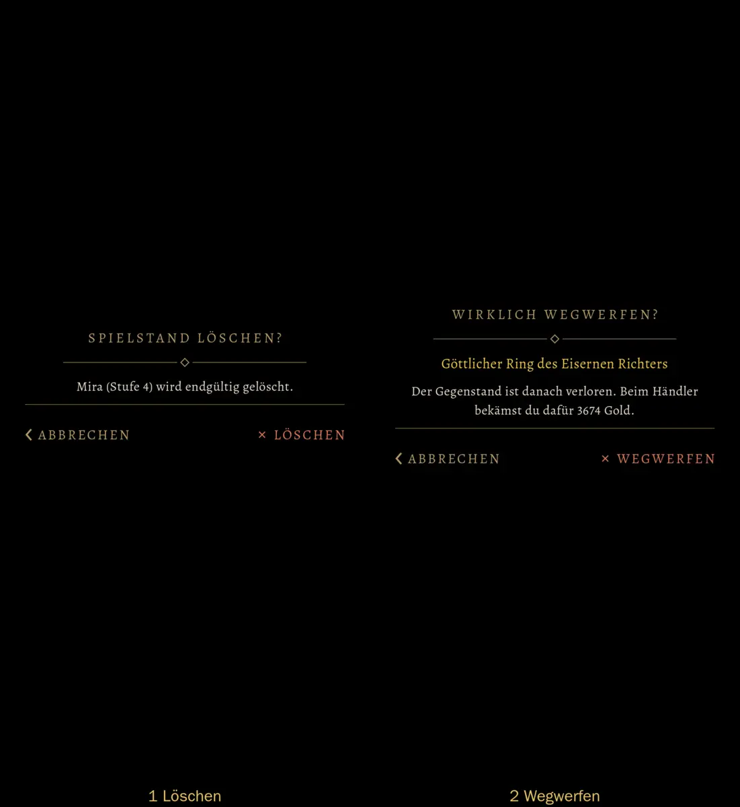
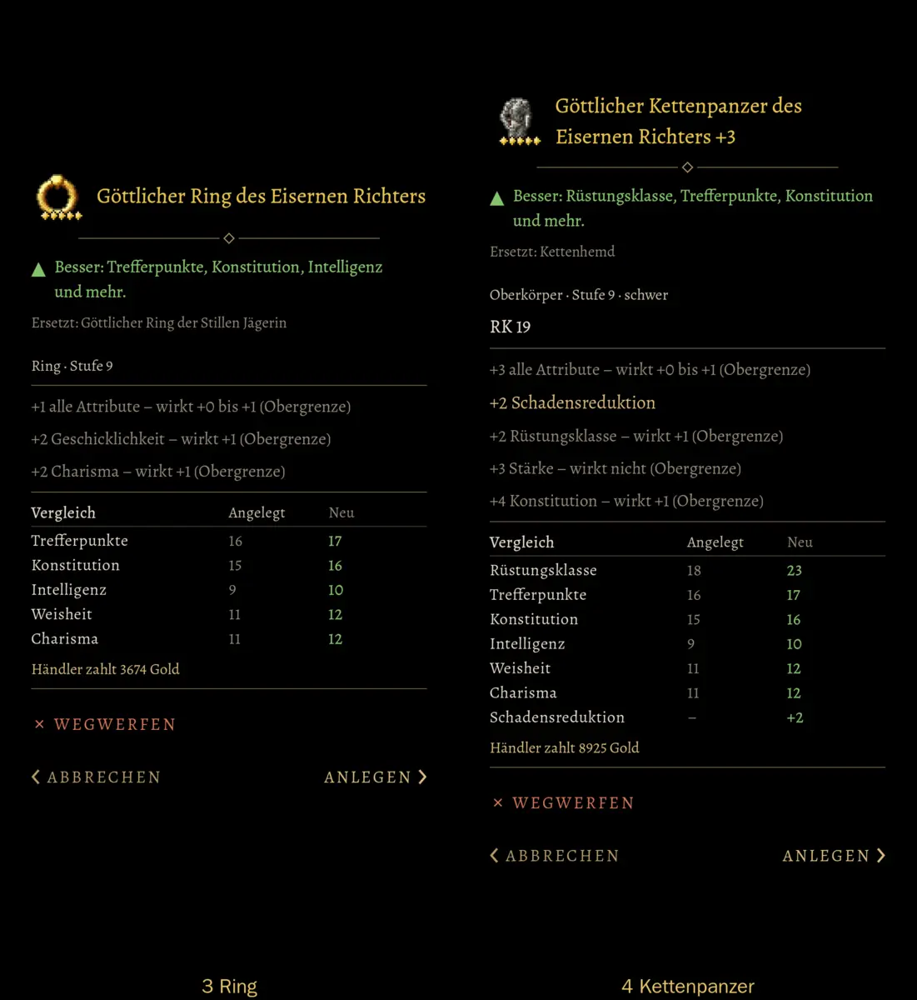
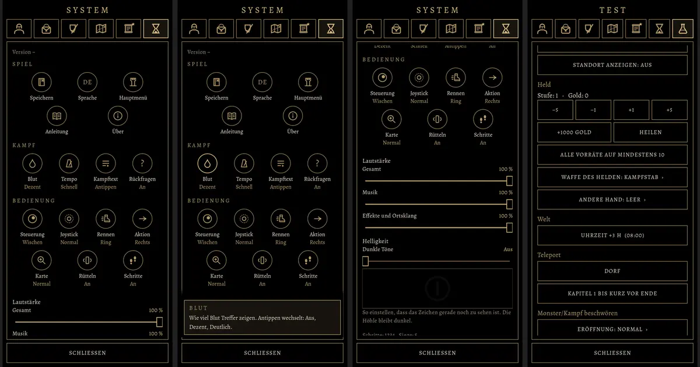
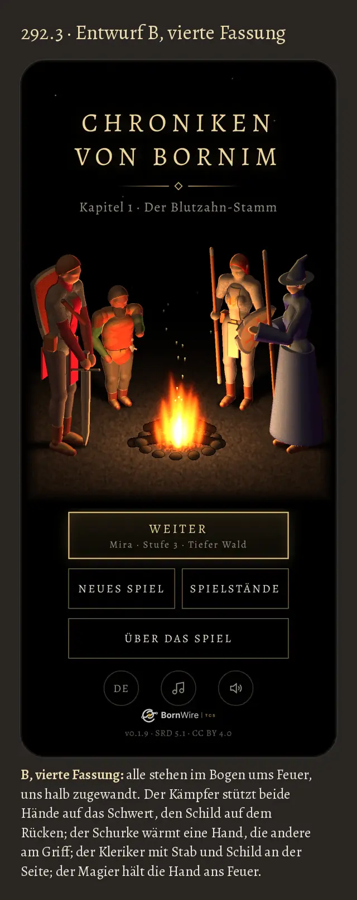
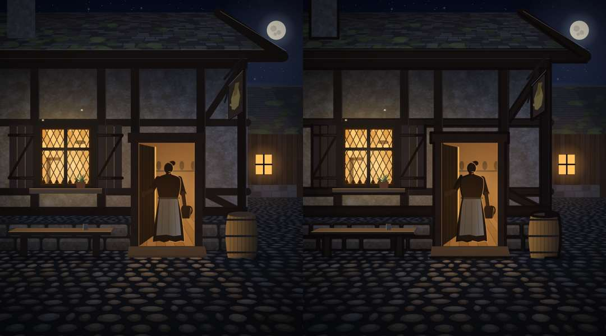

# Stil-Leitlinien

Wie das Spiel aussieht, klingt und sich spielt: die Einzelheiten zum [Leitbild](DESIGN-LEITBILD.md). Wie gebaut und geprüft wird (Abnahme „Ort fertig“, selbst prüfen, alte Ansicht), steht in [Abnahme](DESIGN-ABNAHME.md). Gilt für **alle** künftigen Arbeiten an Grafik, Animation und Klang.

Siehe auch: [Vorräte](FIRMA.md) · [Merkliste](LISTE-IDEEN.md) · [Änderungshistorie](../CHANGELOG.md)

## Auf einen Blick (314)

Diese Datei ist das Stilhandbuch: jede gültige Design-Regel steht hier oder hat hier ihren Verweis (Chef 22.10., 16:48: „die ganzen Design-Sachen vorhalten, zentral, damit wir uns immer daran orientieren können“). Andere DESIGN-Dateien verweisen hierher, statt abzuschreiben. Neue Entscheidung zu Aussehen oder Klang: Homer trägt sie hier ein.

| Bereich | Gültige Regel | Vorgang | Einzelheiten |
|---|---|---|---|
| Bild | Signatur: Licht aus Quelle, Tuschelinie, Gold einziger Glanz | 302 | „Signatur“ unten |
| Richtung | erwachsene, etwas düstere Fantasy; lebendige Diagonalwelt | – | „Richtung“ |
| Schrift | eine Schrift (Alegreya) überall, Pixelschrift und Cinzel nicht mehr | 292.3 | „Oberfläche“ |
| Kästen, Farben | Menüs und Fenster ohne Kasten (549a, Aufbau „Fenster und Schirme“); Goldrand nur im Kampf und an Behältern; Text gebrochenes Weiß; Held golden, Gegner rot | 60, 292.3, 549a | „Oberfläche“ |
| Hauptmenü | **B am Feuer** nach Entwurf 4 (Chef 22.10., 12:08: „Wir bleiben auf jeden Fall bei B. Also A und C sind raus.“); Gesichter erkennbar | 292, 292.2, 292.3 | [Blende](DESIGN-BLENDE.md) „Vorspann und Hauptmenü“ |
| Logo | Leiterbahn mit Lötaugen auf Schwarz | 251 | [Blende](DESIGN-BLENDE.md) Punkt 7 |
| Zwischensequenzen | fünf Bilder mit leichten Bewegungen wie in der alten Fassung, Signatur, Überblendung, Maß ist das Intro | 70, 112, 613 | „Zwischensequenzen“ |
| Muster | Abgenommenes nachbauen statt neu erfinden, mit Bild | 659 | „Muster“ |
| Figuren, Bewegung | Prüfpunkte A–D (Bild, Gestalt, Leben, Bewegung); jede Vorlage wird dagegen geprüft | 461, 461d | „Figuren und Bewegung: was gilt“; E, F (Waffe, Schild, Kampf) [Kampf](DESIGN-KAMPF.md), G (Film) [Abnahme](DESIGN-ABNAHME.md) |
| Gegner, Figuren | drei Varianten, düster, nie niedlich, keine Figur starr | – | „Abwechslung“, „Lebendige Welt“ |
| Karte, Räume | Sichtbarkeit, Maßstab, Karte und Kampfort gehören zusammen | 43, 77e.3 | „Karte und Räume“ |
| Bedienung | frei, wenige Schritte, bekannte Muster | 33 | „Spielerfreundlich“ |
| Menüs | Zeichen statt Textwände, wie die alte Fassung; Maß sind die alten Menüs | 426, 425 | „Oberfläche“ |
| Klang | echte Aufnahmen, drei Varianten, Systemklänge einmal | 18 | „Klang“ |
| Musik | orchestral, keine E-Gitarre, kein Rock; Dorf mittelalterlich | 28, 281 | „Klang“ |
| Klanglogo | Probe 5: Harfe da-da … daa, Glocke; orchestral, höchstens 1,5 s, auf Bild 1 des Vorspanns mit dem Logo; Probe 15 bleibt Variante für später | 292.1 | Vorgangsarchiv 292.1 (Chef 22.10., 17:07: „5 ist unser Erkennungston“) |

## Muster (659)

Wer etwas baut, das es schon gibt, schaut zuerst das abgenommene Muster an und baut danach; Abweichung nur mit neuer Abnahme des Chefs. Neue Muster trägt Homer nach der Abnahme ein (Bild nach `docs/bilder/muster/`, höchstens 60 KB).

| Muster | Bild | abgenommen | Regeln |
|---|---|---|---|
| Rückfragen ohne Kasten (549a) |  | 557 Runde 5, Chef 04.11., 19:54 | „Fenster und Schirme ohne Kasten“ |
| Gegenstand im Fenster ohne Kasten (549a) |  | ebenda | ebenda; Schirme ohne Lichthof und Dunkelverlauf (Bilder 7, 8 der Runde nicht) |
| Zeichen statt Text (326) |  | 425, Chef 31.10., 22:5x: „425 passt“ | „Zeichen“ |
| Hauptmenü B am Feuer (292.3) |  | Entwurf 4, Chef 22.10., 12:08 | [Blende](DESIGN-BLENDE.md) „Vorspann und Hauptmenü“ |
| Zwischensequenz (Intro, 112; Tusche 302.3) |  | 112 (17.10.), 302.3 (23.10., 10:45) | „Zwischensequenzen“; das Bild aus 613 ersetzt dieses nach der Abnahme |

## Signatur (302)

Drei feste Zwänge, an denen man unser Bild wiedererkennt (Chef 22.10., 14:15: „302. Ja.“). Gelten für alles neu Gezeichnete. Bestand (Chef 22.10., 20:25, Vorgangsarchiv „302 Bestand“): nach dem Meilenstein, große Figuren zuerst (Ausrüstung, Hauptmenü, Charakter, Kampf); Orte und Kampforte nur, wenn sie ohnehin überarbeitet werden; auf der Gebietskarte ist die Linie bei Kartengröße unsichtbar, dort nur auf eigene Chefsache.

1. **Licht hat eine Quelle:** jede Szene hat eine sichtbare Lichtquelle (Fackel, Fenster, Mond, Pilz); im Lichtkreis warm, außerhalb kaltes Blauschwarz.
2. **Tuschelinie der Chronik:** jede Figur und jedes Ding hat einen dunklen Umriss wie mit der Feder gezogen, leicht ungleichmäßig, im Schatten dicker, im Licht dünner (Godot: `godot/shader/tusche.gdshader`, im Kampfort `godot/kampf/tusche_licht.gdshader`; Kotlin-Zeit `MapSheet.ink`; an Figuren prüfbar als A1–A3). Die Linie wird im Zeichner mitgezeichnet, das Licht danach darüber; nie als Filter über das fertige Bild, der schwärzt Lichtränder (Chef 23.10., 07:34, 302.3).
3. **Gold ist der einzige Glanz:** nur Gold, Feuer und Magie glänzen oder leuchten; Stahl, Leder und Stein bleiben matt.

## Richtung

- **Unser Stil ist die lebendige Diagonalwelt** (Nutzer 14.10.): Details, Mikrobewegungen, Licht aus Quellen, Klang. Alles andere richtet sich daran aus, auch Standbilder der Zwischensequenzen und Kampf (79). „Dieselbe Welt“ heißt gleiche Farben, Formen, Licht und Stimmung, nicht derselbe Blickwinkel.
- **Weg vom Nintendo- und Pokémon-Stil** (knuffig, quietschbunt, Spielzeug), **hin zu erwachsener, etwas düsterer Fantasy.**
- Bessere Grafik: echte Formen, Licht und Schatten, glaubwürdige Proportionen (Körpermaße, Waffengrößen nach realen Vorbildern).
- Bessere Übergänge: keine Sprünge zwischen Haltungen, Bewegungen gehen fließend ineinander über (Einzelheiten „Übergänge immer weich“, D1).
- Licht kommt von sichtbaren Quellen (Sonne, Mond, Fackeln, Feuer, Pilze, Fenster). Dunkelheit ist erlaubt.
- **Monster sind düster und gefährlich:** böse Mäuler, große Zähne und Klauen, Narben, glühende oder tote Augen, zerfetzte Kleidung. Nie niedlich, nie knuffig.
- Blut und Wunden gehören dazu, abgestuft über die Menüeinstellung „Blut bei Treffern“ (Aus, Dezent, Deutlich), für Held und Gegner gleich.

## Abwechslung: mindestens drei Varianten

- **Kein Gegner sieht aus wie der vorige seiner Art.** Jede Gegnerart bekommt mindestens drei Varianten in Aussehen und Ausrüstung, zum Beispiel ein Goblin mit Krummsäbel und Schild, einer mit Speer, einer mit Keule und Helm. Dazu kommen Hautton, Fell oder Narben.
- **Die Werte bleiben gleich:** Varianten sind Optik. Schaden, Rüstung und Leben kommen aus den Monsterdaten (`LISTE-BESTIARIUM.md`, Werte 2.0).
- **Jede Bewegung in mindestens drei Varianten:** Angriff, Treffer, Ausweichen und Sieg oder Niederlage, damit Kämpfe nicht gleichförmig wirken. Das gilt für Gegner wie für den Helden.
- **Kein Gegner verschwindet einfach:** Jede Gegnerart bekommt eigene Sterbeanimationen (mindestens drei), erst danach blendet sie aus (Ablauf F4 in `DESIGN-KAMPF.md`). Ein tödlicher kritischer Treffer bekommt einen eigenen Killerschlag (Erweiterungen in der [Merkliste](LISTE-IDEEN.md) „Sonstiges“).
- **Größe und Körperbau variieren** um das Grundmaß der Art aus der Abnahmeliste in `LISTE-FIGUREN.md` (wo dort eine Spanne steht; Wölfe ohne Liste: Maßstab 1,32, Rückgrat 0,82 m, B7, 438c; alle Gegner 1,3-fach, Bosse 1,5-fach auf Karte und Kampfort, 587a), zum Beispiel Goblins 98–118 cm, Skelette 160–185 cm, dazu schlank, normal oder kräftig. Größe, Körperbau, Ausrüstung und Hautton werden unabhängig voneinander gewählt.
- Die Variante wird beim Kampfbeginn aus dem Erscheinungsbild-Zufall des Gegners gewählt und bleibt für diesen Gegner im ganzen Kampf gleich.
- **Gespräche nie gleich (504, Chef 03.11., 07:52: „Lebendige Welt, keine monotone Welt“):** jede Zeile, die der Spieler mehr als einmal hören kann (Gruß, Abschied, Frage nach einem Nein, „noch nicht“, Hinweise, Drohung vor einem Kampf nach einer Niederlage), hat mindestens drei Wortlaute; Wechsel nach Zufall, nie derselbe zweimal hintereinander; Spielhinweise stehen in jedem Wortlaut. Einmalige Zeilen brauchen keine. Muster: `STORY-VARIANTEN-K1.md`.
- **Ausnahme einmalige Monster:** Bosse und andere einzigartige Monster (etwa Krogg, Grak, Grimmzahn) erscheinen nur in einer Form, ohne Varianten in Aussehen und Ausrüstung, damit man sie wiedererkennt; ihre Bewegungen haben trotzdem je drei Varianten.
- Gilt für alle künftigen Gegner, Tiere, Begleiter und Figuren.

## Lebendige Welt: keine Figur steht starr

Wunsch des Nutzers (09.10.): Wer auf der Karte steht, lebt. Jede Figur, auch der Held, atmet, verlagert ab und zu das Gewicht, schaut kurz zur Seite oder stützt die Hände in die Hüften (Godot: Ruhebewegungen `godot/skripte/gebiet.gd` `ruhe_naechste`, Leute `godot/skripte/leute.gd`; Kotlin-Zeit Baustein `MapRest`). Figuren mit eigener Aufgabe bekommen eigene Handlungen obendrauf (Garrick: Hände am Feuer wärmen, in den Wald spähen).

- **Atmen immer** (Grundsatz des Nutzers, 01.11., 13:0x, Archiv 453.1): Jede lebende Figur (Held, Söldner, Leute, Tiere, Monster) atmet immer, als eigene Schicht unter jeder anderen Bewegung; ruhig, je Figur eigener Takt, nach Anstrengung schneller und abklingend. Kein Gleichtakt, kein Stillstand: auch nicht für ein paar Sekunden zwischen zwei Ruhebewegungen („atmen kann man nicht aussetzen“).
- **Übergänge immer weich** (Grundsatz des Nutzers, 01.11., 13:1x, Archiv 416.4): Stehen, Gehen und Rennen gehen bei jeder Figur weich ineinander über, in beide Richtungen („Egal, wer sich bewegt. Das muss immer weich sein.“).
- Nie im Takt: Ob, wann, was und wie lange, entscheidet der Zufall, mit eigenem Startwert je Figur, damit zwei Figuren nebeneinander nie gleichzeitig dasselbe tun. Ein gleichmäßiger Rhythmus wirkt wie ein Roboter.
- Figuren schauen den Helden an, wenn er nahe ist (bis 3 Felder), verlieren aber nach etwa 10 s Stillstand das Interesse (5la.3, Nutzer 13.10.).
- Haltungen vorher in allen Blickrichtungen prüfen (vorn, schräg, Seite, hinten); was von einer Seite falsch aussieht, fliegt raus.
- Auch Orte leben (Regel des Nutzers, 10.10., 6f): Räume, Dorf und Wald sollen lebendig wirken, nicht wie eine Kulisse. Licht flackert, Rauch steigt, Staub tanzt im Lichtstrahl, Dinge liegen so, als hätte gerade jemand sie benutzt. Grundstimmung düster durch Licht und Schatten, nicht durch Dunkelheit.
- **Effekte aktiv anbieten (44d, Nutzer 12.10.):** Rauch, Funken, Staub im Licht, Vögel, Regen und Ähnliches unterstreichen die Lebendigkeit. Tom und Jerry schlagen sie bei jedem neuen Ort und jeder neuen Figur von sich aus vor (Standbilder), statt zu warten, bis sie fehlen.

## Figuren und Bewegung: was gilt (461)

Chef 01.11., 20:3x: „auf ein Niveau kriegen, dass wir von da aus alle weiteren Vorlagen machen und nicht jedes Mal ich irgendwelche Sachen sehe, wo ich mir denke, das hat man doch schon 100 Mal entschieden.“ Was der Chef zu Figuren und Bewegung entschieden hat, steht nur hier (461d, 01.11., 22:5x; vorher `LISTE-GRUNDSTAND-461.md`); Waffe, Schild und Kampf (E, F) in `DESIGN-KAMPF.md`, Film und Vorlage (G) und wie geprüft wird in `DESIGN-ABNAHME.md` „Vor jeder Vorlage“. Spalte „Prüfer“: ja = Chefwort und prüfbar, ein Verstoß hält den Lauf an (461a, 511, 621.1; `DESIGN-ABNAHME.md`); „Maß“ = Zahl von uns, nur Richtwert; – = Wirkung, nur Selbstprüfung. Neue Entscheidung: die Zeile hier im selben Commit ändern, am alten Archiveintrag „→ ersetzt durch …“ (461b).

### A Bild und Signatur

| Nr. | Prüfpunkt | Woher | Prüfer |
|---|---|---|---|
| A1 | Spielshader in jeder Probe und jedem Film (Toon-Licht, Tusche nach Licht, Schatten wie im Spiel); ohne nur mit Schalter und Hinweis in der Vorlage | 457, 457.1 (01.11.) | ja |
| A2 | Tusche nach Lichtrichtung (Signatur 2): Lichtseite dünn oder weg, Schattenseite kräftig; im Kampfort Linienstärke 1,3, Sonne schräg von der Seite | 348.13 (26.10.), 348.13a (27.10.) | ja |
| A3 | Dieselbe Signatur an allen Figuren und Tieren, auch an Kaufmodellen („unsere Haut“: eigene Bemalung, Tusche) | 387 (28.10.), 348.12f (27.10.) | ja |
| A4 | Schatten liegt nach Sonnenstand unter dem Körper, keine schwarzen Scheiben unter den Füßen | 348.12f (28.10.) | ja |
| A5 | Held sieht in Dorf, Wiese und Kampfort gleich aus, mindestens Stand Film 403 | 403 (01.11., 11:13), 417 (13:4x), 453 r2 (19:5x) | – |
| A6 | Ausrüstung hat räumliche Tiefe (Schild nicht flach) | 406 (29.10.) | – |

### B Gestalt

| Nr. | Prüfpunkt | Woher | Prüfer |
|---|---|---|---|
| B1 | Held auf dem Kaufkörper wie Film 403, mit einem der sechs Köpfe; Haut nicht „klinisch tot“ (vier Hauttöne); Hautfarbe von Held und Völkern mit einer Eichung, Bezug Kampfortlicht („431e ja, eine Eichung“, 02.11., 18:29); Heldenhaut damit geeicht, abgenommen an Lauf 5 („Heldenhaut so“, 02.11., 20:37) | 403, 376.1 (28.10., 29.10.), 431e, 431 (02.11.) | ja |
| B2 | Grundkörper je Volk: Ork auf Superheld (auch Grak, Krogg, große Leute); Elf, Hügelvolk, Mensch, Aschgeborene auf Regulär; Zwerg nach Film 455.2 | 431 (01.11., 11:42) | ja |
| B3 | Tracht je Herkunft, Mann und Frau gleich; langes Haar unter Helm und Kapuze verborgen; zwölf Frisuren | 376.1 (29.10., 01.11.) | ja |
| B4 | Kleidung geschlossen: nichts scheint durch (Umhang, Robe, Kettenhemd), keine Löcher, keine Knie durch die Robe; Haut unter Kleidung nicht gezeichnet; Frau höchstens so viel Durchdringung wie Mann | 376.1 (29.10.; 01.11., 20:2x, 20:57), 406 (20:2x) | ja |
| B5 | Schild 2 für den ehemaligen Kleriker (darauf goldene Sonne in unseren Farben), Schild 15 für den Krieger; kein zweiter Schild auf dem Rücken | 406 (29.10., 31.10.), 461c (01.11., 22:35) | ja |
| B6 | Neue Figur erst als ruhendes Modell abgenommen, dann bewegt; Figuren untereinander unterscheidbar | 348 (28.10.), 348.12 (28.10.) | – |
| B7 | Größen wie entschieden: Wölfe 1,32 (Film 438) | 438c (01.11., 11:45) | ja |

### C Leben

| Nr. | Prüfpunkt | Woher | Prüfer |
|---|---|---|---|
| C1 | „Atmen immer“ wie unter „Lebendige Welt“, dazu sichtbar; Helden in Ruhe „einen Tick schneller“ als in Film 453.1 (02.11.); nach Angriff und Abwehr sichtbar schneller, dann abklingend | 453.1 (01.11., 13:0x, 19:5x; 02.11., 11:07) | ja |
| C2 | Kein Stillstand: Bewegung oder Atmen, nie starr („Stillstand für mehrere Sekunden geht eigentlich nicht“); Richtwert von uns: kein Abschnitt über 1 s ohne Bewegung | 453 (13:0x) | ja, 1 s Maß |
| C3 | Kein Gleichtakt („Nie im Takt“ unter „Lebendige Welt“): zwei Figuren nie dieselbe Bewegung zur selben Zeit, auch nicht Angriff | 453 (13:0x), 406 (20:2x) | ja |
| C4 | Ruhebewegungen wechseln; Wölfe mit Gesten | 453, 438 (01.11.) | – |

### D Bewegung

| Nr. | Prüfpunkt | Woher | Prüfer |
|---|---|---|---|
| D1 | „Übergänge immer weich“ wie unter „Lebendige Welt“; dazu Anlaufen zügig, Abbremsen in Stufen (Sprint, Rennen, langsamer, Gehen) und länger als Beschleunigen; Stehenbleiben aus dem Sprint geht | 416.4 (01.11., 13:1x, 20:3x) | – |
| D2 | Rennen ohne Waffe Fassung A; mit Waffe Gehen und Rennen aus dem Waffenpaket, nie von Hand gestellt | 416.4, 348.12c, 417 (01.11.) | ja |
| D3 | Gehen langsamer als in Runde 4 (Zahl schlägt Tom vor), Oberkörper aufrecht, nicht vorgeneigt; Rennen mit Waffe nicht stärker vorgebeugt als mit Bogen; kein Schweben, kein Staksen, kein Hoppeln | 417 (12:21, 13:4x; Nachtrag Archiv 20:4x; 02.11., 14:46), 406 (20:2x) | – |
| D4 | Ortswechsel immer mit Laufbewegung, nie geschoben; Füße gleiten nicht | 348.12 (28.10.), 438 (31.10.) | ja |
| D5 | Boss schreitet statt zu sprinten, beim Ortswechsel; nicht beim Ausweichen (F5) | 348.12 (29.10.; 01.11., 22:45) | – |
| D6 | Figuren gehen nicht durcheinander (Wolf durch Wolf) | Test 133 (28.10.) | ja |

## Karte und Räume (diagonale Sicht)

Aus den Rückmeldungen des Nutzers bis 11.10. (Verlauf im Archiv, in Git bis `f3ec7200`: `docs/ARBEIT-ARCHIV.md`):
- **Ausrüstung unterwegs:** nach E1 und E8 in `DESIGN-KAMPF.md`: je Figur, was gut funktioniert und gut aussieht (in der Hand, am Arm oder auf dem Rücken), nichts schwebt, nichts schaut durch (417a, Chef 02.11., 21:24; ersetzt „jede Waffe in der Hand, kein Rücken“ aus 417 vom 01.11. und „geschultert, Schild auf dem Rücken, Zweitwaffe in der Scheide“ vom 11.10., 461d); nie am Boden schleifend.
- **Sichtbarkeit (Thema 43, Nutzer 12.10.):** Was in der alten Ansicht rechts gut zu sehen war, steht diagonal vorn unten zwischen Kamera und Geschehen.
  - **Wichtiges steht frei:** Leute, Questziele, Eingänge, Schilder, Feuerstellen haben freien Blick; zur Kamera hin (Süden, Osten) nichts Hohes davor. Sonst umstellen (das Ding oder die Bäume davor); die Karte muss nur diagonal stimmen.
  - **Durchsicht nur um den Helden:** Kronen, Felsen, Büsche und hohe Möbel in einem kleinen Umkreis um den Helden fast ganz durchsichtig, nicht gestapelt, damit er nie verschwindet.
  - **Verstecktes erwünscht:** Kisten und Kleinkram dürfen unter Bäumen liegen und tauchen erst auf, wenn der Held hingeht (Belohnung fürs Erkunden); keine Durchsicht für sie aus der Ferne.
- **Maßstab:** Höhen im Maßstab des Helden (ein Tisch steht etwa hüfthoch neben ihm). Waagerechte Kreise (Fass, Eimer, Becken) sind in der diagonalen Sicht Ellipsen 2:1, ihr Schatten ebenso.
- **Räume:** eher klein und dicht als groß und leer; jeder Ort hat eigene Möbel, die zu seinem Bewohner passen (Pult und Truhe beim Ältesten, Ladentisch und Waren bei Thessa, Altar und Bänke im Tempel), je drei Varianten. Mehrteilige Möbel (Altar, Theke, Bett über mehrere Felder) haben durchgehend dieselbe Variante. Licht von Herd, Kerze und Fenster; Gebrauchsspuren.
- **Karte und Kampfort gehören zusammen** (Standard für alle bestehenden und neuen Karten; 77e.3): Was auf der Karte steht, bestimmt die Kampfkulisse. Wasser, Felsen, Feuerstellen, Lager, Leuchtpilze, Lichtschächte und Fackeln auf der Karte erscheinen im Kampf an derselben Stelle wieder, auch mit demselben Licht. Kein reines Auswürfeln der Kulisse. Jede neue Kampfkulisse bekommt Orte, die auf der Karte als Gegenstücke vorkommen, und umgekehrt.
- **Jede neue Karte** (60, 13t, 77e.3; aus dem Ideenspeicher, 148): feste Leiste über der Karte, nie über ihr, immer gleich hoch (Zustände reihen sich nebeneinander, die Zeile steht auch leer); Kamera folgt dem Helden ohne Anschlag (Füße etwas unter der Mitte). Ränder laufen diagonal (Nordecke oben), dahinter schwarze Schrägen; neue Karten bekommen am Rand einen Abschluss (Bäume, Felsen, Zaun, Wasser); Eingänge, Schilder, wichtige Figuren am Rand in der Vorschau vom Weg dorthin prüfen (Lücke 27/5.5). Das Blickfeld ist flach und breit: Wege, Engstellen, Sperren quer legen statt steil nach oben.
- **Begleiter und Rudel:** folgen mit eigenem Weg, eigenem Tempo und eigenem Blick, werden nie starr um den Anführer mitgedreht.

## Spielerfreundlich, einfach, frei (Thema 33)

Grundsatz des Nutzers (12.10.): Das Spiel lässt dem Spieler möglichst viel Freiheit, ist aber einfach zu bedienen und kommt mit möglichst wenigen Zusatzdialogen aus („keep it simple and clean“). Tom und Jerry prüfen das vor jeder Umsetzung, wo es Sinn ergibt, mit vier Fragen:
1. **Freiheit:** Muss der Spieler das tun, oder darf er wählen? Nebensachen (Aufträge, Sammeln, Handwerk) sind immer freiwillig; wer etwas nicht will, wird nicht daran erinnert oder gedrängt.
2. **Wenige Schritte:** Wie viele Fenster, Tipps und Bestätigungen braucht es? Ziel: eine Handlung, ein Fenster; keine Rückfrage „Wirklich?“ für Umkehrbares.
3. **Bekannte Bedienung:** Geht es mit Mustern, die das Spiel schon hat (Antippen, Liste, ein Knopf), statt mit einem neuen Bedienelement?
4. **Wachstum:** Bleibt es übersichtlich, wenn mit weiteren Kapiteln viel mehr davon kommt (zehnmal so viele Aufträge, Gegenstände, Orte)?

Im Vorschlag an den Nutzer stehen die vier Antworten kurz neben dem Abgleich mit den übrigen Leitlinien.

## Oberfläche (Thema 60)

- Alle Oberflächen sehen aus wie Blende und Textkasten (42b, **teils ersetzt** durch 549a, 04.11.: Menüs, Fenster und Schirme ohne Goldrand nach „Fenster und Schirme“ unten; der Goldrand bleibt nur im Kampf und an Behältern): schwarz, Text in gebrochenem Weiß, Farben und Gewichte nach „Fenster und Schirme“ (Überschriften gedämpftes Gold, Hervorhebungen hell golden), Serife (mitgeliefert, OFL); keine hellen Tafeln mehr (Nutzer 12.10., 23:20).
- **Eine Schrift überall** (292.3, Chef 22.10., 16:43: „292.3 ja“): Alegreya (mitgeliefert, OFL) für alles; Versalien und Sperrung nach „Fenster und Schirme“ (nur Titel, Zwischenüberschriften, Knöpfe). Cinzel nicht mehr (löst 60f ab). Keine Pixelschrift, auch nicht im Kampf (löst 60i ab): Lebens- und Zauberpunkte, Würfelzeile und Zahlen in MARS und im klassischen Kampf in Alegreya mit gleich breiten Ziffern, mindestens 13 sp. Ausnahmen: Ortsnamen auf den Karten bleiben in Handschrift (62g, Chef 14:02); der Schriftzug im Firmenzeichen ist Teil des Logos.
- **Kästen im Kampf** (292.3): deckend schwarz mit dünnem Rand wie der Textkasten; der Kasten dessen, der am Zug ist, wie sein Feld in der Zugleiste („▶“, Name in Gold, hellerer Goldrahmen), Gegner am Zug ohne Hervorhebung (565 A, Chef 08.11., 13:11; ersetzt „golden umrandet, wenn Held, rot, wenn Gegner“).
- Farben, die auf Schwarz stehen (Seltenheit, Warnfarbe), hell genug zum Lesen; Warnfarbe nur für Zerstörendes („Fenster und Schirme“).
- **Zeichen statt Textwände** (426, Chef 31.10., 21:30 zu Build 143: alte Menüs mit Icons „super klasse“, neue „viel zu viel Text“): Menüs, auch Menü „System“ und Testmenü, zeigen jeden Eintrag als Zeichen mit kurzer Beschriftung (ein bis zwei Wörter), nie als Satz oder Absatz; Erklärung nur, wenn der Spieler sie aufruft. Maß sind die Menüs der alten Fassung: was dort mit Zeichen ging, übernimmt die neue möglichst eins zu eins (425, Tom). Neue Zeichen nach „Zeichen“ unten.

### Fenster und Schirme ohne Kasten (549a, Chef 04.11., 19:28: „549a ja … damit wir nicht jedes Mal wieder neu anfangen“)

Gilt für jeden neuen oder umgebauten Menüschirm und jedes Fenster außerhalb des Kampfs. Alle Schirme werden einheitlich umgebaut, jetzt und nicht erst nach dem Durchspielen (630, Chef 07.11., 22:28; ersetzt „Schirm für Schirm, wenn er ohnehin angefasst wird; kein Umbau aller Schirme vor dem Durchspielen“). Bausteine in Godot: `godot/skripte/spielstaende.gd` (`frage`, `fuss`, `knopf`, `knopfzeile`, `folge_inhalt`, `zier`, `linie`, `tippbar`, `pfeil`), Farben `godot/skripte/stil.gd` (bis 557 auf `main` ist, liegen die Bausteine auf Zweig `claude/tom-557-spielstaende`; `ANGABE` steht dort in `spielstaende.gd` und zieht mit dem Einbau nach `stil.gd`). Wer baut, nimmt diese Bausteine und keine eigenen; weicht ein Wert hier vom Code ab, gilt dieser Abschnitt, der Code wird nachgezogen.

**Geltung.** Gilt für Menüs, Schirme und Fenster. Nicht dafür gilt, mit eigenen Regeln: Kampf (MARS, 292.3), Blende, Vorspann, Zwischenbildschirm und Hauptmenü (`DESIGN-BLENDE.md`), Dialog-Textkasten der Gespräche (42b, unverändert), runde Knöpfe auf der Karte („Zeichen“ unten). Soll eines davon auch ohne Kasten werden, entscheidet der Chef.

**Begriffe.** *Schirm*: füllt den ganzen Bildschirm (Spielstände, Laden, Brauen, Rast, Kapitelende, Wechselliste). *Fenster*: liegt über einem Schirm oder der Karte (Rückfrage, Gegenstand, Mengenkasten, Erklärung, ganzer Bericht).

**Aufbau, von oben nach unten, immer gleich:**
1. **Kopf:** Titel; oder beim Ding Bild links und Name daneben, „+x“ in derselben Zeile wie der Name („Kettenpanzer +3“, bricht mit dem letzten Wort um). Über dem Kopf steht nichts: keine Linie, kein Rahmen.
2. **Zierlinie** direkt unter dem Kopf: feine Goldlinie mit Raute in der Mitte (`zier`, 76 % der Breite, Raute 9 dp, Linie 1 dp). Genau eine je Fenster oder Schirm, keine zweite schlichte Linie darunter.
3. **Inhalt.** Listen als Zeilen zwischen schlichten Linien (`linie`: 0,6 dp, `RIM`), keine Kästen um Zeilen.
4. **Schlichte Linie** über den Knöpfen (eine, nicht doppelt unter der letzten Listenzeile).
5. **Knöpfe** (unten).

**Antippbar erkennt man ohne Kasten so:** jede antippbare Zeile nimmt die ganze Breite ein, ist mindestens 48 dp hoch, hat links ein Zeichen oder Bild und rechts ein goldenes „›“ und wird beim Antippen dunkel (`RAISED`, `tippbar`); Text, der nur informiert, hat weder Zeichen noch „›“. Gewählte Zeile oder gewählter Wert: Schrift `BRIGHT` auf `RAISED`, kein Rahmen. Wahlen in einer Listenzeile (Spielstände „LADEN ›“) stehen rechtsbündig in der Zeile, Schrift wie Knöpfe.

**Grund und Rahmen.** Fenster: schwarz und ganz deckend über den ganzen Bildschirm, nichts scheint durch; Inhalt beginnt oben unter Titel und Zierlinie wie auf jedem Schirm, Titel immer in derselben Höhe (557a B, Chef 04.11., 20:55; ersetzt „senkrecht mittig“), Breite Bildschirm minus 48 dp (24 dp je Seite); Abstand zwischen den Teilen 10 dp. „Neben das Fenster tippen“ heißt: außerhalb dieser Inhaltsspalte. Schirm: Grund rein schwarz, ohne Bild dahinter, ohne Lichthof und ohne Dunkelverlauf (Chef 04.11., 19:38 zur Rast: „diesen Halo … mit dem Dunkelverlauf. Das wollten wir doch rausnehmen“), Seitenrand 24 dp, Inhalt beginnt oben unter Titel und Zierlinie. Zwischenüberschriften (Rezept, Zutaten, Fertigkeiten) werden durch eine schlichte Linie getrennt, nie durch eine zweite Zierlinie. Kein Rahmen um Fenster, Zeilen oder Knöpfe. Rahmen nur im Kampf (Zugleiste, Gruppenkästen, wer am Zug ist; 292.3) und an Behältern (Ausrüstungsplatz, Feld der Tasche), nie an einem Fenster.

**Ausrichtung.** Titel immer zentriert. Rückfragen zentriert (Titel, Text bis drei Zeilen, Name des Dings), ihre Knöpfe aber wie überall links und rechts außen; hat eine Rückfrage mehr als drei Zeilen Text, steht der Text linksbündig. Alles andere linksbündig (Gegenstand, Rast, Brauen, Spielstände, Wechselliste, Kapitelende, Erklärungen), damit Zeilen an derselben Stelle beginnen und Zahlen untereinander stehen. Ausnahme Mengenkasten (abgenommen 16:44, Bild 4): die Menge groß in der Mitte „− 3 +“ mit großen Tippflächen ohne Rahmen, darunter mittig ×1 · ×5 · ALLE als Wörter (je mindestens 48 dp Tippfläche), das gewählte hell mit Goldstrich darunter, nicht wählbare gedämpft lesbar.

**Knöpfe.**
- Alle Knöpfe gleich groß: je die halbe Breite (`knopfzeile`, 8 dp Abstand), Tippfläche 48 dp hoch, Schrift 15 sp, Versalien, Sperrung 2 sp, ß als SS. Kein Rahmen; beim Antippen wird die Fläche dunkel (`RAISED`), ausgelöst beim Loslassen.
- **Seite nach Bedeutung, nie mittig, auch ein einzelner Knopf nicht:** was zurückführt oder schließt links mit „‹“ vorn (‹ ZURÜCK, ‹ ABBRECHEN); was weiterführt oder ausführt rechts mit „›“ hinten (WEITER ›, LADEN ›, ANLEGEN ›, BRAUEN ×3 ›, NEBENHAND ›). „‹“ und „›“ sind gezeichnete Winkel (`pfeil`), kein Schriftzeichen.
- **Farbe statt Größe:** Hauptwahl hell golden (`BRIGHT`), Nebenwahl gedämpftes Gold (`GOLD`), was etwas zerstört (× WEGWERFEN, × LÖSCHEN) überall in Warnfarbe (`WARN`) mit „ד vorn, im Fenster wie in der Rückfrage; nicht wählbar gedämpft (`DIM` zu 75 %), lesbar.
- **Begriffe:** *Hauptwahl* = was das Fenster tut (rechts unten, `BRIGHT`); *Nebenwahl* = Zurück oder Abbrechen (links unten, `GOLD`): „‹ ZURÜCK“ geht eine Ebene zurück, von der obersten Ebene eines Schirms ins Spiel wie die Zurück-Taste von Android; „‹ ABBRECHEN“ verwirft eine angefangene Handlung (Rückfrage, Mengenfenster, Gegenstandsfenster); „Schließen“ entfällt (618, Chef 07.11., 22:21; ersetzt „Zurück, Abbrechen, Schließen“); *Gefahr* = was zerstört (`WARN` mit „ד). In einer Rückfrage ist die Gefahr die Hauptwahl und steht rechts unten (× LÖSCHEN). In einem Fenster mit eigener Hauptwahl steht sie in der Reihe darüber links (Gegenstand: oben „× WEGWERFEN“ links, „NEBENHAND ›“ rechts; unten „‹ ABBRECHEN“, „ANLEGEN ›“). Ein freier Platz in einer Reihe bleibt leer, die anderen Knöpfe werden nicht breiter.
- **Abbrechen sichtbar** in jedem Fenster mit einer Wahl; ein Fenster ohne Wahl (Erklärung, ganzer Bericht) hat links unten „‹ ZURÜCK“ (618; ersetzt „‹ SCHLIESSEN“); Android-Zurück und Tippen neben das Fenster schließen zusätzlich, Tippen ins Fenster nicht (526).
- Mehr als zwei Knöpfe: Reihen zu je zwei; die unterste Reihe ist immer „‹ Nebenwahl“ links, „Hauptwahl ›“ rechts.
- **Lage:** die Knöpfe stehen direkt unter dem Inhalt, solange alles auf einen Schirm passt; nur wenn die Liste rollt, fest unten (`folge_inhalt`).

**Schrift** (eine Schrift: Alegreya, Ziffern auf der Linie; sp nach der Schriftgröße des Handys, 498):

| Was | Größe | Schnitt | Farbe |
|---|---|---|---|
| Titel eines Schirms, eines Fensters oder einer Rückfrage (586a, Chef 05.11., 09:39; `Stil.TITEL_SP`) | 22 sp | Versalien, Sperrung 3 sp | `GOLD` |
| Zwischenüberschrift (Rezept, Zutaten, Fertigkeiten) | 14 sp | Versalien, Sperrung 3 sp | `GOLD` |
| Name eines Dings | 16 sp | normal, keine Versalien | Farbe der Seltenheit |
| Fließtext | 15 sp | normal | `TEXT` |
| Erzählter Text (Chronik, Kapitelende) | 16 sp | schräg erlaubt | `TEXT` |
| Kleine Angaben (Reicht für, Im Besitz, Gold, Stufe, Händler zahlt; in der Rast „Tag · Uhr · TP“ direkt unter der Zierlinie, 549b ja) | 13,5 sp, nie unter 13 sp | normal | `ANGABE` (cfc3ab) |
| Knöpfe | 15 sp | Versalien, Sperrung 2 sp | siehe Knöpfe |

Versalien mit Sperrung nur für Titel, Zwischenüberschriften und Knöpfe; nie für Sätze, Namen oder Zahlen.

**Farben** (`stil.gd`): `TEXT` e6ddcb gebrochenes Weiß für Text; `GOLD` b59a6a für Titel, Nebenwahl, Raute; `BRIGHT` d9bc82 für Hauptwahl, gewählten Wert und wirksame Boni; `ANGABE` cfc3ab für kleine Angaben; `DIM` 948a78 für Gesperrtes; `RIM` b59a6a zu 67 % für Linien; `WARN` d9785a **nur** für Zerstörendes; Urteil ▲ grün (`GRUEN` 86c46e) „Besser“, ▼ „Schlechter“ in `MANGEL` b08a80, ◆ `BRIGHT` „Gemischt“; `MANGEL` b08a80 (stilles, graues Rot) für jeden Mangel ohne Zerstörung: „Schlechter“, „Fehlt“, „kannst du nicht tragen“, „Ungeübt“ (557, Chef 04.11., 19:54; nicht Grau, das heißt gesperrt); Seltenheit (`menue.gd` `SELTEN`): gewöhnlich bdb6a8, ungewöhnlich 86c46e, selten 82aaf2, sehr selten bc8ef2, episch f29e50, göttlich eac650. Inhalt und Reihenfolge des Gegenstandsfensters nach 524.1 (Archiv 04.11., 13:32).
**Prüfen vor jeder Vorlage** (Maßtest `gruppe_mass_557` und Helfer, 512b): alles auf 360 dp sichtbar, nichts überlappt, Schrift mindestens 13 sp, Tippfläche mindestens 48 dp, jedes Bildfeld gefüllt (Gegenstand, Trank, Kraut), jede Regel dieses Abschnitts eingehalten.

### Zeichen (326; Muster: Reiterzeichen; Godot `godot/skripte/reiterzeichen.gd`, Kartenknopf `aktionsknopf.gd`, Menü „System“ `zeichenknopf.gd`, Farben `stil.gd`; Kotlin-Zeit `MenuTabs.kt` `glyph()`)

- **Art:** Raster 24 × 24, nutzbar 1,5–22,5; Linie 1,6 (`line`), fein 1,1 (`thin`), runde Enden und Ecken; nie gefüllt außer Punkten (r ≤ 1,4); nie Pixelbilder. Alle Zeichen gleich kräftig: keine Linie unter 1,2 dp am Bildschirm, darum kein Zeichen unter 16 dp (Sonne, Mond an der Uhr heute 13 dp).
- **Farbe** (Namen aus `stil.gd`, Kotlin-Zeit `Veil.*`): im Menü `GOLD`, gewählt `BRIGHT`; auf der Karte `BRIGHT`; aus oder gesperrt `DIM`.
- **Knopf auf der Karte** (ersetzt den Look von `ActionButton`): Kreis, Grund Schwarz zu 70 % deckend, Rand 1,5 dp `GOLD`, bei allen Knöpfen gleich (Rennen wie Aktion); gedrückt Grund `RAISED`, Rand `BRIGHT`; aus Rand `RIM`, Zeichen `DIM`. Zeichen = halber Knopfdurchmesser, mittig. Probe (Rechnung, 23.10.): hebt sich bei Tag, Nacht und im Wald ab.
- **Die 14 Zeichen** (Punkte im Raster als x,y; L Linie, F fein, P Punkt mit Radius):
  - **Reden** `TALK`: Sprechblase L, Rechteck 3,4–21,16 mit Ecken r 3, Zipfel unten links 11,16 → 7,20.5 → 8,16; P r 0.9 bei 8,10 · 12,10 · 16,10.
  - **Öffnen** `OPEN`: Truhe L, Kasten 3,11.5–21,20.5; Deckel als halbe Ellipse über 3–21, Scheitel y 4.5; F Bänder 7.5,5.6–7.5,11.5 und 16.5,5.6–16.5,11.5; Schloss L 10,10–14,15, P r 0.9 bei 12,12.6.
  - **Lesen** `READ`: Anschlag L, Tafel 3.5,4–20.5,14, Dach 2.5,4 → 12,1.5 → 21.5,4; zwei Pfähle L 8,14–8,21 und 16,14–16,21; Schrift L 7,7.5–17,7.5 und 7,10.5–14,10.5. Keine Rolle (gehört der Chronik).
  - **Rasten** `REST`: Flamme L als Tropfen 12,3 → Bauch 18,10 bzw. 6,10 (quadratisch) → 12,15.5; innere Flamme F 12,8.5 → 14.5,12 / 9.5,12 → 12,14; Scheite L gekreuzt 5,20.5–19,16.5 und 5,16.5–19,20.5.
  - **Aufschließen** `UNLOCK`: Schlüssel L, Ring Mitte 7,12 r 3.5; Schaft 10.5,12–21,12; Bart 17,12–17,15.5 und 20,12–20,15.
  - **Ansehen** `LOOK`: Auge L, Lid 3,12 über 12,3.5 nach 21,12, unten über 12,20.5 zurück (quadratisch); Iris Kreis 12,12 r 3.2; Pupille P r 1.2.
  - **Kampf** `FIGHT`: zwei Schwerter L; Klinge 4,4–14.5,14.5, Parierstange 11,18–18,11, Griff 14.5,14.5–19.5,19.5; gespiegelt 20,4–9.5,14.5, 13,18–6,11, 9.5,14.5–4.5,19.5; Knäufe P r 1.4 bei 20.5,20.5 und 3.5,20.5. Lange Parierstangen, sonst liest man „Schließen“.
  - **Eintreten** `ENTER`: Bogen L 5,21–5,10, Halbkreis Mitte 12,10 r 7, 19,10–19,21; Schwelle L 3,21–21,21; Türflügel weit offen L 5,10.5 → 13,14 → 13,22, Klinke P r 0.9 bei 10.5,17. Kein Pfeil (las sich „Hochladen“).
  - **Weiter** `NEXT`: zwei Winkel L 6,6 → 12,12 → 6,18 und 12,6 → 18,12 → 12,18.
  - **Menü** `MENU`: Reiterzeichen Tasche (`TabSign.BAG`) unverändert; eine Tasche im Spiel, nicht zwei.
  - **Rennen** `RUN`: Stiefel L, Schaft 10,3–16,3–16,11.5, Spann über 21,12.5 nach 21.5,17, Sohle 21.5,19.5–10,19.5, Ferse über 8.5,19 nach 9,16.5, zurück zu 10,3; F Stulpe 10,6.5–16,6.5 und Sohlenkante 9.5,17–21.5,17; Bewegungsstriche L 2.5,8–6.5,8 · 1.5,12–6.5,12 · 2.5,16–6,16. An `Veil.bright`, aus `Veil.dim`.
  - **Handeln** `ACT` (Klassik, kein Ziel): Funke L, Zacken 12,3 · 21,12 · 12,21 · 3,12, Einzüge bei 14,10 · 14,14 · 10,14 · 10,10; immer aus.
  - **Sonne** `SUN`: Kreis L 12,12 r 4.5; acht Strahlen L von r 7.5 bis r 10.
  - **Mond** `MOON`: Sichel L, Kreis 12,12 r 8 ohne Kreis 15.5,9.5 r 6.5 (`Path.op` DIFFERENCE, nur Umriss).
- **Prüfung** (Rechnung mit Helfer, 23.10.): klar Reden, Öffnen, Aufschließen, Ansehen, Weiter, Sonne, Mond, Rasten; „eher“ Lesen, Kampf, Eintreten, Rennen. Diese vier prüft Homer im echten Bild (E) vor dem Build.

## Ausrüstung der Gegner

- Feste Ausrüstung je Gegnerart nach dem Bestiarium (`LISTE-BESTIARIUM.md`, Spalte „Angriff“), in mindestens drei Varianten.
- Zustände wie „rostig“ (altes Eisen) und „grob“ (Holzschild aus Planken) sind reine Optik. Sie kommen nicht in Beute- oder Händlerlisten.
- Die Ausrüstung passt zum Angriffsnamen des Gegners, etwa „Morgenstern“ bei Krogg oder „Kurzbogen“ beim Goblin-Späher.

## Zwischensequenzen (Thema 70)

Alle Zwischensequenzen (Intro 69, Tempelszene 68, spätere Wendepunkte) sind gleich gebaut, damit sie als eine Reihe erkennbar sind:
- etwa **fünf gerenderte Bilder mit leichten Bewegungen** wie in der alten Fassung (`core/.../IntroLife.kt`), mit Signatur (Licht aus Quelle, Tusche im Zeichner, 302.3), verbunden durch **weiche Überblendungen**; zusammen etwa 30–40 Sekunden (Chef 08.11., 15:08: „Zwischensequenzen, wenn die jetzt nochmal neu gemacht, mit leichten Animationen, die wir ja auch hier in der alten Fassung hatten, respektive ja, Signatur, Tusche und so.“; ersetzt „ohne Animation“; Bau 613)
- je Bild **ein kurzer Text** im Textkasten-Stil; Texte legen Nutzer und Berater fest (`STORY-REGELN.md`)
- **Klang je Szene**: leise Geräusche (Intro) oder ein eigenes Musikstück (Tempel: „Ancient Legend“), Geräusche bleiben darunter leise
- Antippen überspringt; danach in der Chronik unter „Bisher geschehen“ wieder ansehbar
- **Figuren** an Umriss und festem Merkmal erkennbar (Merkmale in `LISTE-FIGUREN.md`), nicht am Gesicht; Rückenansicht oder Schattenriss (70.2)
- **Selten:** je Kapitel höchstens Anfang und Ende, dazu selten ein Wendepunkt (70.4)
- **Bild:** dieselbe Welt (Grundsatz unter „Richtung“), **präzise und so detailreich wie die Diagonalwelt** (Nutzer 14.10., 09:5x: keine Abstraktion, keine Pinselstriche, eher mehr Rechenleistung, feiner): Licht aus Quellen mit warmen Lichtkegeln auf Weg und Wasser, Spiegelungen (Mond im Wasser), Leben im Bild; enger Ausschnitt, Wichtiges groß im Vordergrund; Augenhöhe. Muster siehe nächster Punkt
- **Muster ist das Intro** (112; Chef 16.10.: „als Maß aller Dinge“): Bild 2 (Brücke, 69e, 70.1) und die Bilder 1, 3, 4 im selben Stil (`tools/preview` `BridgeProbe.kt`, `IntroProbe.kt`, Leben `IntroLife.kt`). Jede neue Zwischensequenz wird vor der Vorlage Bild für Bild daran gemessen (`tools/bildmass.py`, Intro-Werte im Kopf; Tempel 18.10.). Was es ausmacht (Lesart Homer 17.10., Chefsache 112):
  1. **Dunkel mit wenigen warmen Inseln:** Grundton kühl und dunkel (halbe Bildfläche fast schwarz), warmes Licht nur dort, wo eine Quelle steht (Fenster, Laterne, Fackel), als begrenzter Kegel mit Abfall; kein Farbschleier über dem ganzen Bild.
  2. **Warm gegen kalt:** jede Szene hat ein Gegenlicht (Mond, Himmel, Morgengrau) neben dem warmen Licht.
  3. **Stofflichkeit überall:** jede Fläche hat Struktur (Pflaster, Bohlen, Fachwerk, Moos, Gras, Putz); keine glatte Fläche größer als eine Handbreite im Bild.
  4. **Tiefe in drei Ebenen:** großer Gegenstand vorn (Bohlen, Brunnen, Pflaster), Mitte mit dem Ziel des Blicks, Ferne mit Himmel oder Raum; Blick schräg in den Raum, nie frontal wie auf eine Bühne.
  5. **Figuren wenige und glaubhaft:** Umriss mit Kleidung, Werkzeug, Merkmal (Rowena: Schürze, Krug); keine Kegel mit Kugelkopf, keine gleichen Figuren nebeneinander.
  6. **Leben:** was leuchtet oder Luft ist, bewegt sich (70.3), Ton darunter.
- **Blickwinkel:** Ich-Perspektive des Helden oder ein Bild ohne ihn (Stimmung, anderer Schauplatz); der Held erscheint nie, weil er wählbar ist (Geschlecht, Klasse, Ausrüstung); andere Figuren dürfen ins Bild (wie Lyra in der Tempeltür)
- **Leises Leben** (70.3) ist entschieden: leichte Bewegungen wie oben (613)

## Klang

- **Weg von quietschenden Chiptune- und Nintendo-Tönen, hin zu glaubwürdigen Geräuschen**: Stahl, Holz, Leder, Schritte, Feuer, Stimmen von Tieren.
- **Systemklänge nur in einer Fassung** (Regel des Nutzers, 11.10.): Klänge, die etwas melden (Stufenaufstieg u. ä.), gibt es genau einmal, damit man sie sofort wiedererkennt. Alle übrigen (Umwelt, Kampf, Tiere, Dinge) haben mindestens drei Varianten.
- **Echte Aufnahmen statt Synthese** (18, 11.10.): Grundlage sind CC0-Aufnahmen (Lizenzregel in `CLAUDE.md`); erzeugte Klänge nur, wo sich nichts findet.
- Mindestens drei Varianten je Geräusch, damit es nicht eintönig wird. Die Varianten sind echte Alternativen mit eigenem Charakter (z. B. Abwehr: Klonk auf Holz und Eisen, hölzernes Pochen, Klinge gegen Klinge), nicht nur dieselbe Aufnahme in anderer Tonhöhe. Im Spiel wird zufällig gewechselt.
- **Ortsklang nur von dem, was da ist** (Nutzer 11.10., 22:06, Thema 24.8): Was man an einem Ort hört, kommt von sichtbaren Quellen und den Leuten, die gerade dort sind. Kein Stimmengewirr und keine Menge, wo nur zwei Leute stehen (Schänke: Rowena, Borin); stattdessen Herd plus Einzelklänge der Anwesenden in unregelmäßigen Abständen (Becher abstellen, Krug, Wischen, Stuhl knarrt, Räuspern ohne Worte). Keine erkennbare Sprache. **Ausnahme Umweltklang** (D3.15, Nutzer 15.10., ergänzt 11:1x): was am Ort glaubhaft da ist, aber nicht im Bild, darf man hören: Tierleben (Vögel, Grillen, Eulen), Tropfen und fernes Grollen in der Höhle, im Tiefen Wald ab und zu fernes Wolfsgeheul. Bedingungen: passt zu Ort, Tageszeit und Geschichte (nach Grimmzahns Tod heulen die Wölfe weiter, sie suchen einen neuen Leitwolf); selten, unregelmäßig, leise, aus einer Richtung; nie Stimmen oder Mengen (Schänke-Regel oben); was man sieht, klingt selbst.
- **Hintergrundklänge aktiv anbieten (44d, Nutzer 12.10.):** Wind, Feuer, Tiere, Schritte, Arbeit der Leute beleben jeden Ort; Tom und Jerry bieten sie bei jedem neuen Ort und jeder neuen Figur von sich aus an, mit Hörproben.
- Zu neuen oder geänderten Klängen gibt es Hörproben zum Vergleich (Vorschau: `SOUNDS=NAME,…`).
- **Musik (Nutzer 11.10., 19:43, Thema 28):** einheitlich in einem Stil: **orchestral**, düster und bedrohlich, tragend; kein Metal, kein Rock, kein Chiptune; **keine E-Gitarre** (281, Chef 21.10.: „Epochal, ja, und getragen und Orchester, Streicher, Harfe, Flöte, alles, aber keine E-Gitarre.“). Ausnahme **Dorf:** mittelalterlich (Laute, Trommeln, etwas Bass). Dazu eine eindeutige Titelmusik.
- Was noch zu überarbeiten ist, steht in der [Merkliste](LISTE-IDEEN.md) „Klänge überarbeiten“.
