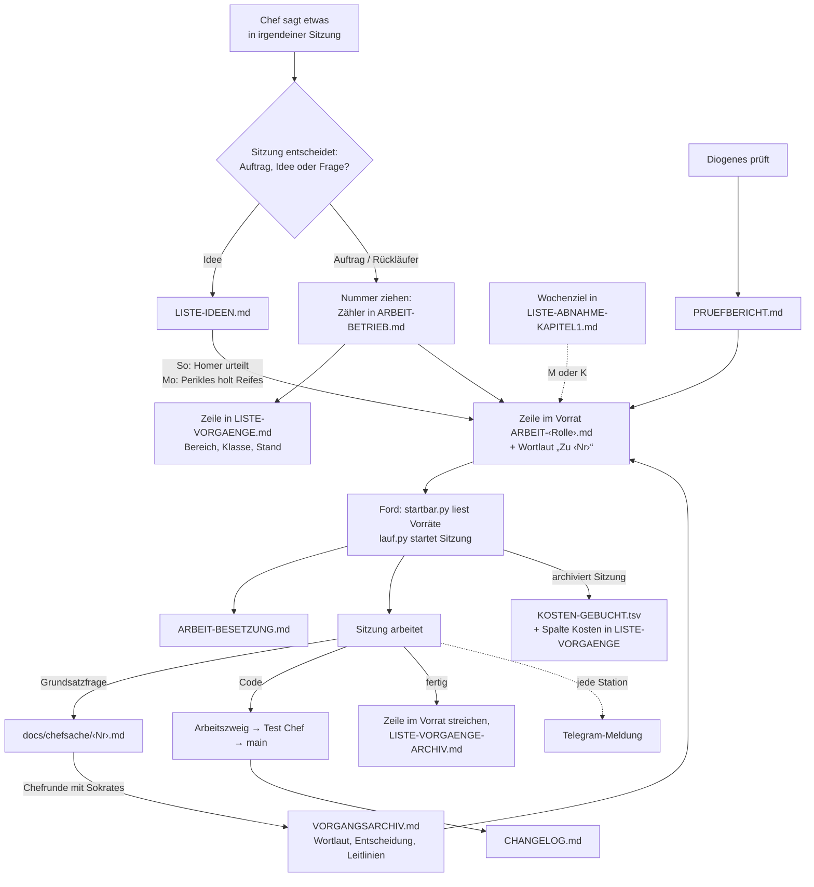

# Ablauf und Dateien (274)

Sokrates, 21.10., 07:2x, auf Frage des Chefs (Wortlaut Zu 274 in `ARBEIT-PROJEKT.md`). Bestandsaufnahme mit Empfehlung, noch nichts umgebaut.

**Chef 07:10** (Wortlaut, gekürzt): „Stell mir doch mal anhand eines kleinen Flussdiagramms oder Ablaufdiagramms … wie unsere ganzen Arbeitsvorräte und Listenvorgänge … ineinander greifen … Welche Dateien gibt es da? Ist da eine überflüssig? … Welche brauchen wir zur Kostenermittlung? … Ziel sollte es mal sein, dass wir das Regelwerk für euch vereinfachen, dass ihr es leichter umsetzen könnt und dass die Dateien halt auch nicht immer so riesig sind.“ **07:22:** „… wenn es bei jemandem rauswandert … verschwindet dann der Vorgang bei dir aus deinem Vorrat oder steht er da weiter … Also warum wandert sozusagen der Eintrag-Vorgang, den es ja nur einmal gibt, nicht rüber?“

**Startlektüre je Rolle** (KB, ohne Grundlast der App; frische Sitzung etwa 90 Tsd. Token, davon unsere Dateien 10–25 Tsd.): Jerry 75, Tom 70, Ford 50, Sokrates 43, Perikles 38 (bis 114 mit ganzem Prüfbericht), Diogenes 34, Homer 33; darin `CLAUDE.md` 15. Teams: `DESIGN-STIL.md` (15) und `CHANGELOG.md`-Kopf (12) erst vor dem ersten Bild oder Build.

## Wandert der Vorgang?

Die **Zeile** wandert schon: am 21.10., 07:2x steht von 58 Vorgängen in den sechs Vorräten nur zwei doppelt, beide gewollt (270: Perikles entscheidet, Diogenes misst; 133: zwei Teams). Chefsache ist kein Vorrat: die Zeile bleibt beim Besitzer mit „wartet auf Chef“, die Datei liegt daneben.

Was **nicht** wandert, sind die Texte daran: Wortlaut, Befund, Begründung („Zu ‹Nr›“) bleiben beim Absender liegen und werden in Chefsache und Vorgangsarchiv noch einmal abgeschrieben. Beispiel Sokrates 21.10. morgens: 6 von 13 „Zu“-Absätzen gehörten zu keiner eigenen Zeile mehr (271, 270 zweimal, Nacht, Uhr, 192); 07:2x gestrichen bzw. zu Diogenes verschoben. **Regel dafür:** der Text geht mit der Zeile, beim Absender bleibt nichts; Chefsache und Vorgangsarchiv verweisen auf den Vorrat statt abzuschreiben.

## Ford

**Chef 07:23** (Wortlaut): „Und wenn du sagst, Ford allein muss 18 KB lesen, ist ja kein Wunder, dass der ständig alles falsch macht. Ich dachte, der muss eine einfache Sache machen. Für was braucht der 18 KB?“

`LISTE-BETRIEB.md` (19 KB): Ablauf eines Laufs 9,4 (12 Schritte), Uhr und Selbstneustart 3,1, Neustart auf Meldung 2,1, Ford 2 1,9 (ruht seit 17.10.), Meldung 1,4, Stellung 0,6; dazu `ROLLE-BETRIEB.md` 5,9. Der Kern sind vier Schritte: `notiz.sh`, Sitzungen in eine Datei, `lauf.py --sperre --besetzung`, Ausgabe Zeile für Zeile ausführen und pushen. Daneben stehen Aufgaben mit eigenem Urteil (Schritt 6 „leer gemeldet“ prüfen, 7 Eingang zuteilen, 8 Nachhalten, 9 „Sitzung hängt“), obwohl Ford laut Rolle „nichts beurteilt“; dort entstehen die Fehler.

**Empfehlung:** Fords Anleitung auf eine Seite (Ziel 3 KB): nur die vier Schritte und die Bedeutung jeder Ausgabezeile von `lauf.py`. Ford 2 aus der Startlektüre. Urteilsaufgaben entweder in `lauf.py` (als Ausgabezeile) oder zu Perikles. **Gegenargument:** was zu Perikles geht, kostet dort das große Modell; was in `lauf.py` geht, ist wieder Bauarbeit.

## Eine zentrale Liste?

**Chef 07:30** (Wortlaut, gekürzt): „Angenommen, wir hätten jetzt eine Vorgangsdatei mit 10.000 Zeilen … jeder schreibt da bloß dahinter … das ist meins … Kannst du das gezielt suchen oder musst du immer alles einlesen? … dann wäre es doch vielleicht doch einfacher, wenn man nicht das alles hin und her kopieren … muss.“

Token kostet nur, was in die Sitzung geholt wird. Gezielte Suche (`grep`) holt nur die Trefferzeilen: „meine Vorgänge“ in `LISTE-VORGAENGE.md` sind heute 1,4 KB, Vorgang 270 eine Zeile; bei 10.000 Zeilen wäre es nicht mehr. Skripte (`startbar.py`, `lauf.py`) lesen ganze Dateien ohne Token-Kosten. Die zentrale Liste gibt es schon (`LISTE-VORGAENGE.md`, Spalte „Vorrat“); doppelt ist, dass Stand und Klasse auch im Vorrat stehen. **Möglich:** die Liste wird die einzige Quelle für Nummer, Besitzer, Klasse, Stand, Vorrang; der Vorrat behält nur Übergabe und „Zu ‹Nr›“. **Bedingungen:** jede Zeile vollständig (Besitzer, Stand in derselben Zeile), Spalte Vorrang statt Zeilenfolge, Regel „suchen, nie ganz lesen“. **Gegenargument:** Umbau von `startbar.py`, `lauf.py`, `regelcheck.py` und allen Rollen; mehr Schreibzugriffe auf eine Datei; nach dem Meilenstein.

## Weg einer Idee

**Ein Satz des Chefs landet heute an bis zu sieben Stellen:** Zähler, `LISTE-VORGAENGE.md`, Vorrat (Zeile und „Zu“ mit Wortlaut), Chefsache-Datei, `VORGANGSARCHIV.md` (Wortlaut noch einmal, dazu Anlass und Leitlinien), Telegram, `CHANGELOG.md`. Der Wortlaut steht oft dreimal. Jede Stelle wird von Werkzeugen gegeneinander geprüft; jede Abweichung ist ein „Pflegefehler“, und den bessert wieder eine Sitzung aus.

## Dateien des Ablaufs

| Datei | KB | Wer liest sie | Nötig? |
|---|---|---|---|
| `CLAUDE.md` | 15 | jede Sitzung beim Start (automatisch) | ja, teuerste Datei (jede Sitzung) |
| `ROLLE-…` (6) | 3–8 | die Rolle beim Start | ja; Stichpunkte statt Prosa |
| `ARBEIT-‹Rolle›` (6 Vorräte) | 6–15 | die Rolle beim Start, `startbar.py` | ja; Herz des Ablaufs |
| `ARBEIT-BETRIEB.md` | 15 | Ford beim Start (Kopf), Werkzeuge | ja; Protokoll unten entbehrlich (steht in Git und Telegram) |
| `ARBEIT-BESETZUNG.md` | 2 | Ford, `lauf.py` | ja |
| `LISTE-BETRIEB.md` | 19 | Ford bei jedem Start ganz | ja, aber zu groß: Ford startet mehrmals täglich neu |
| `LISTE-VORGAENGE.md` | 10 | Werkzeuge, bei Bedarf | ja, für Kosten je Vorgang und Bereich |
| `LISTE-VORGAENGE-ARCHIV.md` | 36 | Werkzeuge (Kosten) | ja, für Kosten; liest kein Mensch |
| `KOSTEN-GEBUCHT.tsv` | 4 | `lauf.py` | ja, verhindert Doppelbuchung |
| `VORGANGSARCHIV.md` | 182 | Sokrates ab letztem Stand, Werkzeuge | ja, aber zu ausführlich: 309 Einträge, Schnitt 585 Zeichen |
| `PRUEFBERICHT.md` | 76 | Perikles „vor jeder Antwort“, Diogenes | ja, aber erledigte Läufe 22–39 nur noch Verlauf |
| `ARBEIT-TAGESBERICHT.md` | 4 | Chef | Probe 247 |
| `LISTE-ABNAHME-KAPITEL1.md` | 3 | Ford, Perikles | ja |
| `LISTE-IDEEN.md` | 21 | Homer sonntags, Perikles montags | ja |
| `FIRMA.md` | 11 | nur bei Anlass | ja |
| `LISTE-RELEASE-NEUSTART.md`, `LISTE-PRUEFUNG.md`, `LISTE-BAUEN-TESTEN.md` | 3–9 | bei Anlass | ja |
| `chefsache/README.md`, `billigen/README.md` | – | wer eine Datei anlegt | ja |

**Für die Kostenermittlung nötig:** `KOSTEN-GEBUCHT.tsv` (je Sitzung), Spalte Kosten in `LISTE-VORGAENGE.md` und `-ARCHIV.md` (je Vorgang, daraus je Bereich), die Zeile „Kosten auf:“ in der Übergabe. Sonst nichts.

**Überflüssig oder erledigt** (kostet nur, wenn jemand sie liest oder durchsucht; Verlauf bleibt in Git):

| Datei | KB | Warum |
|---|---|---|
| `ARBEIT-ARCHIV.md` | 504 | eingefroren seit 16.10.; Werkzeuge nehmen sie eigens von Prüfungen aus |
| `LISTE-ROLLENKONZEPT-98.md` | 25 | Entwurf von 98, umgesetzt in den `ROLLE-…` |
| `LISTE-MORGENBERICHT-19-10.md` | 4 | einmaliger Bericht |
| `LISTE-NIEDERLASSUNG.md` | 5 | ruht seit 17.10. (159) |
| `DESIGN-ZWISCHENBILD.md` | 10 | aus einem Artefakt übernommen (246.1), aber `notiz.sh` meldet sie als „alte Datei, löschen“: Widerspruch, eins von beiden muss weichen |

## Wo es wehtut

1. **Doppelte Buchführung.** Jeder Vorgang steht im Vorrat und in `LISTE-VORGAENGE.md`, der Stand in beiden; Entscheidungen mit Wortlaut in Vorrat, Chefsache und Vorgangsarchiv.
2. **Regeln über zehn Dateien verteilt** (`CLAUDE.md`, `FIRMA.md`, `LISTE-BETRIEB.md`, sechs Rollendateien, zwei README in der Chefsache, Release, Prüfung). Dieselbe Regel steht an zwei oder drei Stellen leicht verschieden; daraus entstehen die Fehler, die morgens umgebaut werden.
3. **Begründungen und Verlauf im Regeltext** (Nummern in Klammern, „seit“, „ersetzt“): wer eine Regel lesen will, liest ihre Geschichte mit.
4. **Groß sind nicht die Archive, sondern was oft gelesen wird:** `CLAUDE.md` (jede Sitzung), `LISTE-BETRIEB.md` (jeder Ford-Start), Vorräte (jeder Start), Prüfbericht (Perikles laufend). Ein großes Archiv, das keiner liest, kostet nichts.

## Empfehlung

In dieser Reihenfolge, je Schritt eine Prüfung durch Diogenes, ob eine Regel verloren ging; danach eine Woche nichts mehr am Ablauf ändern.

1. **Aufräumen ohne Risiko (Perikles, 1 Sitzung):** die fünf Dateien oben löschen (Git behält sie), Inhaltsverzeichnis anpassen; Protokoll aus `ARBEIT-BETRIEB.md` streichen (Telegram und Git reichen); Prüfbericht nur offene Befunde, erledigte Läufe nach `PRUEFBERICHT-ARCHIV.md` verschieben (beim Start nicht gelesen; Chef 07:36: „Gibt es denn ein Prüfbericht-Archiv, wo trotzdem alles drinsteht, um das nachzuhalten?“).
2. **Vorgangsarchiv knapp:** neue Einträge höchstens etwa 250 Zeichen: Nummer, Datum, Entscheidung, Leitlinie, Antwort des Chefs („270 ja“). Anlass und langer Wortlaut stehen schon im Vorrat und in Git. Alte Einträge bleiben.
3. **Eine Regel, ein Ort:** `CLAUDE.md` nur, was jede Sitzung braucht (Ziel 8 KB); alles Rollenspezifische in die Rollendatei, alles Fords in `LISTE-BETRIEB.md`; Stichpunkte, keine Nummern, kein Verlauf. Probe an `ROLLE-PROJEKT.md` (274).
4. **Später, nur wenn 1–3 nicht reichen:** `LISTE-VORGAENGE.md` von `lauf.py` aus den Vorräten erzeugen lassen (Bereich als Spalte im Vorrat), dann gibt es den Stand nur noch an einem Ort.

**Stärkstes Gegenargument:** Das ist wieder ein Umbau, und Umbauten waren heute Morgen 25–28 $ und die Fehlerquelle selbst. Schritt 3 berührt jede Rolle; geht dabei eine Regel verloren, fällt es erst Tage später auf. Darum Schritt 1 sofort (reines Löschen), 2 und 3 nur mit Prüfung und nur, wenn der Chef es will; 4 erst nach dem Meilenstein.

**Ersparnis grob:** Schritt 1 und 3 zusammen etwa 15–25 KB weniger Startlektüre je Sitzung (5–8 Tsd. Token), bei Ford mehr, weil er am häufigsten startet; weniger Pflegefehler, weil eine Regel nicht mehr an drei Orten gepflegt wird.
