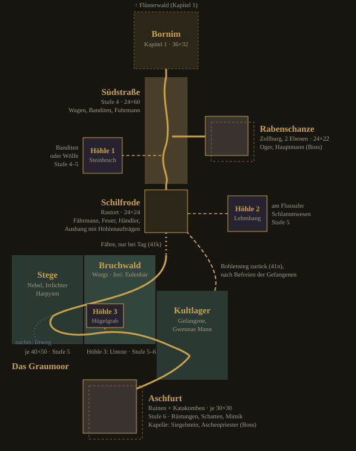

# Storyplan Kapitel 2 – Das Graumoor (Entwurf)

Überblick und Lesart: [`STORY-PLAN.md`](STORY-PLAN.md); Texte: [`STORY-K2-ENTWURF.md`](STORY-K2-ENTWURF.md). Aus dem Docs-Dokument umgezogen 19.10. (99g.1).

Entschieden (13.10.): Mischung, also ein Kult mit weitergegebenem Titel, Ziel ist das Siegel von vor hundert Jahren; am Ende von Kapitel 2 erfährt der Held nur vom Kult. Hier sammeln wir, was Kapitel 1 schon versprochen hat und was die Notizen vorgeben, dann entwickeln wir den Plot im Gespräch.

## Grobzusammenfassung (Entwurf Sokrates, 13.10.)

Arbeitstitel **Das Graumoor**, Stufe 6 bis 8. Der Held folgt den Verschleppten nach Süden und stößt auf einen Kult, der das alte Siegel brechen will. Wer der Prophet ist, bleibt offen.

**Auftakt (angepasst 13.10., 18:15):** Den Anstoß gibt Lyra nach der Tempelszene: Graks Leute brachten Gefangene in ein Lager im Süden (68j–m). Die Südstraße ist schon offen (67), niemand schickt den Helden los. Dass die Fuhrleute die Straße seit dem Frühjahr meiden und Thessas Regale dünner werden, bleibt Hörensagen. Lyra hat in den Tempelchroniken gelesen: Das Sonnenamulett ist nur eine Hälfte eines Siegels, das vor hundert Jahren gesetzt wurde.

1. **Die Südstraße** (Gebiet Stufe 4): umgestürzte Wagen, Banditen statt Goblins. Ein überlebender Fuhrmann erzählt: Die Banditen nehmen keine Ware, sie nehmen Leute.
2. **Die Rabenschanze:** verfallene Zollburg an der Straße, Sitz des Banditenhauptmanns Vesk (Boss), ein Oger hält das Tor, ein Mauerbruch führt an ihm vorbei. Beim Hauptmann: Silber aus Aschfurt und eine Liste mit Namen, darauf Gwennas Mann. Die Leute gingen „ins Moor, an die Grauen“.
3. **Schilfrode** (neuer Rastort): Fährdorf am Moorrand, arm und misstrauisch. Fährmann, Rastfeuer, kleiner Händler. Nachts verschwinden Leute, man schiebt es auf die Irrlichter.
4. **Das Graumoor** (Gebiet Stufe 5, große Karte): Nebel, Stege, Irrlichter, Harpyien, Worgs; frei ein Eulenbär im Bruchwald. Ein Lager der Kultisten mit Gefangenen. Gwennas Mann lebt, ist aber gebrochen. Ihn heimzubringen ist eine freie Wahl, kein Muss.
5. **Aschfurt** (Ruinen, Gebiet Stufe 6): eine Stadt, die vor hundert Jahren in einer Nacht verbrannte und im Moor versank. Belebte Rüstungen (die alte Stadtwache), Schatten, eine Mimik, im Keller ein Gelatinewürfel. Unter der Kapelle des Morgenlichts liegt die zweite Hälfte des Siegels, ein Siegelstein.
6. **Das Ritual (angepasst 2a):** Im Kultlager sitzen nur die Übrigen; die „Erwählten“ wurden kurz vorher nach Aschfurt gebracht, das erzählt Gwennas Mann. Dort will der Aschenpriester, Anführer dieser Zelle, den Siegelstein mit ihren Seelen brechen. Das Ritual dauert lange und erreicht seinen Höhepunkt erst, wenn der Held die Kapelle betritt (Blende statt Termin, keine Uhr). Boss: der Aschenpriester mit einem Gruft-Unhold, der aus einem Opfer entstanden ist. Der Stein bekommt einen Riss, hält aber.
7. **Heimkehr:** Lyra deutet die Funde aus Aschfurt. Der Tag der Asche ist die Nacht, in der Aschfurt brannte, und sie kehrt wieder, wenn beide Hälften fallen. Der Kult nennt sich „die Grauen“ (Arbeitsname), der Prophet ist für ihn ein Mensch, kein Gott. Letzter Satz des Priesters: „Ein Auge schließt sich, ein anderes öffnet sich.“ Das ist die Spur zum weitergegebenen Titel, aufgelöst in Kapitel 3 oder 4.

**Am Ende weiß der Held:** Es gibt einen Kult, er will das Siegel brechen, und Bornims Amulett ist die andere Hälfte. **Er weiß nicht:** wer der Prophet ist und dass der Titel weitergegeben wird.

**Entschieden 13.10., 18:15 (Nutzer: „Ja, mach das so“):**

- **2a** Lager und Ritual wie oben: die Übrigen im Lager, die Erwählten in Aschfurt, Höhepunkt beim Eintreten des Helden.
- **2b** Der Hinweis „ins Moor, an die Grauen“ steht an zwei Stellen (Hauptmann und Kultlager); alle Texte stimmen in beiden Reihenfolgen, die Rabenschanze ist Wahl, keine Pflicht.
- **2c** Der alte Kael öffnet nach der Tempelszene seine Tür: Sein Großvater überlebte den Brand von Aschfurt; so hört der Spieler den Namen, bevor er ihn auf der Karte sieht.
- **2d** Der Fuhrmann will seinen Wagen und seine Ladung zurück: ein bodenständiger Grund, kein weiterer Verschleppter.
- Gwennas Mann: in Kapitel 1 von den Goblins verschleppt (nur der Ring kam zurück), von Grak nach Süden verkauft; Gwenna hält ihn für tot.

**Entschieden 13.10., 18:23 (Station 1):** **3a** Der Fuhrmann heißt Jorrit und stammt aus Schilfrode. **3b** Er kämpft nicht mit, duckt sich weg und wartet vor der Rabenschanze. **3c** Holt der Held den Wagen zurück, fährt Jorrit nach Bornim, und Thessas Regale füllen sich sichtbar. 3d ja: Kaels drei Sätze bleiben wie entworfen (Großvater entkam dem brennenden Aschfurt; der Graue Prophet war vor hundert Jahren dort, der heutige kann nicht derselbe sein).

**3e ja (Nutzer 13.10., im Sprachmodus): Schilfrode mit und ohne Jorrits Fürsprache.**

- **Ohne Jorrit:** Türen zu, Leute einsilbig, kein Hörensagen; Händler nur Grundversorgung (Heiltränke, Proviant); der Fährmann setzt Fremde nicht über, der Weg ins Moor geht dann nur durch den Bruchwald; nur zwei Aufträge am Aushang. Den Anstoß zum Zurückgehen gibt das Dorf selbst, z. B. die Frau des Fährmanns: Jorrit ist seit Tagen überfällig.
- **Feste Grenze:** Rastfeuer, Grundversorgung und der Weg ins Moor bleiben immer offen; Schilfrode wirkt verschlossen, sperrt aber nie den Weg.
- **Mit Jorrit:** Türen öffnen sich, Hörensagen beginnt, Händler verkauft alles, Fährmann setzt über, alle fünf bis sechs Aufträge hängen aus.
- **Beide Reihenfolgen:** Stürmt der Held die Rabenschanze ohne Jorrit, steht der Wagen im Burghof; trifft er Jorrit danach am Graben, holt der ihn selbst.

**Entschieden 13.10., 19:25 (Station 2, Rabenschanze):** **4a** Ein Mauerbruch an der Rückseite führt am Oger vorbei in die Burg; der zweite Weg ohne Schwert. **4b** Das Silber der Banditen stammt aus Aschfurt; es verbindet die Station mit der Vorgeschichte. **4c** Beim Hauptmann liegt eine Liste mit dem Vermerk „Ring fehlt“; zweiter Hinweis auf den Kult, damit jede Reihenfolge trägt. **4d** Der Anführer heißt Hauptmann Vesk.

**Warum so:** Die Südstraße löst ein, was 67 in Kapitel 1 verspricht. Moor und Ruinenstadt sind ein Ort: Das Moor trägt die große Karte, die Ruine übernimmt die Rolle der Höhle. Gwennas Mann gibt dem Kapitel ein menschliches Gesicht (Anmerkung 2). Fast alle Monster der Liste haben einen Platz; den Gnoll spare ich für Kapitel 3. Schilfrode hält das Lagerfeuer-Prinzip und gibt Dorfgefühl, ohne Bornim zu kopieren.

## Gebiete, Wege und Umfang (entschieden 13.10.)

Kapitel 2 bietet im Umfang deutlich mehr als Kapitel 1 (41i). Die Lage der Gebiete zeigt die Karte (Norden oben, ein Feld = 3 Bildpunkte, Bornim zum Vergleich; gestrichelter Rahmen = zweite Ebene):

| Gebiet | Felder | Stufe |
|---|---:|---|
| Südstraße (24×60) | 1.440 | 4 |
| Rabenschanze (24×22, 2 Ebenen) | 1.056 | 4–5 |
| Schilfrode (24×24) | 576 | Rast |
| Graumoor (Stege, Bruchwald, Kultlager, je 40×50) | 6.000 | 5 |
| Aschfurt (Ruinen, Katakomben, je 30×30) | 1.800 | 6 |
| 3 Zufallshöhlen (Steinbruch, Lehmhang, Hügelgrab) | 1.320 | 4–6 |
| **Kapitel 2 gesamt** | **≈ 12.200** | |
| Kapitel 1 (Dorf, Waldrand, tiefer Wald, Höhle) | ≈ 3.900 | 1–5 |

Spieldauer geschätzt, nicht gemessen: Kapitel 1 etwa 1,5–2 Stunden, Kapitel 2 etwa 4–6 Stunden.

**Gebiete (41j):** fünf Gebiete.

- **Südstraße**
- **Rabenschanze**
- **Schilfrode** (Rastort)
- **Graumoor**, dreiteilig (Aufteilung siehe Karte)
- **Aschfurt** mit Katakomben

**Wege und Verbindungen (41n, 41m-Rest):**

- Nach Bornim führt über Land nur die Südstraße, dazu der Bohlensteg.
- Den Bohlensteg zwischen Kultlager und Schilfrode legt der Held frei, nachdem er die Gefangenen befreit hat.
- Das Kultlager erreicht man nur über die Stege oder den Bruchwald.
- Aschfurt im Moor erreicht man nur vom Kultlager aus.

**Zufallshöhlen (41j, 41m, 41o):** drei, je eine pro Landschaft. Alle Höhlen sind frei betretbar.

- Steinbruch an der Südstraße
- Lehmhang bei Schilfrode
- Hügelgrab im Bruchwald

**Nebenaufgaben (41j, 41m, 41p):** fünf bis sechs. Die Aufträge hängen am Aushang in Schilfrode. Der Aushang nennt den Ort in Worten, nicht als Kartenmarke. Welche Aufgaben es sind und ihre Texte: offen.

**Tag und Nacht (41k):** Das Moor ist bei Nacht gefährlicher. Die Fähre fährt nur bei Tag.

**Begleiter (41l):** Es gibt keinen festen Begleiter. Der Fuhrmann begleitet den Helden bis zur Rabenschanze. *Überholt durch 168 (18.10.): Garrick geht in Kapitel 2 fest an der Seite des Helden; Grund und Satz „kommt mit“ offen (41).*

**Noch offen:** Dialoge, Aushänge und Erzähltexte zu Kapitel 2; Inhalt der Nebenaufgaben.

## Station 3: Das Kultlager (entschieden 14.10., 09:3x: 5a, 5c–5f ja, 5b noch nicht)

Lage: eine Insel im mittleren Graumoor, erreichbar über die Stege (Fähre bei Tag, also mit Jorrits Fürsprache) oder durch den Bruchwald. Palisade aus Schwemmholz, drei Zelte, ein Pferch aus Weidenruten für die Gefangenen, ein Feuer mit grauem Rauch. Vom Lager führt ein versunkener Damm nach Aschfurt.

Wer dort ist: fünf bis sechs Kultisten in grauen Kutten, zwei Worgs am Pferch, dazu ihr Aufseher (Name offen, Vorschlag **Brand**), ein kleiner Boss. Im Pferch sitzen die Übrigen, die nicht erwählt wurden, weil sie zu alt, zu krank oder zu widerspenstig sind. Unter ihnen ist Tobin, dazu drei oder vier Leute aus Schilfrode und von der Südstraße.

**5a Zwei Wege ins Lager (72.5).** (1) Kampf am Tor gegen Kultisten, Worgs und den Aufseher. (2) Am Steg hält ein junger Kultist Wache: Merles und Ansels Sohn (Name offen), der für Silber zu den Grauen ging. Hat der Held mit Merle gesprochen, kann er ihm ihre Worte ausrichten. Dann lässt der Sohn das Seitentor offen, und der Held erreicht den Pferch ohne Kampf am Tor; den Aufseher muss er trotzdem stellen. Ohne Merles Worte schlägt der Sohn Alarm. Wissen statt Würfel, es braucht also kein neues Charisma-System. **Gegenargument:** eine weitere Dialogverzweigung kostet Text und Prüfaufwand. **Empfehlung: ja.** Es ist der billigste zweite Weg und gibt Schilfrode ein Gesicht im Moor.

**5b Tag und Nacht im Lager.** Nachts schlafen die Kultisten, und nur zwei Wachen stehen; dafür ist das Moor auf dem Weg dorthin gefährlicher (41k). **Gegenargument:** Tom und Jerry müssten zwei Belegungen des Lagers bauen und prüfen, und 5a ist schon ein zweiter Weg. **Empfehlung: noch nicht.** Das Lager bleibt Tag und Nacht gleich, nur das Moor ändert sich.

**5c Der zweite Hinweis (2b).** Beim Aufseher liegt die Gegenliste zu Vesks Liste: die Namen der Erwählten mit dem Vermerk „nach Aschfurt“. Wer die Rabenschanze ausgelassen hat, erfährt hier, wohin die Grauen die Leute bringen; wer dort war, erkennt die Namen wieder. **Empfehlung: ja.**

**5d Tobin weist den Weg.** Erst wenn Tobin erzählt hat, zeigt sich der versunkene Damm nach Aschfurt (Pfähle im Nebel, vorher nur Moor). So kommt das Wissen vor der Karte (62c), und Aschfurt erreicht man nur vom Lager aus. **Gegenargument:** Ein Spieler, der Tobin nicht anspricht, steckt fest. Darum spricht Tobin den Helden von selbst an, sobald der Pferch offen ist. **Empfehlung: ja.**

**5e Nach der Befreiung.** Die Gefangenen reißen Bohlen aus der Palisade und legen den Steg nach Schilfrode frei (41n). Danach gehen sie allein heim, Merles Sohn mit ihnen, wenn der Held ihn verschont hat. Tobin fragt, ob er nach Bornim soll; der Held entscheidet: „Geh heim zu Gwenna“ oder „Bleib in Schilfrode, bis du wieder Kraft hast“. Im ersten Fall sitzt Tobin später still neben Gwenna, im zweiten sieht man ihn bei Merle. **Empfehlung: ja.**

**5f Freie Welt.** Das Lager wartet ohne Zeitdruck (Blende statt Termin): Die Erwählten sind schon fort, die Übrigen bleiben im Pferch, bis der Held kommt. Kommt der Held erst nach Aschfurt, bleibt der Damm unsichtbar, also gibt es keine falsche Reihenfolge. **Empfehlung: ja.**

## Station 4: Aschfurt (Entwurf Sokrates, 14.10., offen)

**Entschieden 14.10., 09:3x (Nutzer):** 6a–6f ja (6b–6d nach Erklärung, 09:4x; 6c passend zum Leitbild: dunkel, düster). Kaels Laterne steht schon in Kapitel 1 neben seiner Tür (Thema 80, Tom).

Aschfurt verbrannte vor hundert Jahren in einer Nacht und versank im Moor. Man erreicht es nur über den Damm vom Kultlager aus (5d). Gegner laut Plan: belebte Rüstungen (die alte Stadtwache), Schatten, eine Mimik, im Keller ein Gelatinewürfel; am Ende der Aschenpriester mit dem Gruft-Unhold.

**6a Drei Teile.** (1) Die versunkene Stadt, halb im Wasser, mit Mauerresten, verkohlter Glocke und Stadtwache in Rüstung. (2) Die Katakomben unter der Stadt mit Schatten und Mimik. (3) Die Kapelle des Morgenlichts, darunter die Gruft mit dem Siegelstein und dem Ritual. So übernimmt Aschfurt die Rolle der Blutzahnhöhle: Vorposten, Tiefe, Halle. **Gegenargument:** drei Teile sind mehr Bauaufwand als die Höhle; dafür verlangt 41i ausdrücklich mehr Umfang. **Empfehlung: ja.**

**6b Gelatinewürfel freiwillig.** Er liegt in einem Seitenkeller der Katakomben, abseits des Weges, wie Grimmzahn in Kapitel 1, mit eigener Belohnung. **Gegenargument:** Ein Pflicht-Vorboss vor der Kapelle (wie Krogg) gliedert das Kapitel klarer. Den Rhythmus trägt hier aber die Kapelle selbst. **Empfehlung: ja.**

**6c Die Erwählten überleben, bis auf einen.** Besiegt der Held den Priester, leben die Erwählten. Einer ist schon zum Gruft-Unhold geworden; sein Name steht auf der Liste aus dem Kultlager (5c), und am Ölhaut-Rest erkennt man ihn als Mann aus Schilfrode. **Gegenargument:** Ein Toter macht das Ende schwerer, und es gibt keinen Weg, ihn zu retten. Die Alternative, dass alle leben, wäre weicher, nähme dem Kult aber die Gefahr. **Empfehlung: einer verloren.** Kapitel 1 kennt keinen Verlust, und der Kult soll ernst wirken.

**6d Kaels Laterne.** In der Stadt steht ein Haus mit dem Familienzeichen, das auch an Kaels angesengter Laterne ist; neben der Tür ist ein leerer Haken. Kein Text nötig: Wer Kael zugehört hat, versteht es. Zurück in Bornim sagt Kael einen Satz dazu, wenn der Held davon erzählt. **Gegenargument:** Viele Spieler übersehen so etwas. Es kostet aber fast nichts und belohnt Aufmerksamkeit (49/50). **Empfehlung: ja.**

**6e Nach dem Kampf.** Der Siegelstein bekommt einen Riss, hält aber. Beim Priester liegen die Funde für Lyra (Ritualbuch und Siegelabdruck). Die Erwählten gehen über den Damm heim. Der Held darf in Aschfurt bleiben und weiter erkunden; ein Heimweg als Blende nach Schilfrode wird nur angeboten (Wahl, kein Zwang). **Empfehlung: ja.**

**6f Ende von Kapitel 2.** Bei Lyra in Bornim folgt die Zwischensequenz zum Kapitelende (70.4). Lyra deutet die Funde (Tag der Asche, zwei Hälften des Siegels, der Kult „die Grauen“), und der letzte Satz des Priesters bleibt als Faden hängen. Auslöser ist der Besuch bei Lyra, kein Termin (Blende statt Termin). **Empfehlung: ja.**

## Feste Merkmale der Figuren (70.2 ja, 14.10.; jetzt in LISTE-FIGUREN.md)

Regel aus DESIGN-STIL: jede Figur an Umriss und festem Merkmal erkennbar, auch von hinten oder als Schattenriss. Die Grundlage ist das, was die Figuren im Spiel schon tragen (MapFolk); neu ist nur, was mit „neu“ markiert ist.

- **Aldric:** hager, langer weißer Bart, pflaumenfarbene Robe; Merkmal: Stab quer auf der Schulter.
- **Rowena:** kräftig, Ärmel hochgekrempelt; Merkmal: helle Schürze, neu ein Krug in der Hand.
- **Lyra:** schlank, weiße Robe; Merkmal: Stirnreif.
- **Osric:** kahl, Robe aus ungefärbter Wolle; Merkmal: Sonne auf der Brust, in Szenen eine Kerze.
- **Jorin:** Kettenhemd, Helm; Merkmal: blauer Wappenrock, Speer auf der Schulter.
- **Thessa:** rost- und ockerfarbene Kleidung; Merkmal: Reiseumhang in Rostrot.
- **Borin:** Zwerg; Merkmal: Hammer auf der Schulter.
- **Garrick:** breit, kurzer Vollbart; Merkmal: Kapuze, Langbogen quer über dem Rücken.
- **Morwen:** alt, moosgrüne Robe; Merkmal: Kapuze, neu ein Kräuterbündel am Gürtel.
- **Gwenna:** Fischerin mit Schal; neu als Merkmal: Tobins Ring an einer Schnur um den Hals (Gegenstück zu Tobins leerem Ringfinger).
- **Kael, Jorrit, Vesk, Tobin, Ansel, Merle, Wendel, Aschenpriester:** wie in der Figurentabelle oben.

**Gegenargument:** Drei Figuren tragen eine lange Stange (Aldric den Stab, Jorin den Speer, Ansel den Stakstock), und Kael geht am Stock. Im Schattenriss unterscheiden sie sich nur durch die Haltung: Aldrics Stab liegt quer auf der Schulter, Jorins Speer hat eine Spitze, Ansels Stock steht senkrecht und ist viel länger, Kael ist gebeugt und hat Decke und Laterne. **Empfehlung:** so lassen und am ersten Standbild prüfen; reicht das nicht, bekommt Ansel statt des Stakstocks eine Reuse.

**Fäden aus Kapitel 1**

- Der Graue Prophet zahlt Gold für Seelen und wollte Amulett und Priesterin. Was hat er mit beidem vor?
- Der Tag der Asche naht. Was ist das, und wann?
- Lyra hört seine Stimme im Traum.
- Am Steinkreis: kalte Asche, ein grauer Fetzen mit offenem Auge, Stiefelspuren nach Norden. Kein Goblin, ein Mensch.
- Grimmzahns rot glühende Augen: nur ein Wolf, oder auch schon sein Werk?
- Noch ohne Auftritt: Bäcker Edrik, der alte Kael, Schmied Dorran.

**Vorgaben aus den Notizen**

- Stufe am Ende: 8. Ausrüstungsdeckel +2 / +3 (`DESIGN-BALANCE.md`).
- Neue Region, Karten deutlich größer als in Kapitel 1. Ideen dort: Sumpf oder Ruinenstadt.
- Monster auf der Liste: Banditen, Kultisten, Gnoll, Worg, Harpyie, Belebte Rüstung, Mimik, Oger, Eulenbär. Untote: Schatten, Gruft-Unhold, Irrlicht. Bosse: Banditenhauptmann, Ogerhäuptling, Gelatinewürfel.
- Möglich: Lyra oder Garrick als Begleiter, Gesprächsoptionen nach Charisma, Schmied Dorran mit Werkstatt.

**Fragen für unser Gespräch**

1. Wer ist der Graue Prophet, und was will er wirklich?
2. Wohin führt Kapitel 2: Sumpf, Ruinenstadt oder etwas anderes?
3. Erfährt der Held am Ende von Kapitel 2 schon, wer der Prophet ist, oder nur ein weiteres Stück?
4. Kommt ein Begleiter dazu, und wenn ja, wer?
