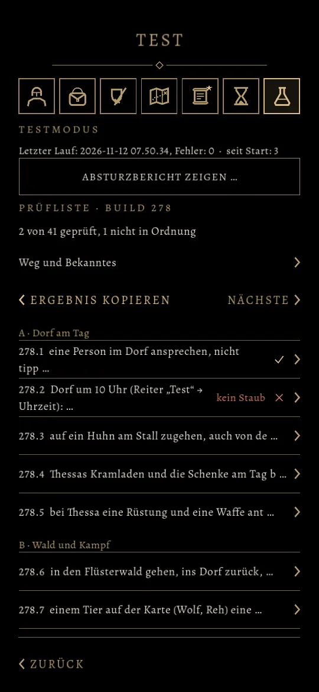
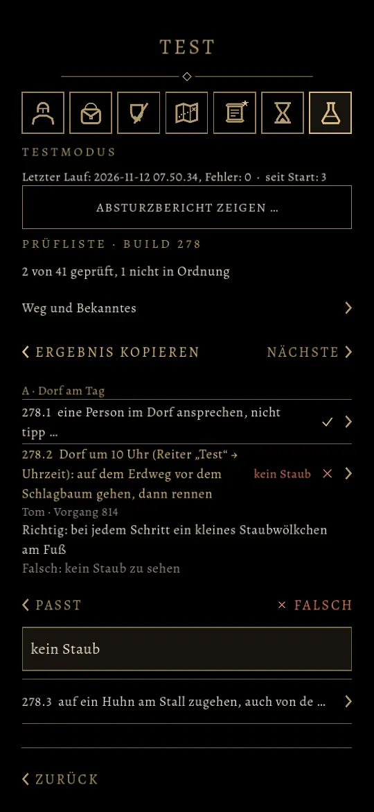

# 1020.1 · Prüfliste im Reiter „Test“ · Tom · 12.11., 08:19

[Bild von 12.11., 08:20](https://github.com/tramour-cmyk/androidapp_rpg_bornim/blob/bilder/2026-11/12-0820-1020.1-Tom-2.png) (eingetragen von meldung.sh, Tom)

[Bild von 12.11., 08:20](https://github.com/tramour-cmyk/androidapp_rpg_bornim/blob/bilder/2026-11/12-0820-1020.1-Tom.png) (eingetragen von meldung.sh, Tom)

Geprüft an: [e76a179d0](https://github.com/tramour-cmyk/androidapp_rpg_bornim/commit/e76a179d0)

Gebaut auf `claude/tom-1020-pruefliste`, Bilder vom Rechner mit der Prüfliste von Build 278; kommt mit dem nächsten Sammelbuild.

 

Links: oben der Zähler, „Weg und Bekanntes“ (Weg durchs Spiel und was rot und bekannt ist), „Ergebnis kopieren“ und „Nächste“ (springt zur nächsten offenen Zeile); rechts in jeder Zeile ein Haken, oder ein Kreuz mit deinem Wort. Rechts: eine angetippte Zeile zeigt, woran sie richtig und woran falsch ist, darunter „Passt“ (weiter zur nächsten offenen Zeile) und „Falsch“ mit einem Feld für ein Wort. Das Ergebnis bleibt über einen Neustart der App gespeichert; „Ergebnis kopieren“ legt es als Text in die Zwischenablage, zum Einfügen in den Chat.

Sag „1020.1 passt“ oder was anders sein soll.
