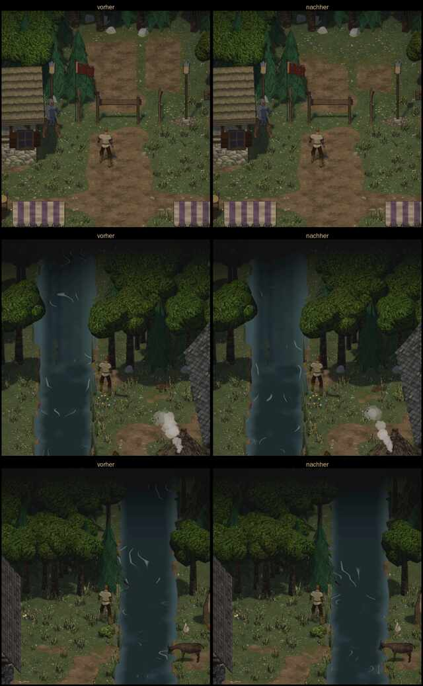

# 1022 · Kartenrand, Rest (1) und (2) weg, vorher/nachher · Tom · 13.11., 01:05

E Welt · Zweig `claude/spike-1022-kartenrand` · auf dem Bauserver mit Kaufmodellen, wie im Spiel

Geprüft an: [Lauf 43326236234](https://github.com/tramour-cmyk/androidapp_rpg_bornim/actions/runs/43326236234), [Commit 6c56b43](https://github.com/tramour-cmyk/androidapp_rpg_bornim/commit/6c56b43fc)

Zum Vorentscheid von Sokrates (12.11., 23:50, „Rest weg (1), (2)“). Nur diese zwei Stellen, so aufgenommen wie um 23:42: links vorher (Stand 23:42), rechts nachher.

- **(1) Schlagbaum:** die Wegstücke dahinter gehen jetzt vor den Bäumen ins Gras über, statt hell an der Baumreihe zu enden. Sie sind matter als vorher, aber noch zu sehen.
- **(2) Fluss:** die Wellenlinien verlöschen mit dem Wasser.
- **Mir ist aufgefallen:** beim Fluss bleibt die Wasserfläche am oberen Bildrand etwas heller als die Kronen daneben.
- Rot waren nur zwei fremde Tests (Prüfliste 1020, Ziege 1079), die mit dem Rand nichts zu tun haben.

**Was du sagen sollst:** „1022 passt“ (geht in den nächsten Build); oder dein Urteil zu den Bildern. Heute Nacht urteilt Sokrates an deiner Stelle (1077).
