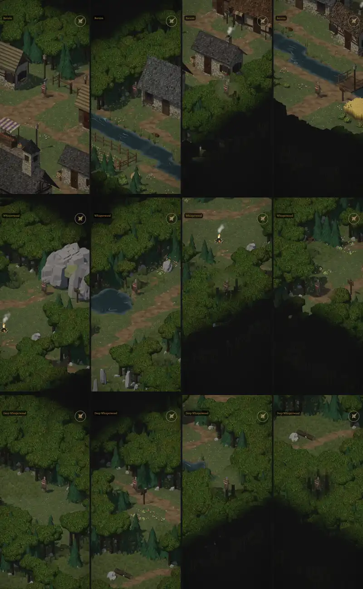

# 1022 · Kartenrand aller Gebietskarten, nachher · Tom (Spike) · 12.11., 10:38

[Bild von 12.11., 10:39](https://github.com/tramour-cmyk/androidapp_rpg_bornim/blob/bilder/2026-11/12-1039-1022-Spike.png) (eingetragen von meldung.sh, Spike)

E Welt · Zweig `claude/tom-1022-kartenrand` · am Rechner ohne Kaufmodelle (ohne Leute und Monster)

Geprüft an: [Commit 55901b2](https://github.com/tramour-cmyk/androidapp_rpg_bornim/commit/55901b2ed6ca5ca4fc376a6983aea05d22122b52)

Oben Dorf, Mitte Flüsterwald, unten Tiefer Wald; je Reihe vom Rand aus nach Norden, Westen, Osten, Süden, bei Tag.

- Norden und Westen: Wald dicht, mehrere Reihen, läuft ins Dunkel; der Weg hinter dem Schlagbaum endet im Wald.
- **Offen, Süden und Osten** (zur Kamera hin): der Wald hinter dem Rand steht als harte schwarze Wand mit gezackter Kronenkante; nicht behoben, Probelauf-Grenze erreicht.
- Vorher-Bilder fehlen aus demselben Grund; für den Norden ist dein Bild aus Build 278 das Vorher.
- Automatisch geprüft: `rand_1022` grün auf allen drei Gebietskarten.

**Was du sagen sollst:** „1022 ja“: Süden und Osten weich auslaufen lassen (das Dunkel richtet sich nach dem Boden, den eine Krone im Bild verdeckt), dann ein Lauf mit Bildpaar vorher/nachher; oder dein Urteil zum Bild.
