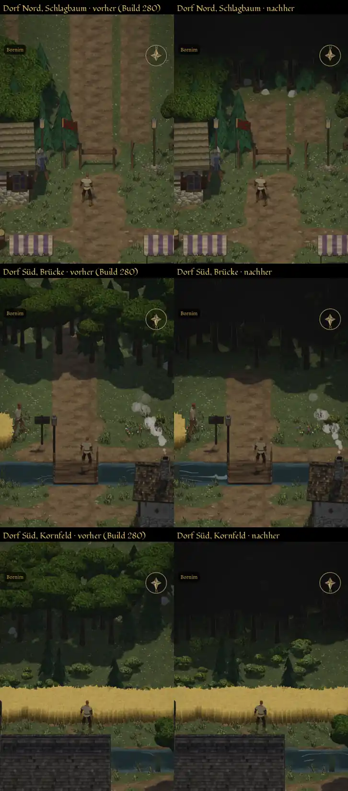
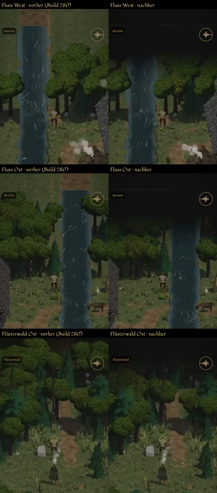
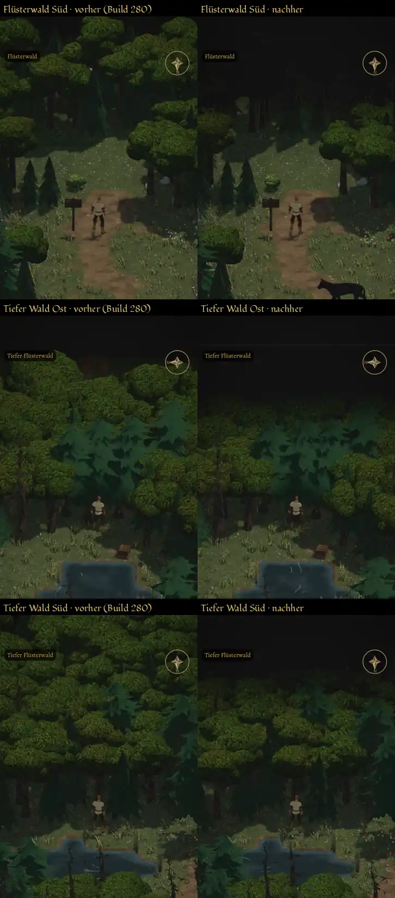

# 1022 · Kartenrand aus der Spielansicht, vorher/nachher · Tom (Spike) · 12.11., 17:58

[Bild von 12.11., 17:59](https://github.com/tramour-cmyk/androidapp_rpg_bornim/blob/bilder/2026-11/12-1759-1022-Spike.png) (eingetragen von meldung.sh, Spike)

E Welt · Zweig `claude/tom-1022-kartenrand` · auf dem Bauserver mit Kaufmodellen, wie im Spiel

Geprüft an: [Lauf 43256618987](https://github.com/tramour-cmyk/androidapp_rpg_bornim/actions/runs/43256618987), [Commit 327ff24](https://github.com/tramour-cmyk/androidapp_rpg_bornim/commit/327ff24f7)

So aufgenommen: Spielansicht bei Tag, die Karte jeweils so gedreht, dass der Held zum Rand schaut (der Rand liegt oben im Bild). Links vorher (Stand Build 280, so wie du es gespielt hast), rechts nachher (1022). Je Bild die obere Hälfte des Schirms bis knapp unter den Helden.

- **Vorher:** hinter dem Schlagbaum und hinter der Brücke läuft der Weg offen bis an den oberen Bildrand; am Fluss endet das Wasser vor einem Stück Weg und Wiese; in den Wäldern hört der Wald in hellem Grün auf.
- **Nachher:** hinter dem Rand Wald und dann Dunkel; der Weg hinter Schlagbaum und Brücke endet nach etwa zwei Kacheln im Dunkel; der Fluss läuft ins Dunkel; in den Wäldern dasselbe auf allen Seiten.
- **Rest, mir ist aufgefallen:** (1) im Dunkel schimmern schwache Stämme und Halme durch (gut zu sehen in Dorf Nord, Brücke, Flüsterwald Ost und Süd); (2) am Fluss im Westen und Osten endet das Wasser mit einer geraden waagerechten Kante im Dunkel; (3) hinter dem Schlagbaum bleiben zwei helle Stücke Weg vor dem Dunkel stehen.
- Der Bildlauf war rot an `schalter_1024` (bekannt, Vorgang 1029 behebt es auf `claude/build-280`, nicht auf diesem Zweig), die Bilder betrifft das nicht.

**Was du sagen sollst:** „1022 passt“ (fährt im nächsten Build); oder „Rest weg“ mit den Nummern (1), (2), (3), die weg sollen (dann ein weiterer Lauf); oder dein Urteil zu den Bildern.
