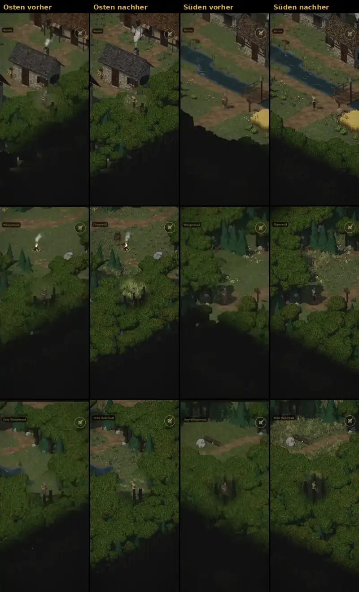

# 1022 · Kartenrand Süden und Osten, vorher/nachher · Tom · 12.11., 15:36

E Welt · Zweig `claude/tom-1022-kartenrand` · am Rechner ohne Kaufmodelle (ohne Leute und Monster)

Geprüft an: [Lauf 43224786392](https://github.com/tramour-cmyk/androidapp_rpg_bornim/actions/runs/43224786392), [Commit 6330fff](https://github.com/tramour-cmyk/androidapp_rpg_bornim/commit/6330fffec421d3a4a98cd53bc883c4cf5c6521e1)

Spalten: Osten vorher, Osten nachher, Süden vorher, Süden nachher; Reihen: Dorf, Flüsterwald, Tiefer Wald, bei Tag. Vorher = Bild von Spike 10:39 (Commit 55901b2).

- Vorher: hinter dem Süd- und Ostrand eine harte schwarze Wand mit gezackter Kante.
- Nachher: die Baumkronen hinter dem Rand bleiben sichtbar und laufen über mehrere Reihen ins Dunkel aus, wie Norden und Westen.
- **Rest, mir ist aufgefallen:** im Dunkel schimmern noch schwache Stämme und Grashalme durch; im Süden hat die Grenze zwischen letztem Kronenband und Dunkel eine schräge, fast gerade Linie.
- Automatisch geprüft: `rand_1022` grün auf allen drei Gebietskarten. Prüfstein im nächsten Build: deine Bilder aus Build 280 (Dorf Nord hinter dem Schlagbaum, Dorf Süd hinter der Brücke und dem Kornfeld).

**Was du sagen sollst:** „1022 passt“ (fährt im nächsten Build); oder „Rest auch weg“ (Stämme im Dunkel weg, Linie im Süden weicher, ein weiterer Lauf); oder dein Urteil zum Bild.
