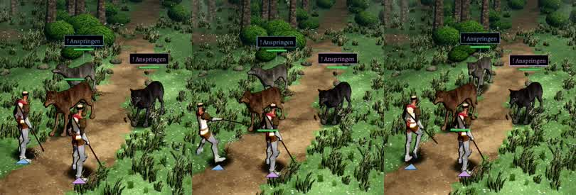

# 1043 · Der Held weicht dem Wolf sichtbar aus · Jerry · 13.11., 02:55

[Film von 13.11., 02:56](https://cdn.jsdelivr.net/gh/tramour-cmyk/androidapp_rpg_bornim@film/20261113-025609-1043/2026-11/13-0256-1043-Jerry.mp4) (eingetragen von meldung.sh, Jerry)

E Kampf · Zweig `claude/jerry-1043-ausweichen` · auf dem Bauserver mit den gekauften Figuren, wie im Spiel; Film über Telegram

Geprüft an: [Lauf 409](https://github.com/tramour-cmyk/androidapp_rpg_bornim/actions/runs/43331361357), [Commit a2b2cb6](https://github.com/tramour-cmyk/androidapp_rpg_bornim/commit/a2b2cb6c8)

Zu deinem Fund t278.33 („Da weicht nichts“) und zum Vorentscheid von Sokrates (13.11., 00:28, „1043a B, dann ein Lauf“): Probekampf gegen Wölfe, Held Klosterschüler, „Ausweichen“ erzwungen. Der Film zeigt das Ausweichen dreimal, je 4 Sekunden.

- **Ausweichen:** der Wolf springt an, der Held tritt einen Schritt schräg zurück (bis 0,57 m von seinem Platz, eine halbe Sekunde), der Wolf verfehlt („daneben“), dann geht der Held an seinen Platz zurück. In allen drei Fällen gleich.
- **Offen:** kurz vor dem Ausweichen steht das Bild etwa 0,4 Sekunden fast still; noch nicht geklärt, ob das so gewollt ist (Halt für den Ring) oder ein Fehler.

**Was du sagen sollst:** „1043 passt“ (dann fährt das Ausweichen im nächsten Build); oder dein Urteil zum Film. Heute Nacht urteilt Sokrates an deiner Stelle (1077).
