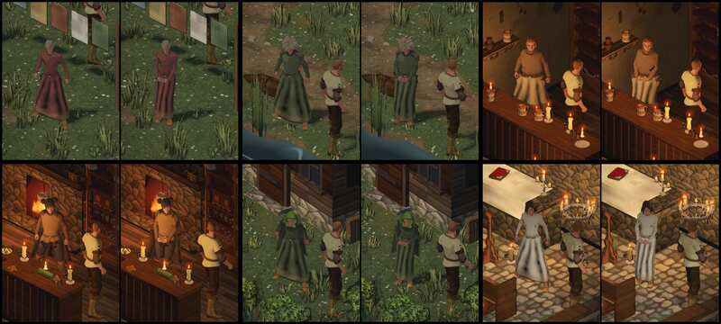

# 1044 · Alle Frauen stehen wie eine Dame, vorher/nachher · Tom · 13.11., 03:26

[Bild von 13.11., 03:27](https://github.com/tramour-cmyk/androidapp_rpg_bornim/blob/bilder/2026-11/13-0327-1044-Tom.png) (eingetragen von meldung.sh, Tom)

E Figuren · Zweig `claude/tom-1044-frauen` · auf dem Bauserver mit den gekauften Figuren, wie im Spiel

Geprüft an: [Lauf 414](https://github.com/tramour-cmyk/androidapp_rpg_bornim/actions/runs/43346874615), [Commit 13c6c20](https://github.com/tramour-cmyk/androidapp_rpg_bornim/commit/13c6c20d6a54de6758bc3a5915a495618c55e08e)

Zum Vorentscheid von Sokrates (13.11., 02:30, „Lyra passt, alle Damen, ein Bildlauf“): alle Frauen außerhalb des Kampfs nah an ihrem Platz, je links vorher, rechts nachher; zur Kamera gedreht, damit man die Haltung sieht.

- **Nachher bei allen sechs:** Füße zusammen, Gewicht rechts, aufrecht, Hände vorn übereinander; Ärmel ohne Knick. Rowena steht hinter dem Schanktisch, ihre Füße sind verdeckt.
- **Am Rechner behoben, bevor der Lauf ging:** bei Liska und Gwenna lagen die Hände zuerst hinter dem Rücken (die Richtung „vorn“ kam aus den Hüftknochen und war bei ihnen gedreht); jetzt nach den Zehen.
- **Rock:** die dunklen Flecken unten sind noch zu sehen; das ist die Hose unter der Robe, sie kommt mit 1090 weg (Lauf läuft).
- Rot war nur der fremde Prüflisten-Test (1020, Spalte „Passt“).

**Was du sagen sollst:** „1044 passt“ (fährt im nächsten Build), oder dein Urteil je Frau. Heute Nacht urteilt Sokrates an deiner Stelle (1077).
