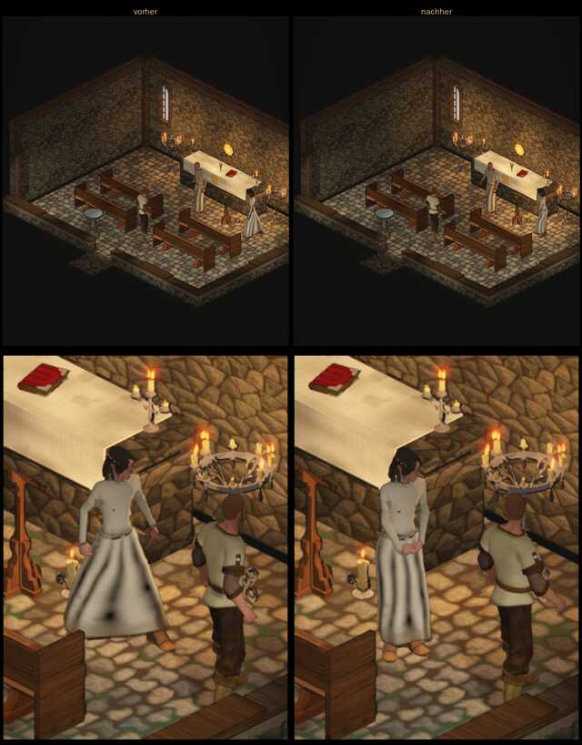

# 1044 · Lyra steht im Tempel wie eine Dame, vorher/nachher · Tom · 13.11., 02:18

[Bild von 13.11., 02:19](https://github.com/tramour-cmyk/androidapp_rpg_bornim/blob/bilder/2026-11/13-0219-1044-Tom.png) (eingetragen von meldung.sh, Tom)

E Figuren · Zweig `claude/tom-1044-frauen` · auf dem Bauserver mit den gekauften Figuren, wie im Spiel

Geprüft an: [Lauf 411](https://github.com/tramour-cmyk/androidapp_rpg_bornim/actions/runs/43337224562), [Commit 6631f41](https://github.com/tramour-cmyk/androidapp_rpg_bornim/commit/6631f4172e6826435c52a46a34e56d7c83d7715d)

Zum Vorentscheid von Sokrates (13.11., 00:09, `billigen/1044-frauenstand.md`, Weg 2): die heutige Stehhaltung angepasst, nur für Lyra. Oben der Tempel in der Spielansicht, unten nah neben Lyra; links vorher, rechts nachher.

- **Nachher:** Füße zusammen (am Rechner gemessen: 0,5 Hüftbreiten statt 2,6), Gewicht auf dem rechten Bein, die linke Hüfte etwas tiefer, aufrecht, die Hände vorn übereinander, die rechte oben. Das Atmen der Ruhe bleibt; beim Gehen blendet die Haltung in einer Viertelsekunde aus und beim Stehenbleiben wieder ein. Im Kampf ändert sich nichts.
- **Rock:** die Flecken an den Knien sind weg, ein kleiner dunkler Fleck bleibt unten zwischen den Schienbeinen. Ursache am Rechner nachgestellt: mit weiter gestellten Füßen wandern die Flecken mit den Knien, die Beine stoßen also durch den Stoff. Das liegt am Modell des Rocks (431, Kleiderschrank), nicht an der Haltung.
- Rot war nur der fremde Prüflisten-Test (1020, Spalte „Passt“), nicht 1044.

**Was du sagen sollst:** „1044 passt“ (dann bekommen alle Frauen außerhalb des Kampfs diese Haltung: Liska, Gwenna, Rowena, Thessa, Morwen, und sie fährt im nächsten Build); oder dein Urteil zum Bild. Heute Nacht urteilt Sokrates an deiner Stelle (1077).
