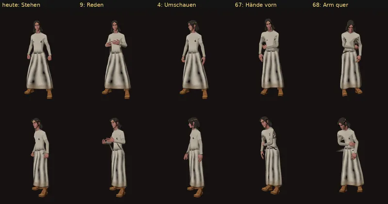

# 1044 · Stehhaltung der Frauen am Beispiel Lyra: Sichtung der gekauften Bewegungen · Team Tom · 13.11., 00:07

[Bild von 13.11., 00:07](https://github.com/tramour-cmyk/androidapp_rpg_bornim/blob/bilder/2026-11/13-0007-1044-Tom.png) (eingetragen von meldung.sh, Tom)

E Welt

Geprüft an: [Lauf 43318704869](https://github.com/tramour-cmyk/androidapp_rpg_bornim/actions/runs/43318704869) (Zweig `claude/tom-1044-frauen`, auf dem Bauserver mit den gekauften Figuren). Großbild: Telegram 13.11., 00:07.

Zu deinem Auftrag (12.11., 16:08: „Die Damen posen im Stand … jetzt am Beispiel Lyra“) erst Weg 1: alle Stehbewegungen aus den gekauften Paketen an Lyra ausprobiert (73 Stück, von vorn und schräg). Im Bild die fünf ruhigsten; links „heute“, die Haltung, in der sie jetzt im Tempel steht.

- **Befund:** Keine der gekauften Bewegungen steht mit geschlossenen Beinen; überall stehen die Füße etwa schulterbreit. „Reden“ (9) wirkt mit den Händen vor der Brust am ruhigsten. „Hände vorn“ (67) und „Arm quer“ (68) stehen enger, kommen aber aus einem anderen Paket und verdrehen auf Lyra die Ärmel (dunkle Knicke am Arm).
- **Empfehlung, Weg 2:** die heutige Stehhaltung anpassen: Füße zusammen, Gewicht auf einem Bein, aufrecht, Hände locker vorn übereinander. Dann ein Bild vorher/nachher von Lyra im Tempel; danach alle Frauen außerhalb des Kampfs (Liska, Gwenna, Rowena, Thessa, Morwen, die Heldinnen). Im Kampf bleibt die Kampfhaltung.

**Was du sagen sollst:** „Weg 2“ (anpassen wie oben), oder eine Nummer aus dem Bild, die so bleiben soll.

Vermerk: Bilder ohne Hintergrund (nur Lyra, nicht im Tempel). Gwenna und Thessa nutzen heute schon „Reden“ beim Stehen.
