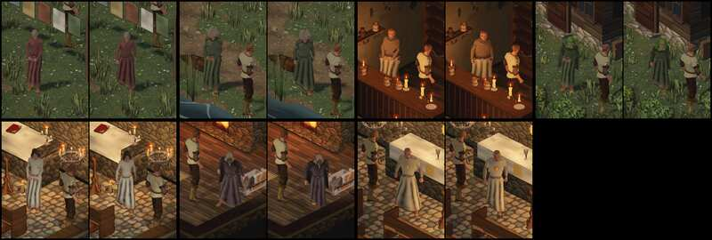
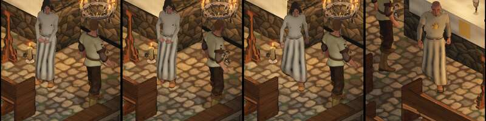

# 1090 · Robe ohne Hose darunter, sieben Träger im Stehen und Gehen · Tom · 13.11., 04:07

[Bild von 13.11., 04:07](https://github.com/tramour-cmyk/androidapp_rpg_bornim/blob/bilder/2026-11/13-0407-1090-Tom.png) (eingetragen von meldung.sh, Tom)

E Figuren · Zweig `claude/tom-1090-rock` · auf dem Bauserver mit den neu gebauten gekauften Figuren, wie im Spiel

Geprüft an: [Lauf 415](https://github.com/tramour-cmyk/androidapp_rpg_bornim/actions/runs/43347672047), [Commit eac82bc](https://github.com/tramour-cmyk/androidapp_rpg_bornim/commit/eac82bc2a4766a8c2fd2cd308a516c2b727ce3d1)

Zum Vorentscheid von Sokrates (13.11., 02:46, „1090 A“): unter der Robe keine Hose mehr, wie beim Helden im Zaubergewand. Je Figur links im Stehen, rechts im Gehen (mitten im Schritt).

- **Flecken:** der dunkle Fleck zwischen den Schienbeinen und die Flecken an den Knien sind weg (Lyra vorher/nachher im zweiten Bild).
- **Gehen:** bei keinem der sieben geht zwischen Saum und Schuh eine Lücke auf.
- **Mir ist aufgefallen:** senkrechte dunkle Streifen in den hellen Roben bleiben; sie liegen auf den Falten, ich halte sie für Faltenschatten (nur im Bild gesehen, nicht gemessen).
- Am Rechner vorher gemessen: Lyras Kleid hat keine Lage mehr bis 4 cm am Bein (vorher etwa 100 Ecken je Bein).
- Rot waren nur die fremden Tests zur Prüfliste (1020) und zur Ziege (1079).

**Was du sagen sollst:** „1090 passt“ (fährt im nächsten Build), oder dein Urteil je Figur. Heute Nacht urteilt Sokrates an deiner Stelle (1077).
