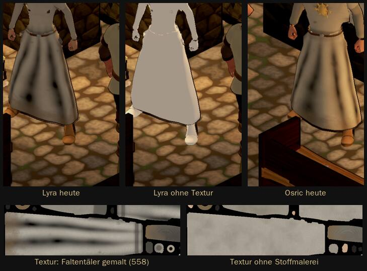

# 1092 · Dunkle Längsstreifen in hellen Roben: Ursache gefunden · Tom · 13.11., 08:50

E Figuren · Zweig `claude/tom-1092-streifen` · am Rechner mit den gekauften Figuren, Stand Build 282

Geprüft an: [Commit 68ab772](https://github.com/tramour-cmyk/androidapp_rpg_bornim/commit/68ab77244) (Probe `streifen_1092.gd`: Lyra, Osric, Rowena, je fünf Bilder mit Toon-Licht und Tusche wie im Spiel; je Bild eine Ursache abgeschaltet: Stoffbild, Schatten, Lichtstufen, Linien in den Falten)

- **Ursache:** die gemalten Faltentäler der Stoffmalerei 558 sind zu tief und laufen bis ins Schwarze über (die schwarzen „Augen“ in den Streifen). Schatten, Licht und Tusche sind es nicht; ohne das gemalte Stoffbild sind die Streifen weg. Auf hellem Stoff fällt es auf, auf dunklem kaum.
- **Vorschlag, nicht gebaut:** Täler höchstens 40 % dunkler, die Faltenform aus 558 bleibt. Das trifft alle Wappenröcke, Umhänge und Schürzen, auch den Helden, der mit 558 schon abgenommen ist; darum vorher ein Bild vorher/nachher.
- **Kosten:** eine Sitzung, ein Probebild, Leute und Held neu bauen.
- **Stärkstes Gegenargument:** du wolltest den Stoff mit 558 ausdrücklich nicht „zu clean“; flachere Täler nehmen etwas von der Schattenstruktur. Darum nur begrenzen (kein Schwarz), nicht abschalten.

**Was du sagen sollst:** „1092 so“ (Täler flacher, Bild vorher/nachher folgt), oder dein Urteil.
