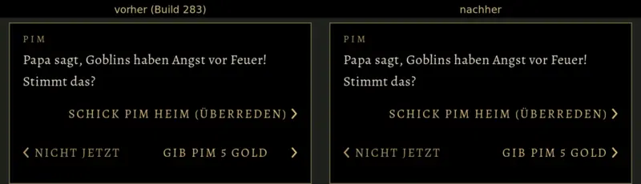

# 1120 · Knöpfe im Gespräch: Beschriftung rechtsbündig am Pfeil · Team Tom · 13.11., 17:03

E Welt

Geprüft an: [Commit c0f835c04](https://github.com/tramour-cmyk/androidapp_rpg_bornim/commit/c0f835c04) (Zweig `claude/tom-1120-rechts`, Bild am Rechner mit `tests/knoepfe_bild_1120.gd`), gemischt in `claude/build-284`

Dein Wort 16:52: Anordnung passt, nur der Text rechts muss „randrücken ans Größerzeichen“. Jetzt steht die Beschriftung der rechten Wahl rechtsbündig direkt am Pfeil; links Build 283, rechts neu, Pims Gespräch mit zwei Wahlen. Gilt für jede Wahl neben „Nicht jetzt“, auch „Kaufen“ bei Osric. Kommt mit dem nächsten Lauf von Build 284 aufs Handy.

Was du tust: am Bild „passt“ oder sagen, was nicht stimmt.
