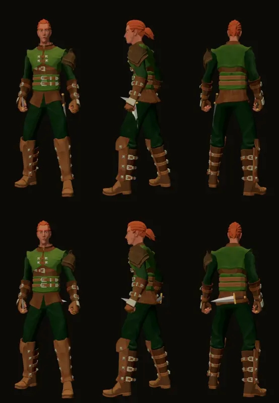

# 1149 · Dolch der zweiten Hand am Körper: Bild Gürtel gegen Kreuz
Tom · 13.11., 18:56 · E Figuren · Bild zur Frage [1149](../entscheiden/1149.md)

Geprüft an: https://github.com/tramour-cmyk/androidapp_rpg_bornim/actions/runs/43468464537

Die Frage und das Votum stehen in [entscheiden/1149.md](../entscheiden/1149.md); diese Datei geht mit der Antwort weg.
