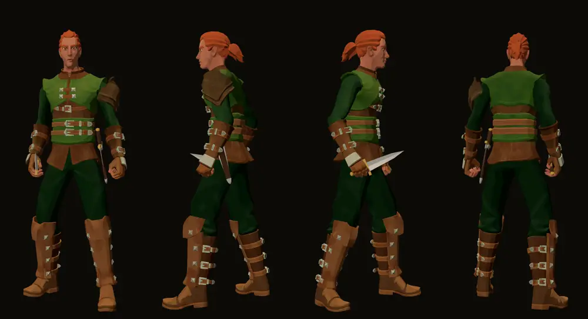

# 1149 · Dolch der zweiten Hand in der Lederscheide links an der Hüfte · Team Tom (Spike) · 14.11., 05:06

Geprüft an: Lauf 466 (godot.yml, Zweig claude/tom-1149-dolch, 28d1bef28), Bild `dolch1149/1149_dolch.png`

**Ansehen:** Sitz und Aussehen der Scheide nach deinem Wort „1149 A“ und „Ja, einen Ort zum Wegstecken.“ (13.11., 19:44/19:45): Griff vorn oben, Scheide schräg nach hinten unten, Mundblech und Ortband in Metall, wie die alte Fassung.

**Offen:** Die Klinge ragt im Bild seitlich aus der Scheide (Scheide nach halben statt ganzen Klingenmaßen gebaut). Behoben im Zweig (bb8c8c99c, nachgerechnet: 2 mm Rand überall), mit eigener Prüfung im Bildlauf; das neue Bild braucht einen weiteren Lauf (Freigabe bei Sokrates erbeten). Die Scheide wird dadurch breiter: 7,6 cm am Mundblech statt 4,2 cm.

**Gemessen:** Scheide überall mindestens 1,3 cm von der Haut (Ruhelage); nichts im Körper.
