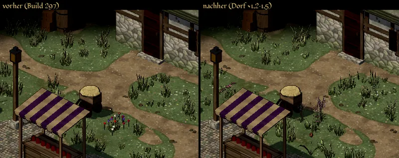

# 1205 · Blumen kleiner und gestreut: Dorf ×1,2–1,5, draußen ×1,2–1,8 · Tom · 17.11., 16:40

E Welt · Tom · 17.11. · aus deinem Wort 16:23 (an Sokrates): „ist ein bisschen zu groß. Dann vielleicht eher Faktor 1,5 und in Dorf vielleicht … ein Faktor 1,2 bis 1,5 und vielleicht außerhalb 1,2 bis 1,8. Halt eine Mische irgendwie.“

Geprüft an: https://github.com/tramour-cmyk/androidapp_rpg_bornim/commit/e9b2c63bc (`claude/tom-1205-wiese`, Standbilder am Rechner, Großbild: Telegram 17.11. 16:40)

Links Build 297, rechts neu, gleiche Stelle: jede Blume des Graspakets bekommt ihre eigene Größe, im Dorf zwischen 1,2- und 1,5-fach, im Flüsterwald zwischen 1,2- und 1,8-fach; Farben und Gras wie bei deinem letzten Bild.

Offen (eigene Prüfung, du urteilst):
- Der Held fehlt in den Bildern: sein Modell war am Rechner nicht gebaut.

👍 passt: in den nächsten Sammelbuild (Blumenwiese im Dorf und im Flüsterwald am Handy ansehen) · 👎 falsch: mit Fund, was anders soll
