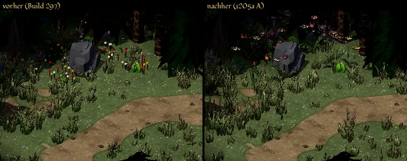

# 1205 · Blumenwiese nach deinem „1205a A“: Blumen des Graspakets groß und farbig, mehr Gras · Tom · 17.11., 15:50

[Bild von 17.11., 15:48](https://github.com/tramour-cmyk/androidapp_rpg_bornim/blob/bilder/2026-11/17-1548-1205-Tom.png) (eingetragen von meldung.sh, Tom)

E Welt · Tom · 17.11. · aus deinem Wort 15:35: „1205a A, gerne auch mehr Gras?!?“

Geprüft an: https://github.com/tramour-cmyk/androidapp_rpg_bornim/commit/9f98626ca (`claude/tom-1205-wiese`, Standbilder am Rechner, Großbild: Telegram 17.11. 15:50)

Links der Stand von Build 297, rechts neu, gleiche Stelle (Flüsterwald, Blumenwiese bei den Kräutern): die Blumen des Graspakets etwa doppelt so groß, in den Farben der alten Kleckse (weiß, gelb, rosa-rot, violett, orange), die Kleckse sind weg; Gras an jeder zweiten statt jeder dritten Stelle, dazu buschige Büschel und einzelne Halme. Blumen und Gras wiegen sich im Wind und weichen dem Helden aus.

Offen (eigene Prüfung, du urteilst):
- Im Dorf steht am Marktstand eine einzelne Tulpe, die deutlich größer wirkt als die anderen Blumen (zweites Bild auf Telegram).
- Der Held fehlt in den Bildern: sein Modell war am Rechner nicht gebaut.
- Bilder je Sekunde erst am Handy messbar (mehr Gras).

👍 passt: in den nächsten Sammelbuild (Blumenwiese im Flüsterwald und im Dorf am Handy ansehen) · 👎 falsch: mit Fund, was anders soll
