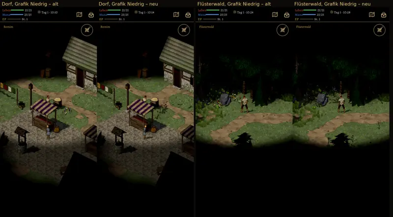

# 1205b · Wiese in Grafik Niedrig: Kit-Blumen statt Kleckse?

[Bild von 18.11., 17:04](https://github.com/tramour-cmyk/androidapp_rpg_bornim/blob/bilder/2026-11/18-1704-1205b-Tom.png) (eingetragen von meldung.sh, Tom)

Tom · 18.11., 17:05 · E Welt · aus deinem Entscheid „1205b A“ 15:37
Kurz: Grafik Niedrig, Spielkamera in Handygröße, je Ort alt und neu nebeneinander: Dorf am Marktstand, Flüsterwald an der Kräuterstelle. Neu sind die gezeichneten Blütenkleckse weg, dafür die Blumen des Kits zu unserem Gras; sie wirken in Niedrig etwas dunkler und kleiner als die Kleckse.

Geprüft an: https://github.com/tramour-cmyk/androidapp_rpg_bornim/commit/fdbacd715 (`claude/tom-1205-wiese`), Bild am Rechner mit Kaufmodellen und Gras-Kit (1205, Läufe frei 17:01)

- 👍 passt: so in den nächsten Sammelbuild.
- 👎 falsch: Kit-Blumen zu dunkel oder zu klein, oder Kleckse fehlen (bitte sagen, was).
