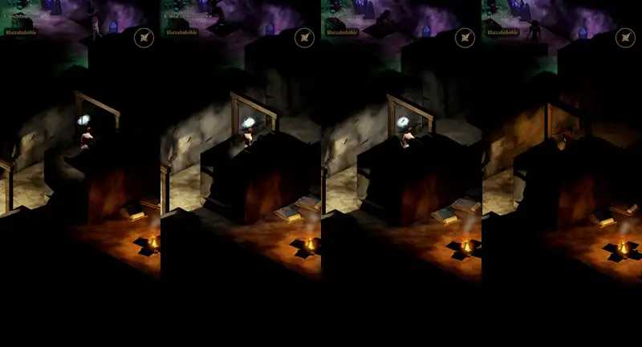

# 1211 · Leuchtfunke: welches Licht in der Höhle, A, B oder C?

Spike · 18.11., 00:43 · aus 1211 (Leuchtfunke), dein Wort 17.11., 23:56: „Ja, das wäre hilfreich.“ und „Intensität … an den Grad der Dunkelheit … nicht an der Uhrzeit“
Kurz: Ein Film in der Blutzahnhöhle bei Nacht zeigt drei Fassungen des Funkenlichts nacheinander und die Fackel zum Vergleich; dazu leuchtet der Funke in der Höhle jetzt auch tagsüber voll.

Geprüft an: https://github.com/tramour-cmyk/androidapp_rpg_bornim/commit/1ee508e46 (Film, Renderer wie am Handy; Test funke_677: Höhle am Tag vorher Licht 0, jetzt voll)

**Bild:** je ein Standbild, von links: **A** wie heute (Reichweite 6,7 m, harter Abfall), **B** weicher Abfall mit Reichweite 8 m, **C** wie B und heller (Stärke 2,0 statt 1,7), **Fackel** wie heute. Mit Tusche und Spielkamera wie im Spiel.

**Behoben:** Der Funke richtete sich nach der Uhr; in der Höhle bei Tag blieb er dunkel. Jetzt richtet er sich wie die Fackel nach der Dunkelheit am Ort: in der Höhle immer voll, draußen und in Häusern nach deren Licht. Geht mit dem Zweig `claude/spike-1211-1484` in den nächsten Sammelbuild.

**Offen:** Der Film dauert 16 s, je Fassung einmal hin und zurück. Der Held ist im Gang zeitweise hinter einem Felsblock verdeckt; das Licht an den Wänden bleibt sichtbar.

👍 A · 👍 B · 👍 C (bitte als Antwort, welche) · 👎 keine
