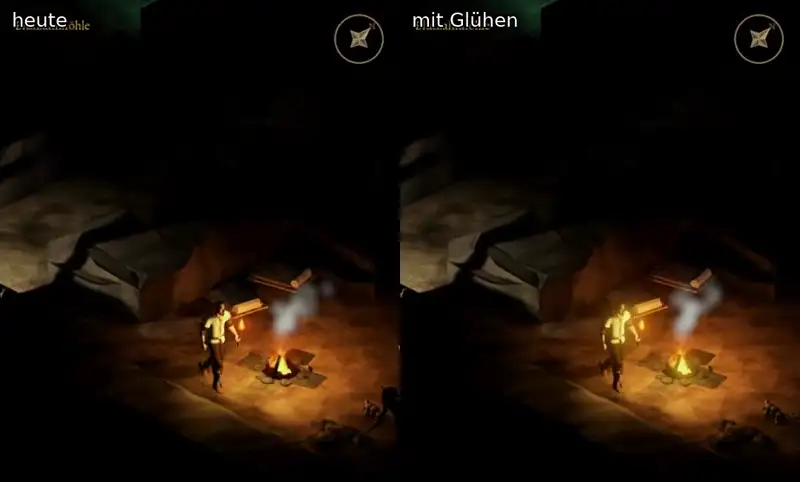
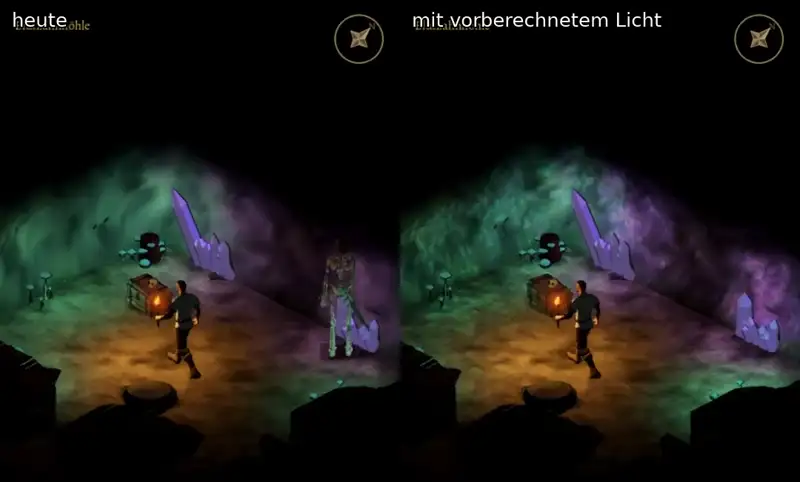

# 1270.4 · Glühen und vorberechnetes Höhlenlicht: heute gegen neu · Spike · 16.11.
E Technik · Spike · 16.11. · aus 1270 A (15.11., 10:51) und deinem Wort 22:43 („Da wäre jetzt, glaube ich, wieder ein Film gut“)

Geprüft an: `ba758ac03` (`claude/spike-1270-4-gluehen`, Stand Build 293 mit Belichtung 1303), Film am Rechner im Renderer mobile

Zwei Filme, je links heute, rechts neu; derselbe Weg mit Fackel durch die Blutzahnhöhle: Lager am Lagerfeuer, Graks Halle, Westflügel mit Kristallen und Leuchtpilzen. Die Gegner laufen in beiden Hälften nicht gleich (Zufall), das Licht ist der Prüfgegenstand.

**Glühen:** Was heller als weiß ist (Flammen, Glut, Kristalle, Pilze), bekommt einen weichen Schein; der Rest bleibt, wie er ist. Kostet beim Spielen etwas Grafikzeit, wäre also eine Sache der Grafikstufe „Hoch“ (698).

**Vorberechnetes Höhlenlicht:** Licht, das von Boden und Fels zurückgeworfen wird, einmal beim Bau gerechnet; Wände nahe Kristallen, Pilzen und Feuer nehmen deren Farbe an, ohne Kosten beim Spielen.

Offen: Gold glänzt nirgends in der Höhle so hell, dass es glühen würde; Zauber im Kampfort sind gezeichnete Bilder über der Szene, das Glühen erreicht sie nicht.

👍 passt: ins Spiel (Glühen ab Grafikstufe Hoch, Höhlenlicht immer) · 👎 falsch: bleibt, wie es ist
