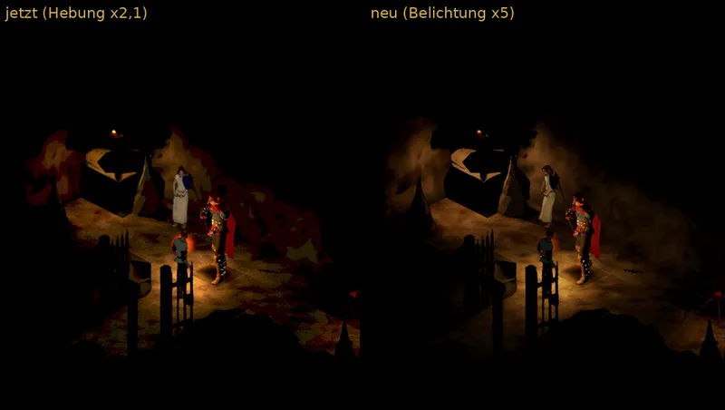

# 1303 · Höhle mobile: Belichtung statt Hebung, ohne Flecken · Spike · 16.11., 13:04

[Bild von 16.11., 13:05](https://github.com/tramour-cmyk/androidapp_rpg_bornim/blob/bilder/2026-11/16-1304-1303-Spike.png) (eingetragen von meldung.sh, Spike)

Geprüft an: [Lauf 519](https://github.com/tramour-cmyk/androidapp_rpg_bornim/actions/runs/43857035128), Commit 108c9b058 (`claude/spike-1303-stufen`), Renderer mobile am Bauserver

Graks Halle, Held mit brennender Fackel, links wie heute (Hebung ×2,1 nach dem Bild), rechts Belichtung der Kamera ×5 ohne Hebung. Ausschnitt an der Fackel und Lager auf Telegram.

- **Flecken:** rechts weg; die roten und gelbgrünen Ränder an Wand und Boden werden ein glatter brauner Verlauf.
- **Helligkeit:** ×5 kommt der heutigen am nächsten (Mittel des ganzen Bilds mit Fackel: Halle 4,6 → 5,1, Lager 6,2 → 5,6, Gang 6,6 → 7,2; ×4 und ×6 liegen je einmal näher, im Ganzen nicht). Der Lichtkreis wird etwas heller, die fernen Ränder dunkler, weil die Hebung bisher auch das fast Schwarze mit anhob.
- **Fackel:** überstrahlt nicht. Heute steht hinter dem Helden eine harte orange Scheibe, bei ×5 ein weicher Schein.
- **Deine Frage** („… dass der Held in diesem Bild keine Fackel trägt. Und er deswegen dunkel ist, oder?“): Ja. Im Messstand hatte er keine Fackel in der Nebenhand (der Lauf liest es aus, Ergebnis „false“), darum stand er im Dunkeln. Alle Bilder hier sind darum zusätzlich mit brennender Fackel gemacht.

**Frage:** Passt der rechte Stand so (Belichtung ×5 ins Spiel, Sammelbuild mit Handyfrage)? 👍 auf Telegram, sonst 👎 mit dem, was anders sein soll (heller, dunkler, Ränder).
