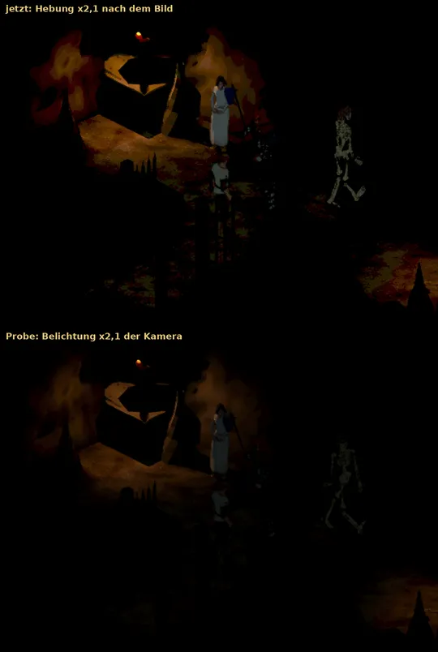

# 1303 · Höhle im Renderer mobile: Flecken im Dunkel weg, dafür dunkler · Spike · 16.11., 00:35
[Bild von 16.11., 00:35](https://github.com/tramour-cmyk/androidapp_rpg_bornim/blob/bilder/2026-11/16-0035-1303-Spike.png) (Telegram, Nachricht 4312)

E Technik

Beim Chef, weil: Aussehen (Helligkeit der Höhle; Prüfart Bild nach 1128 A)

Geprüft an: [Lauf 508](https://github.com/tramour-cmyk/androidapp_rpg_bornim/actions/runs/43770409468), Stand `7058f9d82` (Zweig `claude/spike-1303-stufen`), Renderer mobile (Vulkan, Lavapipe), Graks Halle

Oben jetzt: die Höhle wird nach dem fertigen Bild um das 2,1-Fache aufgehellt; das vergrößert die groben Helligkeitsstufen des Bildpuffers zu roten und gelben Flecken (Jerrys Fund zu 1289). Unten Probe: dieselbe Aufhellung als Belichtung der Kamera, vor dem Bildpuffer. Die Flecken sind weg, der Verlauf ist glatt, aber das Bild ist deutlich dunkler (mittlere Helligkeit der dunklen Flächen 13,9 statt 24,6).

**Frage:** Ist das der richtige Weg (👍 auf Telegram), dann messe ich in einem Lauf Belichtung ×3 bis ×6 und lege die Stufe vor, die so hell ist wie jetzt; oder sollen die Flecken anders weg (👎)?

| Prüfpunkt | passt | falsch |
|---|---|---|
| Bild | unten glatte Verläufe statt Flecken; Weg weiter, Helligkeit wie oben angleichen | unten stimmt etwas anderes nicht (Farbe, Figuren), oder der Weg gefällt nicht |

Offen: zweiter Lauf (Belichtung ×3 bis ×6) wartet auf dein 👍 (621 A); Lager und Gang zeigen dasselbe (Lauf 508).
