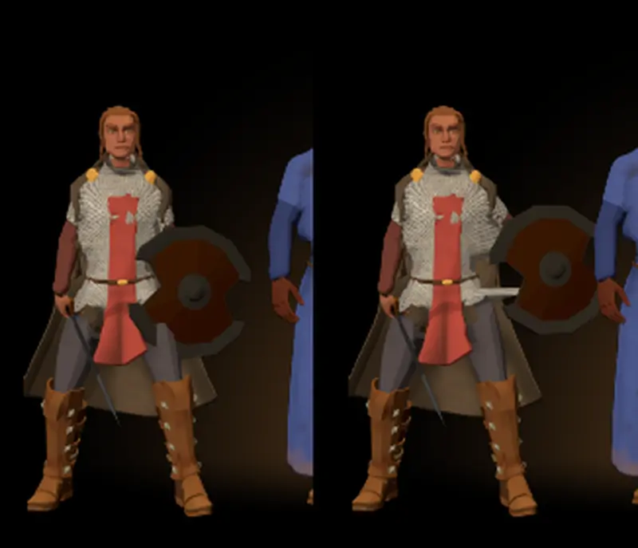

# 1417 · Schild der Wachsoldatin im Hauptmenü nicht mehr im Rock · Tom · 16.11., 19:40

[Bild von 16.11., 19:38](https://github.com/tramour-cmyk/androidapp_rpg_bornim/blob/bilder/2026-11/16-1938-1417-Tom.png) (eingetragen von meldung.sh, Tom)

E Oberfläche · Tom · 16.11. · aus deinem Wort 12:37/12:38 (über Sokrates): „an mehreren Stellen anscheinend eingekerbt oder kaputt … als ob der Stoff, der dahinter liegt, einen Teil des Schildes überdeckt oder das Schild halt im Körper steckt“

Geprüft an: Lauf 43922320211 (`claude/tom-1417-schild`, `c63a8f1c5`), Bauserver

Links vorher, rechts nachher; Ausschnitt aus dem Hauptmenü, wie es im Spiel steht.

**Ursache:** Der Schildarm hing im Stand am Bein; der Rock über dem linken Oberschenkel ragte bis 6,2 cm durch den Schild (Messung `schild_menue_1417`), das waren die „Kerben“. Jetzt ist der Arm 25 Grad abgespreizt, die Fläche bleibt schräg zum Spieler; 1,9 cm frei, die Messung läuft künftig im Prüfschritt mit.

**Überall?** Nur das Hauptmenü hält den Schild so am hängenden Arm. Unterwegs und in der Erschaffung trägt der Held ihn auf dem Rücken, im Kampf am Unterarm; beides misst `schild_406` seit 01.11. ohne Befund.

Offen (eigene Prüfung, du urteilst):
- Links am Schild sieht man jetzt den Unterarm hervorkommen (grau, Kettenhemd); das ist der Arm, der den Schild hält.
- Der Schild reicht jetzt bis nahe an die Hand des Zauberlehrlings daneben.

👍 passt: so ins nächste Build · 👎 falsch: mit Fund, ich stelle nach
