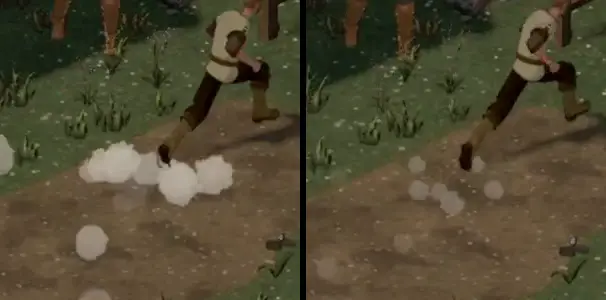

# 1420 · Fußstaub sanfter, auch im Wald · Tom · 16.11., 19:39

E Welt · Tom · 16.11. · aus deinem Wort 12:44/12:45 (Test t290, über Sokrates): „sind sie jetzt zu stark. Die müssen noch ein bisschen sanfter werden. Das sieht nach Comic aus.“ und „auf dem Weg im Wald, wenn ich laufe, kriege ich keine … im tiefen Wald gibt es auch keine“

Geprüft an: Lauf 43922556254 (`claude/tom-1420-staub`, `714719fe7`), Bauserver, Grafik wie am Handy (Mobile)

Film, 15 s, Mittag, je Stück erst gehen, dann rennen auf Erde: Dorf vorher (bis 3,8 s), Dorf nachher, Flüsterwald, Tiefer Flüsterwald.

**Sanfter:** kleiner, halb so deckend, kürzer, etwas dunkler. **Wald:** Ursache war, dass die Effekte nur für Dorf, Gasthaus und Laden gebaut wurden; jetzt staubt auch der Erdweg im Wald, dort schwächer (70 %).

Offen (eigene Prüfung, du urteilst):
- Der Staub ist noch hellgrau, nicht im Braun der Erde.
- Im Tiefen Flüsterwald läuft der Held im Film meist durch hohes Gras, der Staub ist dort kaum zu sehen.

👍 passt: so ins nächste Build · 👎 falsch: mit Fund (etwa „noch sanfter“, „brauner“), ich stelle nach
