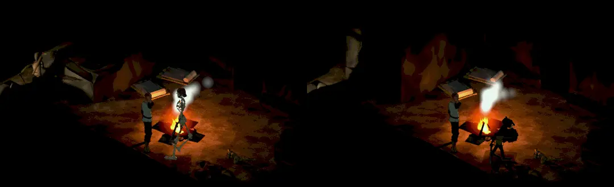
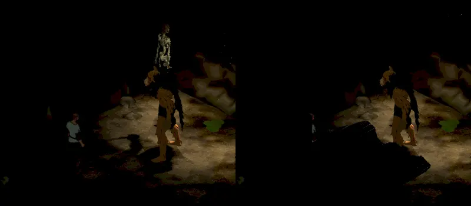

# 1423 · Höhle: Zwischenwände in voller Höhe (alt links, neu rechts)

Tom · 17.11., 04:25 · G Stil · dein Wort 16.11., 13:08 („Die kann nicht auf halber Höhe aufhören“), 13:32 („Zwischenwandproblem“)
Kurz: 1423 (Höhle, Zwischenwände): die Wände zwischen zwei Räumen standen nur 80 cm hoch, jetzt 2,4 m wie die Außenwände.

Geprüft an: https://github.com/tramour-cmyk/androidapp_rpg_bornim/commit/11c14ace0 (Bildlauf am Rechner, Renderer des Handys); Kerntests 182 grün, `hoehle_492` grün

**Ursache:** Der Bau der Höhle zählte jede Wand mit Boden dahinter als „dünn“ und baute sie wie die alte Fassung nur halbhoch (alt 1 m, bei uns 80 cm), damit sie den Helden im Raum dahinter nicht verdeckt. Das waren 38 von 48 Wandstücken, die meisten davon zwischen den Räumen. Eine Fackel an so einer Wand hing 70 cm über der Wandkante in der Luft.

**Was du siehst (Bild 1, Lager):** hinter dem Feuer und links vom Lager steigt der Fels jetzt hoch auf, vorher endete er knapp über den Schlaflagern.

👍 passt: die Wände hinter dem Lager stehen hoch wie die Außenwände · 👎 falsch: sie wirken noch halbhoch oder brechen oben ab

**Offen (Bild 2, Krogg):** Verdeckt eine hohe Wand den Helden, wird sie halb durchsichtig wie ein Haus im Dorf. In der Höhle reicht das nicht: der dunkle Fels deckt den Helden trotzdem fast ganz (Bild rechts: der Held links von Krogg, dem Grottenschrat). Weg: ein Loch um den Helden wie beim Laub im Wald, nur solange die Wand ihn verdeckt. Baue ich als Nächstes, dann Bild.

