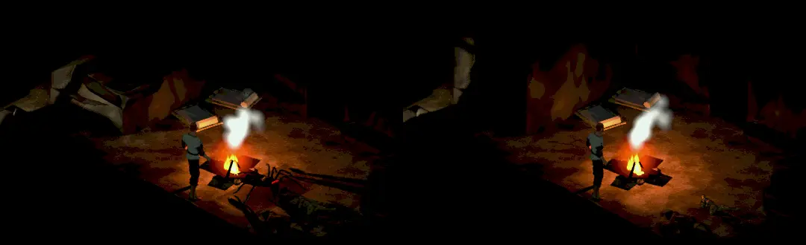
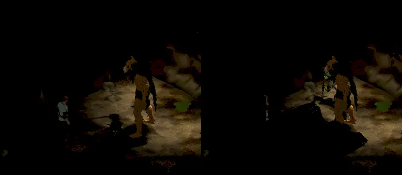

# 1423 · Höhle: Zwischenwände in voller Höhe (alt links, neu rechts)

[Bild von 17.11., 04:45](https://github.com/tramour-cmyk/androidapp_rpg_bornim/blob/bilder/2026-11/17-0445-1423-Tom.png) (eingetragen von meldung.sh, Tom)

Tom · 17.11., 04:46 · G Stil · dein Wort 16.11., 13:08 („Die kann nicht auf halber Höhe aufhören“), 13:32 („Zwischenwandproblem“)
Kurz: 1423 (Höhle, Zwischenwände): die Wände zwischen zwei Räumen standen nur 80 cm hoch, jetzt 2,4 m wie die Außenwände.

Geprüft an: https://github.com/tramour-cmyk/androidapp_rpg_bornim/commit/c4380cc5f (Bildlauf am Rechner, Renderer des Handys, Lauf von Sokrates freigegeben 04:43); Kerntests 182 grün, `hoehle_492` grün

**Ursache:** Der Bau der Höhle zählte jede Wand mit Boden dahinter als „dünn“ und baute sie wie die alte Fassung nur halbhoch (alt 1 m, bei uns 80 cm), damit sie den Helden im Raum dahinter nicht verdeckt. Das waren 38 von 48 Wandstücken, die meisten davon zwischen den Räumen. Eine Fackel an so einer Wand hing 70 cm über der Wandkante in der Luft.

**Was du siehst (Lager):** hinter dem Feuer und links vom Lager steigt der Fels jetzt hoch auf, vorher endete er knapp über den Schlaflagern.

👍 passt: die Wände hinter dem Lager stehen hoch wie die Außenwände · 👎 falsch: sie wirken noch halbhoch oder brechen oben ab

**Offen (Krogg, Bild unten):** Steht der Held hinter einer hohen Wand, öffnet sie jetzt ein Loch um ihn (wie das Laub im Wald; im Test geprüft). Im Bild ist er trotzdem kaum zu sehen (rechts, links von Krogg, dem Grottenschrat). Links ist er hell, weil das Lagerfeuer über die niedrige Wand zu ihm schien; vermutlich hält die hohe Wand das Licht jetzt ab und er steht im Dunkeln. Ursache noch nicht nachgestellt, Befund bei Sokrates; kein weiterer Lauf ohne Freigabe.

