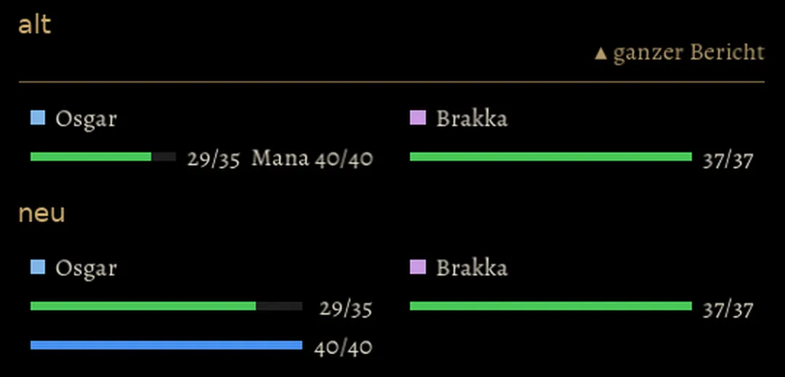

# 1439 · Mana als eigener blauer Balken im Kampfschirm

[Bild von 16.11., 23:51](https://github.com/tramour-cmyk/androidapp_rpg_bornim/blob/bilder/2026-11/16-2351-1439-Tuffy.png) (eingetragen von meldung.sh, Tuffy)

Tuffy · 16.11., 23:52 · E Kampf · dein Wort 16.11., 14:15 und 1448 A (14:47)
Kurz: Mana steht jetzt als blauer Balken unter dem Lebensbalken, in der Farbe der Weltleiste, ohne Wort davor, beide Balken gleich lang, die Zahl dahinter.

Geprüft an: https://github.com/tramour-cmyk/androidapp_rpg_bornim/blob/main/docs/chefsache/bilder/1439-alt-neu.webp (Rechner, Probekampf Wölfe, Held Kleriker; Stand `claude/jerry-1439-mana` `3f13a50de`)

**Was du siehst:** oben alt (nur „Mana 40/40“ als Text hinter dem Leben), unten neu (zweiter Balken in Blau `4890f0` wie in der Weltleiste).

👍 passt: zwei Balken untereinander, gleich lang, Mana blau, Zahl dahinter · 👎 falsch: Balken verschieden lang, Farbe anders als in der Weltleiste, Wort davor
