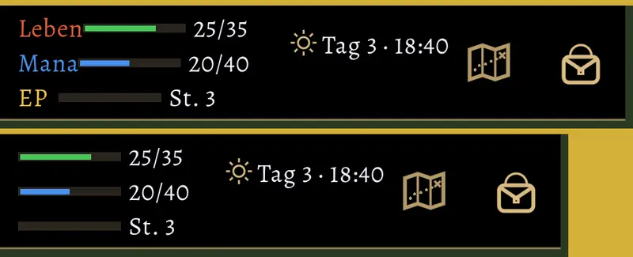
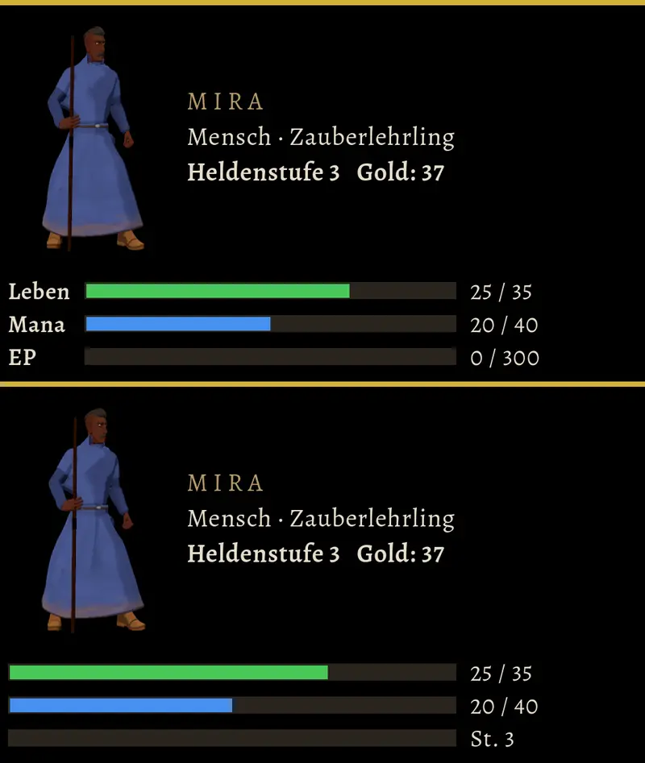

# 1448 · Weltleiste und Heldenmenü ohne Wörter vor den Balken

[Bild von 17.11., 01:14](https://github.com/tramour-cmyk/androidapp_rpg_bornim/blob/bilder/2026-11/17-0114-1448-Tom.png) (eingetragen von meldung.sh, Tom)

Tom · 17.11., 01:14 · E Oberfläche · dein Entscheid „1448 A“ (16.11., 14:47)
Kurz: 1448 (Leiste ohne Wörter): Leben, Mana und Erfahrung ohne Wort davor, alle Balken bündig und gleich lang, dahinter die Zahl, bei Erfahrung die Stufe.

Geprüft an: https://github.com/tramour-cmyk/androidapp_rpg_bornim/actions/runs/43975509293 (Bauserver, Renderer des Handys, Schritt „Leiste (1448)“; Stand `claude/tom-1448-balken` `a538e03a7`; Held Zauberlehrling Stufe 3)

**Was du siehst:** je Bild oben alt, unten neu; erst die Weltleiste, dann die Balken im Heldenmenü. Im Heldenmenü stand hinter der Erfahrung bisher „0 / 300“, jetzt „St. 3“ (dein Entscheid: bei Erfahrung die Stufe).

👍 passt: keine Wörter, Balken beginnen an derselben Stelle und sind gleich lang, Zahl dahinter · 👎 falsch: Balken versetzt oder verschieden lang, oder im Heldenmenü soll „EP / Bedarf“ bleiben
