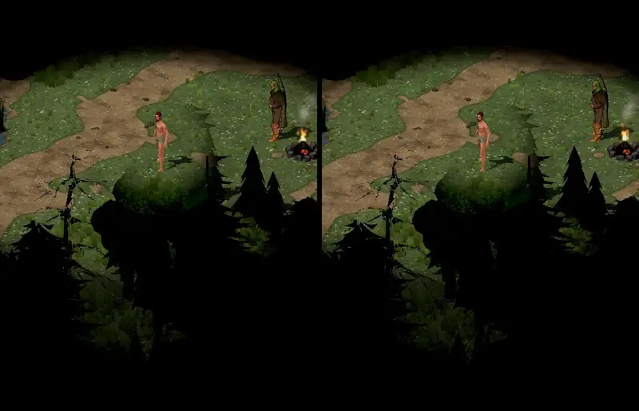

# 1484a · Welt in Zellen: Bilder alt gegen neu an drei Stellen · Spike · 18.11., 01:30

[Bild von 18.11., 01:30](https://github.com/tramour-cmyk/androidapp_rpg_bornim/blob/bilder/2026-11/18-0130-1484a-Spike-2.jpg) (eingetragen von meldung.sh, Spike)

[Bild von 18.11., 01:30](https://github.com/tramour-cmyk/androidapp_rpg_bornim/blob/bilder/2026-11/18-0130-1484a-Spike.jpg) (eingetragen von meldung.sh, Spike)

E Technik · Spike · aus Vorentscheid A (Sokrates 18.11., 00:53, `billigen/1484a-welt-zellen.md`): „Vor dem Build Bilder alt gegen neu an drei Stellen, Tom sieht mit.“

Geprüft an: https://github.com/tramour-cmyk/androidapp_rpg_bornim/commit/9fa1444d47 (`claude/spike-1484a-zellen`, Bau am Rechner, Renderer wie am Handy)

Drei Bilder per Telegram, je links alt (ein Netz über die ganze Karte), rechts neu (Zellen von 12 m, Durchsicht nur nahe am Helden), mittags: Flüsterwald 9/12, Wald 11/19, Dorf 12/12.

**So soll es aussehen:** beide gleich; keine Lücke, keine Naht an Kronen, kein fehlender Baum oder Ding, Durchsicht um den Helden wie vorher.

- **Gemessen am Rechner** (Lavapipe, nur das Verhältnis zählt): Wald 9/12 gezeichnet 2655k → 1331k Dreiecke, Grafikzeit −24 %; Wald 11/19 2588k → 1139k, −25 %; Dorf 12/12 2365k → 737k. Zeichenaufrufe 261 → 436. Bei 3D 50 % zusätzlich −28 % (Wald 9/12).
- **Eigene Prüfung der Bilder:** Abweichung 0,1–0,5 % der Bildpunkte, verstreut an Laubkanten und am Feuer (Wind und Flamme bewegen sich); keine Fläche fehlt.
- **Stärkstes Gegenargument:** mehr Zeichenaufrufe; am Tablet hat „Schatten aus“ die Dreiecke halbiert und nur 12 % gespart. Darum der Prüfpunkt im Testbuild mit 3D 50 %.

**Weiter:** in den nächsten Sammelbuild, Prüfpunkt Handy (Tablet): Wald 11/19 und Flüsterwald 9/12 messen, auch mit 3D 50 %, je Text „Kopieren“. Kein `main` ohne deinen Test.

Antwort:
