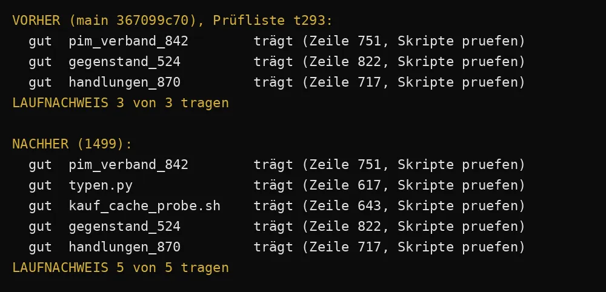

# 1499 · Laufnachweis: Prüfskripte mit Endung werden jetzt erkannt

Spike · 16.11., 23:11 · B Werkzeuge · Befund D282.1 (Laufnachweis) von Diogenes (1498 Bestätigung)
Kurz: `laufnachweis.py` übersah Prüfskripte wie `typen.py` und `kauf_cache_probe.sh`; jetzt sucht es sie unter ihrem Dateinamen im Bauablauf. t293: 5 von 5 statt 3 von 3 erkannt.

Geprüft an: `e49569691` auf `main`, gegen die Bauabläufe von Build 290 bis 294

**Was das Bild zeigt:** Prüfliste t293, vorher und nachher. Vorher fehlten 1408 (Typen-Sperrklinke, `typen.py`) und 1409 (Kauf-Cache, `kauf_cache_probe.sh`), Diogenes musste sie von Hand nachweisen.

**Gebaut:**
- Namen mit Endung `.py` oder `.sh` gelten als Prüfskript; gesucht wird der Dateiname im Bauablauf, der Pfad davor zählt nicht.
- Ein Skript trägt nur, wenn es mit Fehlercode enden kann (Python mit `sys.exit(1)` oder Ähnlichem, Shell mit `set -e` oder `exit 1`) und weder `|| true` noch `continue-on-error` hat.

**Neuer Befund (Vorgang 1502, Jerry):** t294 führt `bildrate.py` (1426, Messung von Ladezeit und Bildrate) unter „Im Bau geprüft“. Der Schritt läuft mit `continue-on-error`, wird nie rot; die Commit-Prüfung hält t294 darum beim Verschieben nach `ansehen/` an.

👍 passt · 👎 falsch
