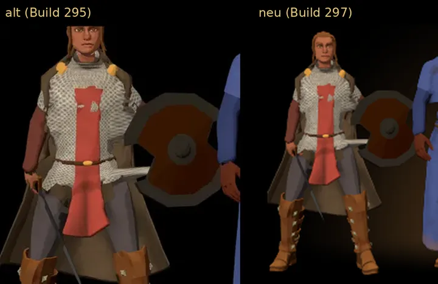

# 1515 · Hauptmenü: weißer Streifen vor dem Schild der Wachsoldatin (Bild alt gegen neu, Runde 2)

Tom · 17.11., 23:48 · E Figuren · Fund des Chefs 17.11., 07:32; 👎 21:34 („die Aussage, dass der breite weiße Streifen weg sei, ist falsch“)
Kurz: Der Streifen ist jetzt weg. Ursache war ein Stück vom Saum des Kettenhemds, das an ihrem linken Daumen hing.

Geprüft an: https://github.com/tramour-cmyk/androidapp_rpg_bornim/tree/claude/tom-1515-streifen (`claude/tom-1515-streifen`), Kaufbau am Rechner, Hauptmenü wie im Spiel (Renderer des Rechners, nicht des Handys); alt = Stand `main` am selben Rechner; Test `achsel_1515` 0 Fehler (vorher 13 an der Wachsoldatin)

**Ursache:** Einige Ecken am Saum des Kettenhemds hingen am linken Daumen. Hebt sie den Schild, spannte sich das Stück von der Hüfte bis zur Schildhand, etwa 70 cm lang. Die erste Behebung (Build 297) hatte nur Stücke zwischen Unterarm und Rumpf gesucht, darum blieb dieser Streifen.

**Jetzt:** Solche Ecken nehmen beim Bau die Gewichte ihrer Nachbarn. Das gilt für alle Kleider. Derselbe Fehler steckte auch bei Borin, Bram, Garrick, Rowena und Jorin (1535); dort ist er nach dem Test ebenfalls weg, ein Bild davon kommt mit dem Build.

👍 passt (in den nächsten Sammelbuild) · 👎 anders (bitte sagen, was)
