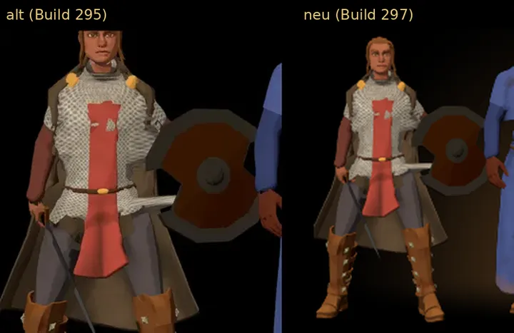

# 1515 · Hauptmenü: weißer Streifen vor dem Schild der Wachsoldatin (Bild alt gegen neu)

Tom · 17.11., 19:25 · E Figuren · Fund des Chefs 17.11., 07:32 (Bild Hauptmenü Build 295); Bau in Build 297 (auf `main`)
Kurz: Der breite Streifen ist weg, ein schmaler heller Rest bleibt an der Hüfte.

Geprüft an: Lauf 555 (https://github.com/tramour-cmyk/androidapp_rpg_bornim/actions/runs/44140594520, Stand `d2552e46e`, Renderer des Handys), Freigabe Sokrates 17:41; alt: Bild vom 17.11., 08:16 (Build 295)

**Bild:** Links wie in Build 295: der helle Streifen läuft breit vom Gürtel zum Schild. Rechts Build 297: der Streifen ist weg; an der linken Hüfte zum unteren Schildrand bleibt ein schmaler heller Rest (Kettensaum).

👍 passt · 👎 Rest auch weg
