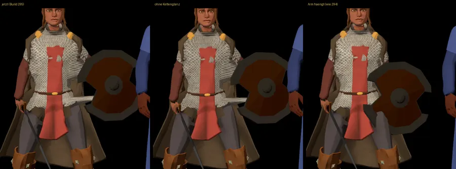

# 1515 · Hauptmenü: weißer Streifen vor dem Schild der Wachsoldatin (Befund)

Tom · 17.11., 08:16 · E Figuren · Fund des Chefs 17.11., 07:32 (Bild Hauptmenü Build 295, nach 1417)
Kurz: Der Streifen ist ein Stück Kettenhemd, das von der Achsel bis zum Unterarm gezogen wird. Ursache gefunden, noch nicht behoben.

Geprüft an: https://github.com/tramour-cmyk/androidapp_rpg_bornim/commit/faa0e1b43 (Stand `claude/build-296`), Bildlauf am Rechner, Renderer des Handys; Messläufe ohne Bild

**Bild, drei Fassungen:** Links wie in Build 295: der helle Streifen läuft vom Gürtel zum Schild. Mitte ohne Glanz der Kette: der Streifen bleibt, der Glanz ist es also nicht. Rechts der Arm hängend wie in Build 294: der Streifen ist weg, dafür steckt der Schild wieder im Rock (der Fund aus 1417).

**Ursache (Messung):** Im Kettenhemd hängen einige Ecken an der Achsel am Unterarm statt an Oberarm und Brust. Hängt der Arm am Körper, liegt das gezogene Stück verdeckt am Rumpf; seit 1417 der Schildarm abgespreizt ist, spannt es sich vom Körper zum Unterarm und wird als heller, gestreckter Streifen sichtbar.

**Weg:** Gewichte des Kettenhemds an der Achsel beim Bau der Trachten richtigstellen (`kauf_kleid.py`), danach Bild alt gegen neu. Das kann auch in Welt und Kampf auftreten, wenn der Arm vom Körper weggeht; nicht gemessen.

👍 so angehen · 👎 anders (bitte sagen, wie)
