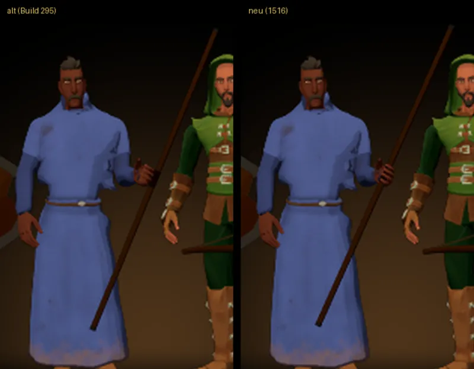

# 1516 · Hauptmenü: Zauberlehrling hält den Stab in der Faust

[Bild von 17.11., 08:13](https://github.com/tramour-cmyk/androidapp_rpg_bornim/blob/bilder/2026-11/17-0813-1516-Tom.png) (eingetragen von meldung.sh, Tom)

Tom · 17.11., 08:13 · E Figuren · Fund des Chefs 17.11., 07:32 (Tablet, Hauptmenü)
Kurz: Der Stab des Zauberlehrlings lief neben der linken Hand vorbei; jetzt geht er durch die Faust.

Geprüft an: https://github.com/tramour-cmyk/androidapp_rpg_bornim/commit/5f6a2ecfb (Bildlauf am Rechner, Renderer des Handys); Test `stab_menue_1516` grün, Kerntests 184 gut, 1 rot (`wolf_mess_438`, bekannt, 1505)

**Bild, links alt (Build 295), rechts neu:** Links schwebt der Stab rechts neben der Hand. Rechts läuft er durch die geschlossene Faust. Ursache: Die Lage der Waffe in der Hand galt nur für die rechte Hand; der Zauberlehrling hält den Stab links, dort ist die Hand gespiegelt. Gemessen: Abstand Stab zur Mitte der Faust alt 4,8 cm, neu 2,7 cm.

Welt und Kampf: In der Welt trägt der Held den Stab rechts als Wanderstab (0,9 cm), im Kampf in der rechten Hand (1,5 cm); beide nicht betroffen.

👍 passt: der Stab sitzt in der Hand · 👎 falsch: er schwebt noch oder sitzt unnatürlich
