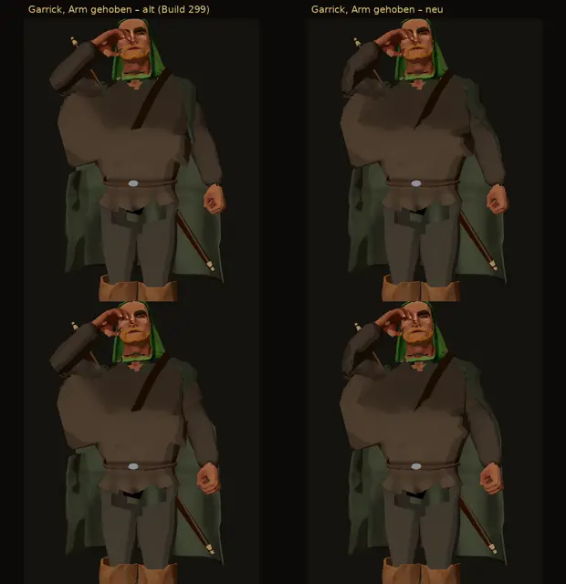

# 1535 · Garrick: ist der Faden an der Jacke weg?

Tom · 18.11., 16:59 · E Figuren · aus deinem Fund 15:33 (Build 299, Garrick hebt in der Ruhe den Arm) und 15:59 (Bewohner im Kittel)
Kurz: Garrick in der Ruhebewegung mit gehobenem rechtem Arm, links Build 299, rechts neu (Flanke der Jacke unter der Achsel folgt dem Rumpf statt dem Oberarm, für alle Figuren mit Kaufkleid). Die ausgebeulte Fläche unter dem Arm ist kleiner, aber nicht ganz weg.

Geprüft an: https://github.com/tramour-cmyk/androidapp_rpg_bornim/commit/547033f9f (`claude/tom-1535-gruss`), Bild am Rechner mit Kaufmodellen (1535, Läufe frei), zwei Zeitpunkte der Bewegung

- Offen: Bild in Spielkamera und Handygröße fehlt (das Bildskript stellt nur die Figur frei).
- 👍 passt: so in den nächsten Sammelbuild, Rest im Spiel ansehen.
- 👎 falsch: Beule unter dem Arm stört noch → weiter an der Achsel.
