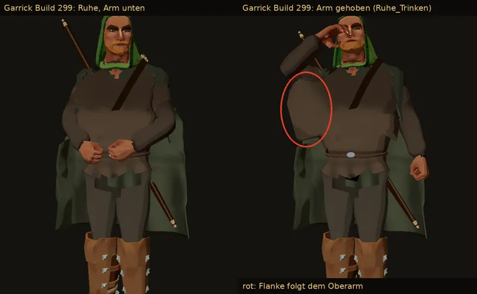

# 1535 · Garrick: woher kommt der Faden an der Jacke?

Tom · 18.11., 16:15 · E Figuren · aus deinem Fund 15:33 (Build 299, Garrick hebt in der Ruhe den Arm)
Kurz: Nachgestellt am Stand `claude/build-299`: hebt Garrick den rechten Arm (Ruhebewegung Trinken), zieht die Flanke der Jacke vom Gürtel bis zum Oberarm mit. Behebung in Arbeit, das Bild danach braucht einen freien Lauf.

Geprüft an: https://github.com/tramour-cmyk/androidapp_rpg_bornim/commit/c2f5499da (`claude/build-299`), Bild am Rechner mit Kaufmodellen (Probe 1535), Messung `durchstich_1631` an Garrick

- Links Ruhe mit Arm unten, rechts Arm gehoben: rot die Fläche, die vom Gürtel zum Oberarm gespannt ist.
- Offen: Behebung (Jacke unter der Achsel an den Rumpf statt an den Oberarm, ein Weg für alle Figuren mit Kaufkleid); Bild alt gegen neu danach.
