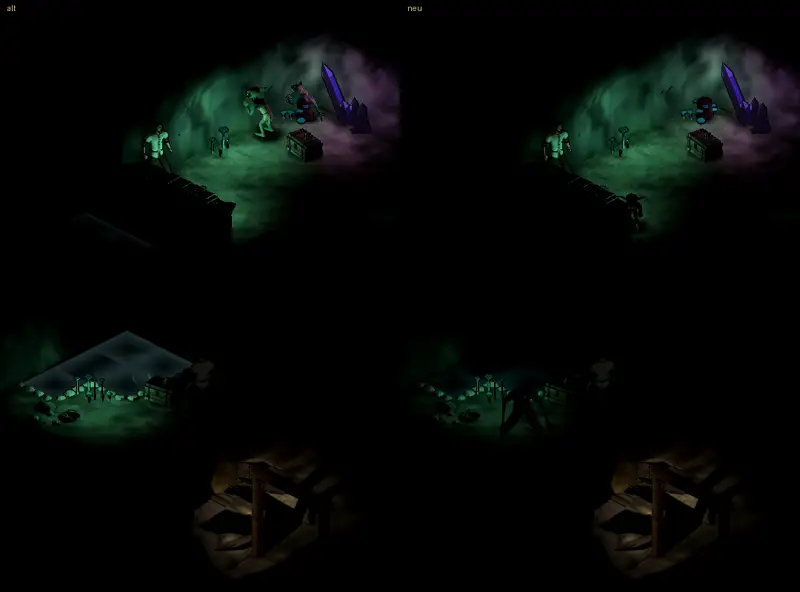

# 1566 · Höhlenwasser schimmert nicht mehr hinter Wänden · Jerry · 17.11., 16:05

Geprüft an: https://github.com/tramour-cmyk/androidapp_rpg_bornim/commit/1cbc7da50

Links alt, rechts neu (am Rechner, Stand `1cbc7da50`). Oben der Westflügel, der Teich liegt hinter der hohen Wand. Unten am Teich selbst.

Sag „passt“ oder „falsch“ (👍/👎 auf Telegram).
- 👍 passt: hinter der Wand ist kein Wasser mehr zu sehen; am Teich ist das Wasser dunkel und nur nah am Licht (Pilze) zu erkennen.
- 👎 falsch: am Teich ist das Wasser jetzt zu dunkel, oder es schimmert hinter Wänden weiter durch.
