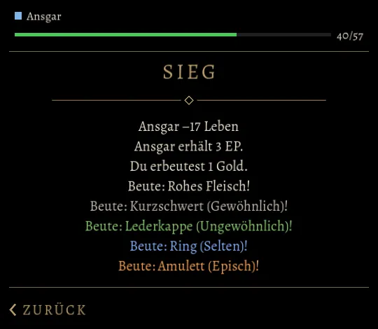

# 1567 · Siegtafel nach „Schnell“: Verlust ab Kampfbeginn, kein „−0 Leben“

[Bild von 17.11., 20:18](https://github.com/tramour-cmyk/androidapp_rpg_bornim/blob/bilder/2026-11/17-2018-1567-Spike.png) (eingetragen von meldung.sh, Spike)

Spike · 17.11., 20:20 · E Oberfläche · Fund des Chefs 17.11., 14:54 (Build 296: „Alrik –0 Leben“ bei Leiste 97/109, „Minus 0 Leben macht nicht so viel Sinn“)
Kurz: Die Tafel zählt den Verlust jetzt ab Kampfbeginn; wer nichts verlor, steht nicht da.

Geprüft an: `48033f7fa` (`claude/spike-1567-sieg-leben`), am Rechner mit dem Renderer des Handys (gl_compatibility), Test `schnell_78510` grün; fährt im nächsten Sammelbuild mit (Handypunkt)

**Bild:** Probekampf Ratten, vor „Schnell ›“ 7 Leben verloren, danach 10. Die Tafel sagt „Ansgar −17 Leben“, die Leiste 40/57, beides passt. Ursache von „−0“: gezählt wurde erst ab dem Druck auf „Schnell ›“, Verlust davor fiel weg.

👍 passt · 👎 falsch
