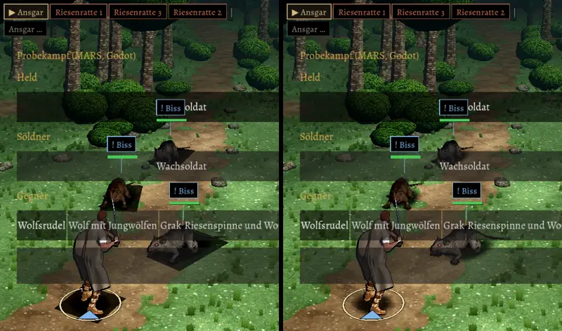

# 1568 · Kampfort: kein rechteckiger Schatten mehr unter Tieren und Held

[Bild von 17.11., 20:25](https://github.com/tramour-cmyk/androidapp_rpg_bornim/blob/bilder/2026-11/17-2025-1568-Jerry.png) (eingetragen von meldung.sh, Jerry)

Jerry · 17.11., 20:25 · G Stil · Fund des Chefs 17.11., 16:05 (Build 297: „Warum haben die Wölfe einen rechteckigen Schatten unter sich?“)
Kurz: Unter Tieren und Held liegt nur noch der runde weiche Schatten, die dunkle Fläche drumherum ist weg.

Geprüft an: `083ab557a` (`claude/jerry-1568-schatten`), am Rechner mit dem Renderer des Handys (gl_compatibility), Probekampf; fährt im nächsten Sammelbuild mit (Handypunkt)

**Bild:** links bisher, rechts neu. Probekampf mit Riesenratten statt Wölfen (gleicher Schatten); das Menü darüber gehört zum Prüfbild, nicht ins Spiel. Ursache: Auf dem Handy wurde die ganze Fläche um den weichen Fleck mit abgedunkelt, ihre Ecken standen als Rechteck. Seit Build 289 (1289).

👍 passt · 👎 falsch
