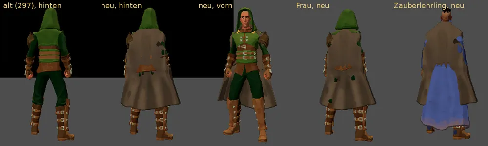

# 1569 · Angelegter Umhang an jeder Herkunft sichtbar (Bild alt gegen neu)

Tom · 17.11., 19:12 · E Figuren · Fund des Chefs 17.11., 16:12 (t297.18: Umhang angelegt, an der Figur nichts)
Kurz: Der Umhang der Wachsoldaten hängt jetzt an jeder Herkunft, sobald im Platz Umhang ein Umhang liegt. Zwei Stellen stechen noch durch.

Geprüft an: https://github.com/tramour-cmyk/androidapp_rpg_bornim/commit/7a679dd58 (`claude/tom-1569-umhang`), Kaufbau am Rechner, Bild wie im Menü Ausrüstung (Renderer des Rechners, nicht des Handys); Tests `umhang_1569`, `kleid_stufe2_431` 0 Fehler

**Ursache:** Nur die Tracht der Wachsoldaten hat ein Umhangnetz; Jägerkind, Herumtreiber, Zauberlehrling und die übrigen haben keins, und der Umhang hatte im Kleiderschrank kein Teil. Darum blieb der Platz an der Figur leer, in der Welt wie im Menü.

**Jetzt:** Der Umhang der Wachsoldaten ist ein Teil im Kleiderschrank und hängt an jeder Herkunft (auch der Umhang des Schutzes und Thessas Umhang). An der Wachsoldatin bleibt alles wie bisher.

**Offen (nicht behoben, sichtbar im Bild):** (1) Am Jägerkind stechen hinten Gürtel und Schulterstück der Waldtracht als braune und grüne Flecken durch den Umhang. (2) Am Zauberlehrling ist die Robe unten breiter als der Umhang und schaut seitlich heraus. Weg: den Umhang beim Bau an jede Tracht anlegen (wie das Kettenhemd an der Wachsoldatin), dann ein neues Bild.

👍 so weiter (Durchstechen beheben, dann in den nächsten Sammelbuild) · 👎 anders (bitte sagen, wie)
