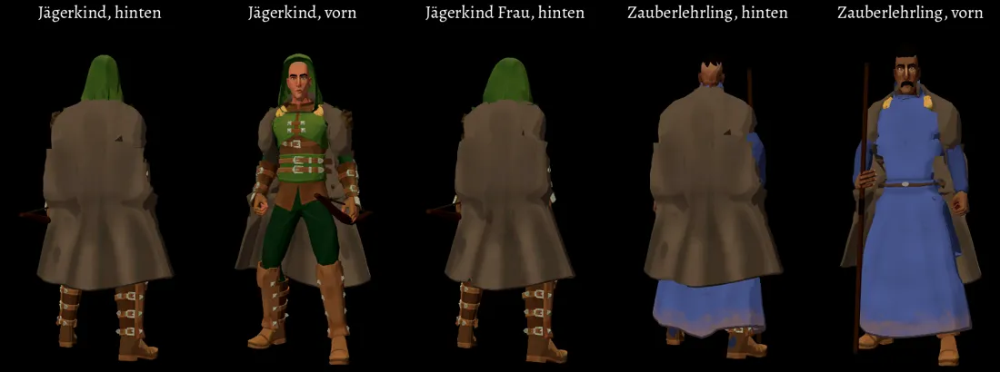

# 1569.1 · Umhang an den Seiten weiter (Bild 4: Keil und grüner Rand)

[Bild von 18.11., 02:42](https://github.com/tramour-cmyk/androidapp_rpg_bornim/blob/bilder/2026-11/18-0242-1569.1-Tom.png) (eingetragen von meldung.sh, Tom)

Tom · 18.11., 02:42 · E Figuren · aus Bild 3 zu 1569 (Sokrates, Nachtvertretung 01:46): dunkler Keil an der rechten Schulter, grüner Rand beim Jägerkind; ein Bildlauf frei
Kurz: Der Umhang ist an den Seiten 4 cm weiter. Den grünen Rand sieht man nicht mehr, der Keil ist kleiner, aber noch zu sehen. Die Seiten wölben sich jetzt etwas am Oberarm.

Geprüft an: https://github.com/tramour-cmyk/androidapp_rpg_bornim/commit/fa6e46791 (`claude/tom-1569-umhang`), Kaufbau am Rechner, Bild wie im Menü Ausrüstung (Renderer Compatibility wie am Handy); Tests `umhang_1569`, `kleid_stufe2_431` 0 Fehler

**Ursache:** Im Stehen hängt der Oberarm unter der Seitenbahn des Umhangs und drückt sie nach außen. Man sah dort die Innenseite der Bahn (der dunkle Keil) und davor den Ärmel (beim Jägerkind grün). Vergleich mit Bild 3 (Telegram 18.11., 01:43).

**Gemessen** (von hinten wie im Menü, Bewegung „Stehen“): sichtbare Innenseite des Umhangs Zauberlehrling 30 → 3 Messpunkte, Jägerkind 35 → 9; Kleidung, die an Schulter und Oberarm durch den Umhang schaut, 617 → 174 und 538 → 115; Robe hinter dem Umhang hervor 126 → 36 Ecken.

**Offen (sichtbar im Bild):** (1) An der rechten Schulter ist ein kleiner dunkler Keil geblieben. (2) Die Seiten des Umhangs wölben sich am Oberarm etwas nach außen, der Umrand ist dort unruhiger als in Bild 3.

👍 so lassen (mit 1569 in den nächsten Sammelbuild) · 👎 zurück auf Bild 3 oder anders (bitte sagen, was)
