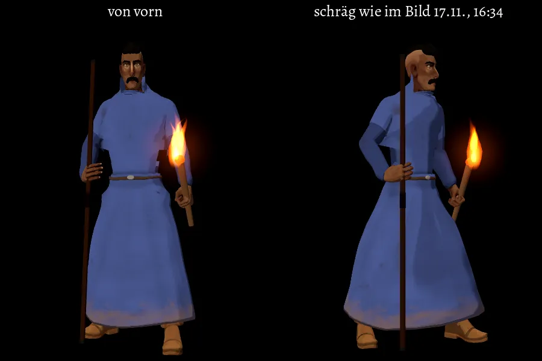

# 1571 · Fackel der Nebenhand: welche Hand

[Bild von 18.11., 01:47](https://github.com/tramour-cmyk/androidapp_rpg_bornim/blob/bilder/2026-11/18-0147-1571-Tom.png) (eingetragen von meldung.sh, Tom)

Tom · 18.11., 01:48 · E Figuren · Fund des Chefs 17.11., 16:35 (Build 297, Bild `t297-stab-fehlt.webp`): „Fackel der Nebenhand sitzt in der rechten Hand“
Kurz: Die Fackel sitzt in der linken Hand der Figur. Im Bild vom 17.11. ist der Held nach rechts gedreht, darum sieht man sie auf der rechten Bildseite.

Geprüft an: https://github.com/tramour-cmyk/androidapp_rpg_bornim/commit/9a53e6aaf (`claude/tom-1571-fackel`, Stand `main`), Kaufbau am Rechner, Held wie im Menü Ausrüstung; Messung `fackel_hand_1571` (8 Helden, Mann und Frau, die Fackel immer an der Hand `hand_l`)

**Befund:** Von vorn hält der Held den Stab in der rechten und die Fackel in der linken Hand. Gedreht wie im Bild vom 17.11. liegt die Fackel auf der rechten Bildseite, ist aber weiter in der linken Hand. Darum ist nichts zu bauen. Die übrigen Funde aus 1571 laufen getrennt: Zauberstab 1587 (Jerry, gebilligt), Umhang 1569.

👍 stimmt, 1571 erledigt, sobald 1587 und 1569 im Build sind · 👎 doch falsch (bitte sagen, was)
