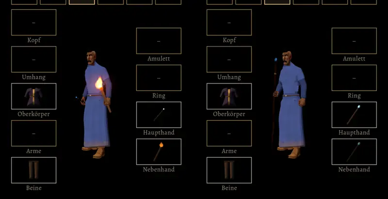

# 1587 · Zauberstab und Magierstab jetzt an der Figur

[Bild von 17.11., 20:27](https://github.com/tramour-cmyk/androidapp_rpg_bornim/blob/bilder/2026-11/17-2027-1587-Jerry.png) (eingetragen von meldung.sh, Jerry)

Jerry · 17.11., 20:27 · E Figuren · Fund des Chefs 17.11., 16:35 (1571, Build 297: Zauberstab angelegt, an der Figur nicht zu sehen)
Kurz: Beide Stäbe haben ein Modell; der Magierstab ist gut zu sehen, der Zauberstab nur an der blauen Spitze.

Geprüft an: `0008daf9d` (`claude/jerry-1587-stab`), am Rechner mit dem Renderer des Handys (gl_compatibility), Reiter Ausrüstung; Kerntests grün; fährt im nächsten Sammelbuild mit

**Bild:** links Zauberstab (Haupthand) mit Fackel (Nebenhand) wie in deinem Bild, rechts Magierstab (beide Hände). Nach der alten Fassung: knorriger Magierstab mit Kristall in drei Klauen und Messingring; Zauberstab mit Messingring und Kugel; Kristall und Kugel glimmen im Kampf blau. Der Glutstab nutzt den Magierstab.

**Offen:** Der Zauberstab ist dunkles Holz vor dem dunklen Grund und hängt tief an der Hüfte; zu sehen ist fast nur die Spitze. Fackel in der rechten Hand ist 1571 (Tom).

👍 passt · 👎 falsch
