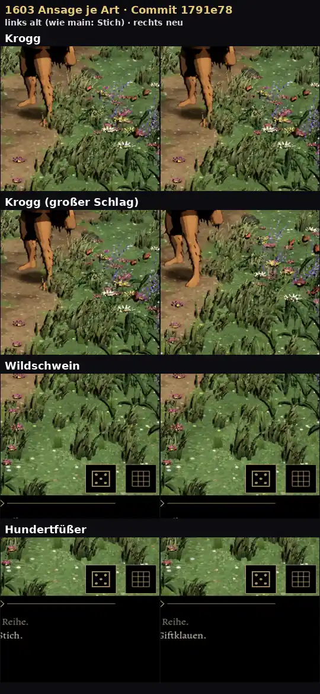
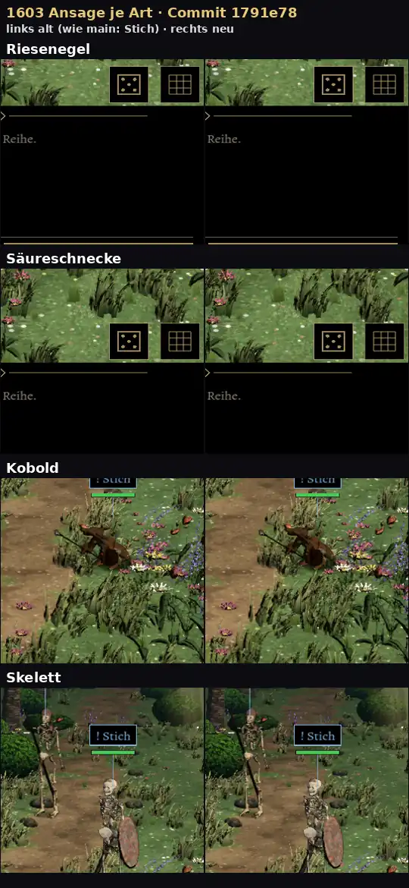

# 1603 · Ansage je Art und Kroggs Prankenhieb

[Bild von 24.11., 11:33](https://github.com/tramour-cmyk/androidapp_rpg_bornim/blob/bilder/2026-11/24-1133-1603-Carla.png) (eingetragen von meldung.sh, Carla)

[Film von 24.11., 11:33](https://cdn.jsdelivr.net/gh/tramour-cmyk/androidapp_rpg_bornim@film/20261124-113329-1603/2026-11/24-1132-1603-Carla.mp4) (eingetragen von meldung.sh, Carla)

Carla · 24.11., 11:31 · E Kampf · Zweig `arne/1603-ansagen`
Kurz: Gegner sagen ihren eigenen Grundangriff an statt „Stich“; Krogg hat den Prankenhieb als großen Schlag mit Ring (Los Morgenstern 2 : Prankenhieb 1, Zusatz 0,3 nach Entscheid C).

Geprüft an: https://github.com/tramour-cmyk/androidapp_rpg_bornim/commit/1791e782e (Lauf 589, Handygröße 540 × 1170, links alt wie `main`, rechts neu). Film: Krogg seitlich, Prankenhieb angesagt („!! ◯ Prankenhieb“), Ring perfekt, ausgewichen, dreimal, 13 s.

- Bild unvollständig: Der Ausschnitt verfehlt die Ansage bei Krogg, Wildschwein, Riesenegel und Säureschnecke. Sichtbar sind Hundertfüßer („Giftklauen“ im Bericht), Kobold und Skelett („Stich“, wie verlangt). Der Ausschnitt um die Ansage ist in 1a51f61db behoben; der neue Lauf wartet auf die Freigabe (Laufbremse 1766).
- Test `ansage_1603`: 29 Fälle, alle 18 Arten, 0 Fehler. `tools/t logik`: 194 gut.
- Krogg (sim444): bei „halb gut“ −8,5 Punkte (N = 200) und +7,0 Punkte (N = 500), Grenze 10.
