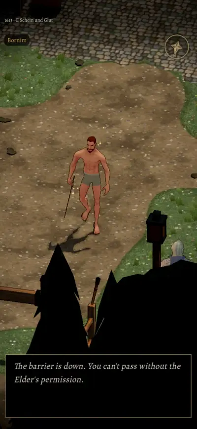

# 1613 · Waffen episch und göttlich: Effekt statt Färbung, drei Fassungen im Dorf · Spike · 18.11., 02:30

E Figuren · Spike · aus deinem Wort 02.11., 11:28 (Archiv 458.3): „dieses Glimmern … sieht man eigentlich nicht … als ob die Waffe einfach orange gefärbt wäre … cool, wenn man da irgendwie noch eine Art Effekt draufkriegen“

Geprüft an: https://github.com/tramour-cmyk/androidapp_rpg_bornim/commit/33b3fa52cf (`claude/spike-1613-glanz`, auf der Waffenstaffel 458.3, Bau am Rechner, Dorf mit Toon-Licht, Tusche und Spielkamera)

Film per Telegram (15 s, Dorf wie im Spiel): der Held geht auf der Straße, alle 2,4 s die nächste Fassung, oben links benannt: am epischen Langschwert **A** Schein (Rand und ein heller Streifen vom Griff zur Spitze, atmet), **B** Glut (Funken steigen auf und bleiben beim Gehen zurück), **C** beides; dann C am göttlichen Langschwert und am epischen Morgenstern, zuletzt ein seltenes Schwert ohne Effekt.

**Frage:** Welche Fassung, A, B oder C?

- **Eigene Prüfung (Standbilder bei 1, 6 und 9 s):** Waffe in der Hand, Funken als feine Punkte zu sehen; in Spielgröße ist der Effekt klein, die epische Klinge fast schwarz (Schwarzstahl aus 458.3, Farbe nicht geändert), der Schein dort nur ein Saum.
- **Offen im Film, nicht Teil der Frage:** der Held ist ohne Rüstung (neuer Spielstand); er läuft an den Schlagbaum, darum kommt dessen Hinweis (englisch, Sprache des Testlaufs); bei 9 s geht er unter einem Dach durch (Durchsicht).
- **Stärkstes Gegenargument:** Funken an jeder epischen Waffe kosten am Handy Teilchen (24–32 je Waffe).

Antwort:
