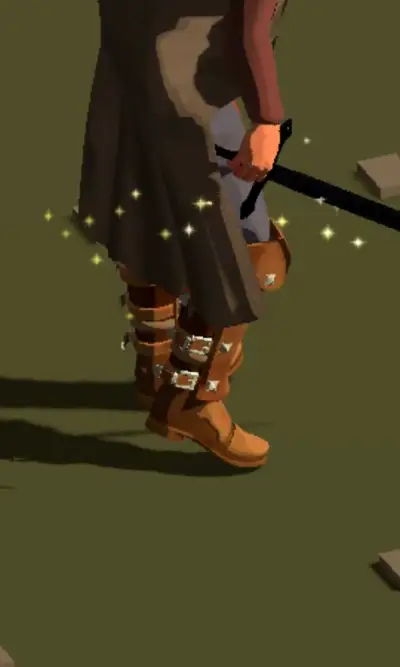

# 1613 · Waffen episch und göttlich: Effekt statt Färbung, drei Fassungen · Spike · 18.11., 02:15

E Figuren · Spike · aus deinem Wort 02.11., 11:28 (Archiv 458.3): „dieses Glimmern … sieht man eigentlich nicht … als ob die Waffe einfach orange gefärbt wäre … cool, wenn man da irgendwie noch eine Art Effekt draufkriegen“

Geprüft an: https://github.com/tramour-cmyk/androidapp_rpg_bornim/commit/0c1fa24c28 (`claude/spike-1613-glanz`, auf der Waffenstaffel 458.3, Bau am Rechner)

**Stand:** der Film 02:14 auf Telegram ist der Wiesenfilm aus dem Drehteller, ohne unsere Signatur; er gilt nicht als Vorlage. Der Film im Dorf mit Toon-Licht, Tusche und Spielkamera (`tests/film_glanz_1613.gd`) wartet auf die Freigabe des Laufs durch Sokrates und kommt dann hierher.

Inhalt beider Filme: nacheinander am epischen Langschwert **A** Schein (Rand und ein heller Streifen vom Griff zur Spitze, atmet), **B** Glut (Funken steigen von der Waffe auf und bleiben beim Gehen zurück), **C** beides; dann C am göttlichen Langschwert und am epischen Morgenstern, zuletzt ein seltenes Schwert ohne Effekt zum Vergleich.

**Frage:** Welche Fassung, A, B oder C?

- **Eigene Prüfung (Wiesenfilm):** alle sechs Abschnitte zeigen die Waffe; am epischen Langschwert ist die Klinge fast schwarz (Schwarzstahl aus 458.3), der Schein liegt dort nur als Saum; am Morgenstern und am göttlichen Schwert leuchtet er deutlich.
- **Offen:** epischer Stahl fast schwarz (Farbe aus 458.3, nicht geändert); Kampfort noch ohne Effekt.
- **Stärkstes Gegenargument:** Funken an jeder epischen Waffe kosten am Handy Teilchen (24–32 je Waffe).

Antwort:
