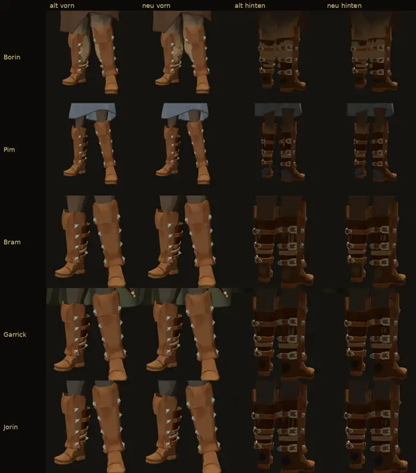

# 1650 · Hose im Stiefel: sticht sie noch durch den Schaft?

Tom · 18.11., 17:00 · E Figuren · aus Toms Durchstechprüfung 1631 (Lauf 560), dein „so weiter“ 15:46
Kurz: Borin, Pim, Bram, Garrick, Jorin, je Zeile; Spalten alt (Build 299) und neu, von vorn und hinten, Ruhebewegung Stehen. Hinten sind die dunklen Hosenflecken zwischen den Riemen und an der Ferse weniger (Bram, Garrick, Jorin, Pim); vorn sieht man kaum Unterschied. Gemessen: Borin 216 → 181, Pim 106 → 80 durchstechende Ecken.

Geprüft an: https://github.com/tramour-cmyk/androidapp_rpg_bornim/commit/6ab87322b (`claude/tom-1650-stiefel`), Bild am Rechner mit Kaufmodellen (1650, Läufe frei)

- Offen: Bild in Spielkamera und Handygröße fehlt (das Bildskript stellt die Unterschenkel frei); Wache nicht im Bild.
- 👍 passt: so in den nächsten Sammelbuild.
- 👎 falsch: Hose sticht noch sichtbar durch (Person und Stelle nennen).
